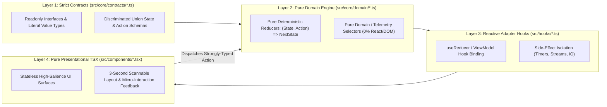

# IMPERIAL ENGINEERING TSX & WEB PLATFORM STANDARD

## 1. File-Type & Platform-Specific Boundary Rules

| Target File Pattern | Concrete Platform / Language Role | Mandatory Engineering Constraints & Bans |
| :--- | :--- | :--- |
| **`package.json`** | Node/Bun Dependency & Script Manifest | • Verify installed package names and major versions (`React 19`, `Vite 8`, `Tailwind v4`) before adding any `import` statement. |
| **`tsconfig.json`** | TypeScript Compiler Gate Configuration | • Enforce `"strict": true`, `"noUnusedLocals": true`, `"noUnusedParameters": true`, and `"noFallthroughCasesInSwitch": true`.<br/>• Configure `"jsx": "react-jsx"` (`0` legacy default `React` imports). |
| **`vite.config.ts`** | Vite 8 Bundler & Dev Server Config | • Use native ESM `import.meta.dirname` instead of CommonJS `__dirname`.<br/>• Preserve `@` path alias resolution (`path.resolve(import.meta.dirname, '.')`). |
| **`src/core/contracts/*.ts`** | Layer 1: Pure TypeScript Type Contracts | • Declare only pure `export interface` and `export type` contracts (`0` runtime code, `0` external imports) with `readonly` properties and arrays. |
| **`src/core/domain/*.ts`** | Layer 2: Pure TypeScript Domain Logic | • **Forbidden Imports**: `react`, `react-dom`, `lucide-react`, `window`, `document`, `localStorage`.<br/>• Write `100%` pure deterministic TypeScript executable in `< 1ms` without a DOM. |
| **`src/hooks/*.ts`** | Layer 3: React Lifecycle & Side-Effect Hooks | • Encapsulate `useReducer`, `useCallback`, and external side effects (`window.setInterval`, WebSockets, IPC/API calls).<br/>• **Ban**: Never use `useEffect` to compute synchronous derived state. |
| **`src/components/*.tsx`**<br/>**`src/App.tsx`** | Layer 4: React 19 Presentational Surfaces | • Enforce `Props-In, Intent-Out` pure renderer surfaces and ban raw domain math or multi-`useState` boolean soup inside `.tsx` files. |

---

## 2. The 4-Layer Unidirectional TSX Architecture (Contracts ➔ Domain ➔ Hooks ➔ Surface)

### 2.1 Architectural Flow Topology



### 2.2 Layer 1 Concrete Rules (`src/core/contracts/*.ts`)
* **Rule 1.1 (`Zero Any / Zero Untyped Primitives`)**: Never use `any`, `object`, `Function`, or loose `Record<string, any>`; declare explicit `readonly` interfaces, literal types (e.g., `readonly schemaVersion: 1`), and union types.
* **Rule 1.2 (`Discriminated Union State Machine`)**: Model every state machine using a literal `kind` or `phase` discriminant property so impossible state combinations are unrepresentable at compile time:
  ```ts
  export type EngineExecutionPhase =
    | {
        readonly kind: 'IDLE_READY';
        readonly activeWorkers: 0;
        readonly badgeLabel: 'READY';
      }
    | {
        readonly kind: 'ACTIVE_PROCESSING';
        readonly activeWorkers: number;
        readonly badgeLabel: 'PROCESSING';
        readonly startedAtIso: string;
      };
  ```
* **Rule 1.3 (`Exhaustive Action Union`)**: Type all user events, timer ticks, and adapter responses as a single discriminated union (`type EngineAction = { readonly type: 'START_PIPELINE'; readonly timestampIso: string } | ...`).

### 2.3 Layer 2 Concrete Rules (`src/core/domain/*.ts`)
* **Rule 2.1 (`Pure Reducer with Compile-Time Exhaustiveness Check`)**:
  - Terminate every `switch (action.type)` block inside a reducer with a `default` exhaustiveness guard:
    ```ts
    default: {
      const _exhaustiveCheck: never = action;
      return _exhaustiveCheck;
    }
    ```
* **Rule 2.2 (`Zero Impure Calls in Reducers`)**: Never call `new Date()`, `Date.now()`, `Math.random()`, or `console.log` inside `src/core/domain/*.ts`; pass timestamps and random deltas via `action` payloads from Layer `3`.
* **Rule 2.3 (`Pure Selector Functions for UI Ratios`)**: Compute normalized percentages (`0~100%`) and derived view metrics via exported pure functions (e.g., `calculateUtilizationPercent(metrics)`) rather than inline JSX math (`style={{ width: `${(val / 1000) * 100}%` }}`).

### 2.4 Layer 3 Concrete Rules (`src/hooks/*.ts`)
* **Rule 3.1 (`Single-Entry ViewModel Hook`)**: Bind `useReducer(reducer, INITIAL_STATE)` inside a dedicated custom hook and wrap all exported intent handlers in `useCallback`.
* **Rule 3.2 (`Timer & Stream Cleanup Invariant`)**: Return an explicit cleanup function (`() => window.clearInterval(id)`) from every `useEffect` that registers `window.setInterval`, `window.addEventListener`, or stream subscriptions.

### 2.5 Layer 4 Concrete Rules (`src/components/*.tsx` & `src/App.tsx`)
* **Rule 4.1 (`Named Component Exports & Explicit Props Interface`)**: Export presentational components as named functions (`export function ComponentName(...)`) with an explicit `export interface ComponentNameProps` directly above.
* **Rule 4.2 (`Stable Domain Keys & Accessible Controls`)**:
  - Bind a deterministic domain ID (`key={entry.id}`) instead of an array index (`key={idx}`) for dynamic lists.
  - Include explicit `type="button"` on non-submit `<button>` elements and `aria-label` on icon-only toggle buttons.
* **Rule 4.3 (`Tailwind CSS v4 & Centralized Design Token Consumption`)**:
  - Consume centralized CSS/theme tokens consistently across presentational surfaces without scattering magic hex literals across JSX class strings.

---

## 3. TypeScript & Vite Verification Gates

Whenever modifying any `.ts`, `.tsx`, `tsconfig.json`, `vite.config.ts`, or `package.json` file, execute and pass these verification gates in the same turn:

1. **Gate 1 — TypeScript Strict Typecheck**:
   - Execute `npm run lint` (`tsc --noEmit`) with zero `any`, zero `@ts-ignore`, zero `@ts-expect-error`, and zero `eslint-disable`.
2. **Gate 2 — Vite Production Bundle Verification**:
   - Execute `npm run build` (`vite build`) to verify clean bundle generation in `dist/` with zero unresolved imports or deprecation warnings.
3. **Gate 3 — Line-Count Ceiling & 1:1 Test Symmetry Audit**:
   - Keep every `.ts` and `.tsx` file in `src/` strictly `<= 250 lines` and maintain `1:1` mirrored test coverage for all domain modules.
