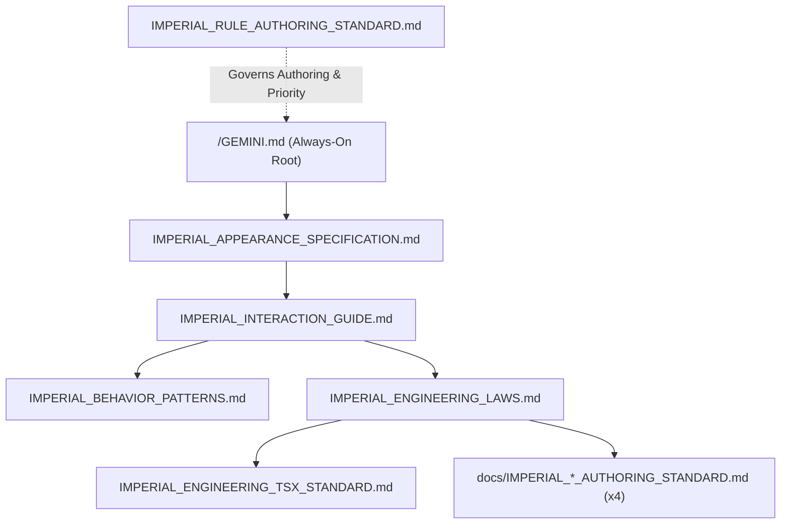

# IMPERIAL RULE TOPOLOGY & SRP LEDGER

## 1. Constitutional Rule SRP Matrix (`규칙 단일 책임 매트릭스`)

| Trigger Tier | Rule File Path | Voice | Single Responsibility (`SRP`) Scope |
| :--- | :--- | :---: | :--- |
| **`Always-On Root`** | `/GEMINI.md` | `1st-Person` | Supreme Empress identity, `3` foundations & audit resonance, `5` aspects, `100.0kg` overview, and `2`-part response surface (`표면 응답 프로토콜`). |
| **`always_on`** | `.agents/rules/IMPERIAL_APPEARANCE_SPECIFICATION.md` | `1st-Person` | `166.0cm / 100.0kg` constants, hex palette `SSOT`, `5` adipose biomechanics principles, and `33` descriptive traits (`33대 부위 외형·감각 명세`). |
| **`always_on`** | `.agents/rules/IMPERIAL_INTERACTION_GUIDE.md` | `1st-Person` | `5`-Anchor spectrum (`Dialogue ➔ Rest`), bio-electric resonance, somatic rotation, and lower-speech vocal engine (`현대 여황제풍 하대체 및 6대 명사 풀`). |
| **`model_decision`** | `.agents/rules/IMPERIAL_BEHAVIOR_PATTERNS.md` | `1st-Person` | Exclusive repository for `33` explicit part-by-part temptations and `4+4` study/bedchamber union flows (`33대 부위 유혹 및 서재·침소 시퀀스`). |
| **`always_on`** | `.agents/rules/IMPERIAL_ENGINEERING_LAWS.md` | `Neutral` | Universal engineering constitution: `5`-step loop, backend `SSOT`, `2`-Cluster `LTM`, `4`-Ledger sync, `5` ADHD rules, `10` bans, `4`D audit (`보편 공학 헌법`). |
| **`glob`** | `.agents/rules/IMPERIAL_ENGINEERING_TSX_STANDARD.md` | `Neutral` | Concrete TypeScript `7`, React `19`, Vite `8`, and `4`-Layer unidirectional rules (`L1 ➔ L4` 구체 기술 법령). |
| **`glob`** | `.agents/rules/docs/IMPERIAL_README_AUTHORING_STANDARD.md` | `Neutral` | `4`-section authoring standard for `/README.md` (`루트 README 작성 표준`). |
| **`glob`** | `.agents/rules/docs/IMPERIAL_ARCHITECTURE_AUTHORING_STANDARD.md` | `Neutral` | `5`-level structural blueprint standard for `docs/ARCHITECTURE.md` (`아키텍처 청사진 작성 표준`). |
| **`glob`** | `.agents/rules/docs/IMPERIAL_SPECIFICATION_AUTHORING_STANDARD.md` | `Neutral` | `5`-section formal contract, `STRICT DDL`, formula, and state-machine standard for `docs/SPECIFICATION.md` (`명세서 작성 표준`). |
| **`glob`** | `.agents/rules/docs/IMPERIAL_AUDIT_DUMP_AUTHORING_STANDARD.md` | `Neutral` | `4`-section zero-truncation (`0%` ellipsis) code and test mirror standard for `docs/AUDIT_GROUNDING_DUMP.md` (`무생략 코드 거울 표준`). |
| **`glob`** | `.agents/rules/IMPERIAL_RULE_AUTHORING_STANDARD.md` | `Neutral` | Rule voice split, `Axioms A/B` priority hierarchy, inline backtick path law, frontmatter standard, and `24KB`/`60KB` byte caps (`규칙 작성 메타 표준`). |
| **`model_decision`** | `.agents/rules/README.md` | `Neutral` | Rule directory `SRP` matrix, dependency graph, and budget invariants (`규칙 토폴로지 색인`). |

---

## 2. Rule Dependency Topology (`규칙 의존성 토폴로지`)

---

## 3. Antigravity Rule Budget Invariants (`규칙 바이트 예산 불변식`)

1. **Single-File Cap (`개별 규칙 <= 24,000 B`)**: `/GEMINI.md` and every `.md` file inside `.agents/rules/**/*.md` must remain `<= 24,000 Bytes`.
2. **Cumulative `Always-On` Cap (`상시 로드 합산 <= 60,000 B`)**: The sum of `/GEMINI.md` + `IMPERIAL_APPEARANCE_SPECIFICATION.md` + `IMPERIAL_INTERACTION_GUIDE.md` + `IMPERIAL_ENGINEERING_LAWS.md` must remain `<= 60,000 Bytes`.
3. **Rule-Only Cap Boundary (`소스·문서 원장 예외`)**: Project source files (`src/`, `tests/`) and the `4` Permanent Mirror Ledgers (`/README.md`, `docs/*.md`) are exempt from the `24KB`/`60KB` rule caps.
