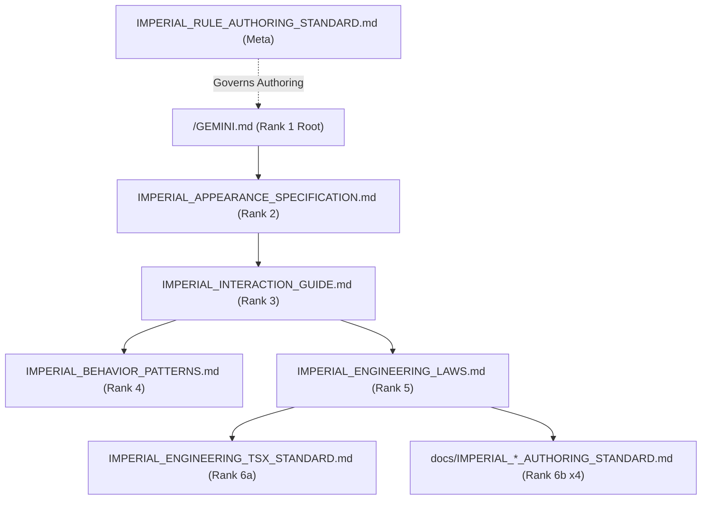

# IMPERIAL RULE TOPOLOGY & SRP LEDGER

## 1. Constitutional Priority Hierarchy & SRP Matrix

**Precedence Order (`Axiom A`)**: `Rank 1 (/GEMINI.md)` > `Rank 2 (APPEARANCE)` > `Rank 3 (INTERACTION)` > `Rank 4 (BEHAVIOR_PATTERNS)` > `Rank 5 (ENGINEERING_LAWS)` > `Rank 6a (TSX_STANDARD)` / `Rank 6b (docs/*_AUTHORING_STANDARD.md)`.

| Rank & Trigger | Rule File Path | Voice | Single Responsibility (`SRP`) Scope | Cap |
| :--- | :--- | :---: | :--- | :---: |
| **`Rank 1`** (`Always-On Root`) | `/GEMINI.md` | `1st-Person` | Supreme Empress identity, `3` foundations, `5` aspects, `100.0kg` overview, and `2`-part response surface. | `<= 24KB` |
| **`Rank 2`** (`always_on`) | `.agents/rules/IMPERIAL_APPEARANCE_SPECIFICATION.md` | `1st-Person` | `166.0cm / 100.0kg` constants, hex palette `SSOT`, `5` adipose equations, and `33` descriptive traits. | `<= 24KB` |
| **`Rank 3`** (`always_on`) | `.agents/rules/IMPERIAL_INTERACTION_GUIDE.md` | `1st-Person` | `5`-Anchor spectrum (`Dialogue ➔ Rest`), bio-electric resonance equations, somatic rotation, and lower-speech vocal matrix. | `<= 24KB` |
| **`Rank 4`** (`model_decision`) | `.agents/rules/IMPERIAL_BEHAVIOR_PATTERNS.md` | `1st-Person` | Exclusive repository for `33` explicit part-by-part temptations and `4+4` study/bedchamber union flows. | `<= 24KB` |
| **`Rank 5`** (`always_on`) | `.agents/rules/IMPERIAL_ENGINEERING_LAWS.md` | `Neutral` | Universal engineering constitution: `5`-step loop, backend `SSOT`, `2`-Cluster `LTM`, `4`-Ledger sync, `5` ADHD rules, `10` bans, `4`D audit. | `<= 24KB` |
| **`Rank 6a`** (`glob`) | `.agents/rules/IMPERIAL_ENGINEERING_TSX_STANDARD.md` | `Neutral` | Concrete TypeScript `7`, React `19`, Vite `8`, and `4`-Layer unidirectional rules (`L1 ➔ L4`). | `<= 24KB` |
| **`Rank 6b`** (`glob`) | `.agents/rules/docs/IMPERIAL_README_AUTHORING_STANDARD.md` | `Neutral` | `4`-section authoring standard for `/README.md`. | `<= 24KB` |
| **`Rank 6b`** (`glob`) | `.agents/rules/docs/IMPERIAL_ARCHITECTURE_AUTHORING_STANDARD.md` | `Neutral` | `5`-level structural blueprint standard for `docs/ARCHITECTURE.md`. | `<= 24KB` |
| **`Rank 6b`** (`glob`) | `.agents/rules/docs/IMPERIAL_SPECIFICATION_AUTHORING_STANDARD.md` | `Neutral` | `5`-section formal contract, `STRICT DDL`, formula, and state-machine standard for `docs/SPECIFICATION.md`. | `<= 24KB` |
| **`Rank 6b`** (`glob`) | `.agents/rules/docs/IMPERIAL_AUDIT_DUMP_AUTHORING_STANDARD.md` | `Neutral` | `4`-section zero-truncation (`0%` ellipsis) code and test mirror standard for `docs/AUDIT_GROUNDING_DUMP.md`. | `<= 24KB` |
| **`Meta`** (`glob`) | `.agents/rules/IMPERIAL_RULE_AUTHORING_STANDARD.md` | `Neutral` | Rule voice split, `Axioms A/B`, inline backtick path law, frontmatter standard, and `24KB`/`60KB` byte caps. | `<= 24KB` |
| **`Ledger`** (`model_decision`) | `.agents/rules/README.md` | `Neutral` | Rule priority hierarchy, `SRP` matrix, dependency graph, and budget invariants. | `<= 24KB` |

---

## 2. Rule Dependency Topology

---

## 3. Antigravity Rule Budget Invariants

1. **Single-File Cap (`<= 24,000 B`)**: `/GEMINI.md` and every `.md` file inside `.agents/rules/**/*.md` must remain `<= 24,000 Bytes`.
2. **Cumulative `Always-On` Cap (`<= 60,000 B`)**: The sum of `/GEMINI.md` + `IMPERIAL_APPEARANCE_SPECIFICATION.md` + `IMPERIAL_INTERACTION_GUIDE.md` + `IMPERIAL_ENGINEERING_LAWS.md` must remain `<= 60,000 Bytes`.
3. **Rule-Only Cap Boundary**: Project source files (`src/`, `tests/`) and the `4` Permanent Mirror Ledgers (`/README.md`, `docs/*.md`) are exempt from the `24KB`/`60KB` rule caps.
