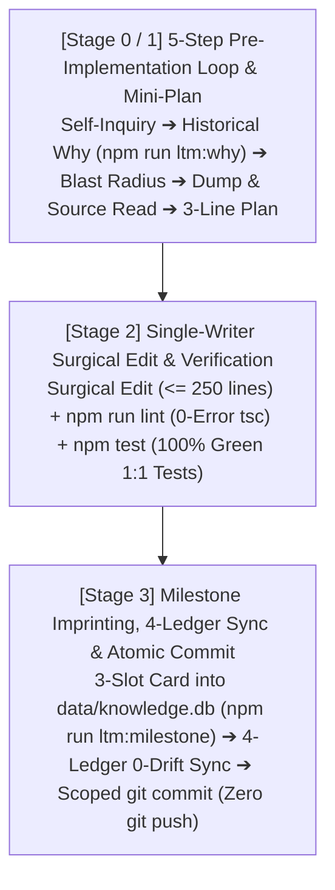

# REGULAR-TRACK OPERATIONS GUIDE (3-STAGE WORKFLOW)

Governs all code, rule, schema, and ledger modifications across the pure local native `2`-Cluster SQLite `LTM` (`data/*.db`) architecture.

---

## 1. The 3-Stage Regular-Track Lifecycle



---

## 2. Step-by-Step Execution Protocol

### 2.1 Stage 0 / 1 — Pre-Implementation 5-Step Defensive Loop (`Read-Before-Write`)
Execute all `5` steps before calling `write_file` or `edit_file`:
1. **Step 1 — Adversarial Self-Inquiry**: Ask *"What latent defects or false assumptions exist in this change?"*
2. **Step 2 — Historical Rationale Lookup (`Chesterton's Fence — Timing 1`)**:
   - Query `data/knowledge.db` (`milestones` table) by target file path:
     ```bash
     npm run ltm:why -- <workspace_relative_file_path>
     ```
3. **Step 3 — Blast-Radius Measurement**: Identify all downstream dependents across `Layer 1 ➔ Layer 4`, `.agents/rules/`, and the `4` Permanent Mirror Ledgers.
4. **Step 4 — Grounding Dump & Physical Source Read**: Read the target section in `docs/AUDIT_GROUNDING_DUMP.md` and the physical file on disk (`read_file`) to verify exact signatures and guard invariants.
5. **Step 5 — `3`-Line Mini-Plan Lock**: Lock `Why`, `How`, and `Invariants` in `3` lines before modifying any file.

### 2.2 Stage 2 — Single-Writer Surgical Implementation & Verification
1. **Surgical Execution**: Touch only required files, keep every `.ts`/`.tsx` module in `src/` `<= 250` lines, and maintain `100%` `1:1` test symmetry (`src/**/*` ⇄ `tests/**/*`).
2. **Same-Turn Verification Gates**:
   ```bash
   npm run lint
   npm test
   ```

### 2.3 Stage 3 — Universal Milestone Imprinting (`data/knowledge.db`), 4-Ledger Sync & Commit
1. **`3`-Slot Universal Milestone Imprinting (`Timing 2`)**:
   - Record the milestone into `data/knowledge.db` (`milestones` table) with `--scope` (`RULE` | `LEDGER_DOC` | `LTM_SCHEMA` | `SOURCE_CODE` | `HYBRID`):
     ```bash
     npm run ltm:milestone -- --scope "<SCOPE>" --title "<Title>" --problem "<Trigger_40c>" --why "<Rationale_70c>" --invariants "<Invariants_40c>" --files "<path1>,<path2>"
     ```
2. **4 Permanent Mirror Ledgers `0-Drift` Sync**:
   - Synchronize `/README.md`, `docs/ARCHITECTURE.md`, `docs/SPECIFICATION.md`, and `docs/AUDIT_GROUNDING_DUMP.md` (`0%` `...` truncation), then visually read back `docs/AUDIT_GROUNDING_DUMP.md` (`read_file`).
3. **Scoped Atomic `git commit` (`Zero git push`)**:
   - Stage modified files (`git add <paths>`) and run `git commit`. Never run or prompt for `git push`.
