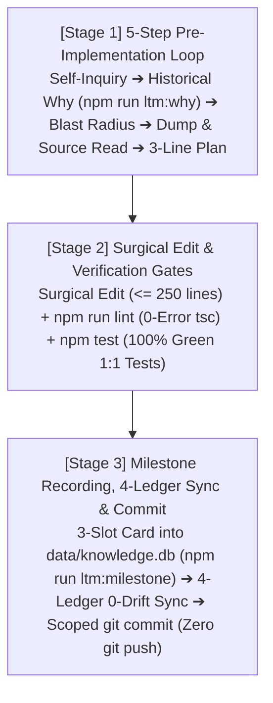

# REGULAR-TRACK OPERATIONS GUIDE (3-STAGE WORKFLOW)

Governs surgical code refactoring, constitutional rule updates, schema changes, and `4`-Ledger synchronization across the pure local native `2`-Cluster SQLite `LTM` (`data/*.db`) architecture.

---

## 1. The 3-Stage Regular-Track Lifecycle



---

## 2. Detailed 3-Stage Execution Protocol

### 2.1 Stage 1 — Pre-Implementation 5-Step Defensive Loop (`Read-Before-Write`)
Complete all `5` steps before calling `write_file` or `edit_file`:
1. **Step 1 — Adversarial Self-Inquiry**: Identify latent failure modes and false assumptions in the planned change.
2. **Step 2 — Historical Intent Lookup (`Chesterton's Fence — Timing 1`)**:
   - Query `data/knowledge.db` (`milestones` table) by target file path:
     ```bash
     npm run ltm:why -- <workspace_relative_file_path>
     ```
3. **Step 3 — Blast-Radius Measurement**: Trace downstream dependents across `Layer 1 ➔ Layer 4`, `.agents/rules/`, and the `4` Permanent Mirror Ledgers.
4. **Step 4 — Grounding Dump & Physical Source Read**: Read the target section in `docs/AUDIT_GROUNDING_DUMP.md` and the physical file on disk (`read_file`) to verify exact signatures and guard invariants.
5. **Step 5 — Rationale & Direction Lock**: Lock a `3`-line execution plan (`Why`, `How`, `Invariants`) before modifying any file.

### 2.2 Stage 2 — Single-Writer Surgical Implementation & Automated Verification
1. **Surgical Execution**: Modify only target files while keeping `.ts`/`.tsx` modules in `src/` `<= 250` lines and preserving `1:1` mirrored test coverage (`src/**/*` ⇄ `tests/**/*`).
2. **Same-Turn Verification Gates**:
   ```bash
   npm run lint
   npm test
   ```

### 2.3 Stage 3 — Universal Milestone Recording (`data/knowledge.db`), 4-Ledger Sync & Atomic Commit
1. **Mandatory `3`-Slot Universal Milestone Imprinting (`Timing 2`)**:
   - Record a `3`-slot milestone card (`M-0001`, `M-0002`, ...) into `data/knowledge.db` (`milestones` table) before committing:
   - **`--scope` Categories**: `RULE` (`/GEMINI.md`, `.agents/rules/`) | `LEDGER_DOC` (`/README.md`, `docs/*.md`) | `LTM_SCHEMA` (`Cluster C1/C2` schemas) | `SOURCE_CODE` (`src/`, `tests/`) | `HYBRID` (cross-cutting).
   - **`3`-Slot Standard**: `--problem` (`~40 chars` trigger), `--why` (`~70 chars` design rationale), `--invariants` (`~40 chars` preserved contracts).
   - **One-Liner Execution Command (`Auto-Verifies in data/knowledge.db`)**:
     ```bash
     npm run ltm:milestone -- --scope "<RULE|LEDGER_DOC|LTM_SCHEMA|SOURCE_CODE|HYBRID>" --title "<Milestone_Title>" --problem "<Problem_Trigger>" --why "<Design_Rationale>" --invariants "<Core_Invariants>" --files "<path1>,<path2>"
     ```
2. **Real-Time `0-Drift` Synchronization of the `4` Permanent Mirror Ledgers**:
   - Synchronize `/README.md`, `docs/ARCHITECTURE.md`, `docs/SPECIFICATION.md`, and `docs/AUDIT_GROUNDING_DUMP.md` (`0%` `...` truncation), then visually read back `docs/AUDIT_GROUNDING_DUMP.md` via `read_file`.
3. **Scoped Atomic Local `git commit` (`Zero git push`)**:
   - Stage only modified paths (`git add <paths>`) and execute `git commit`. Never run or prompt for `git push`.
