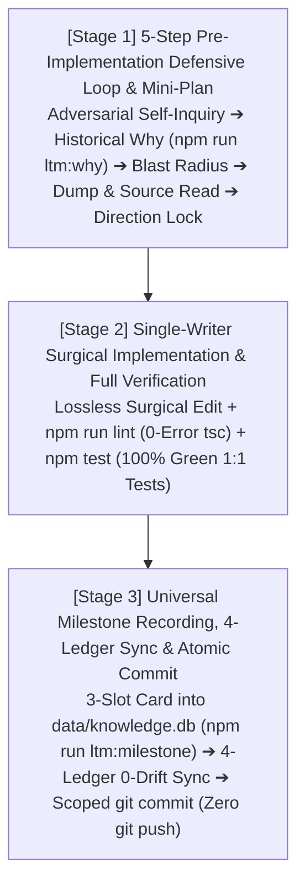

# REGULAR-TRACK OPERATIONS GUIDE (3-STAGE HIGH-VELOCITY LIFECYCLE)

This skill governs **surgical refactoring, constitutional rule and ledger updates, bug hotfixes, and modular feature milestones** with maximum velocity and zero-defect verification across the pure local native `2`-Cluster SQLite `LTM` (`node:sqlite` in `data/*.db`) architecture.

---

## 1. The 3-Stage Regular-Track Lifecycle



---

## 2. Detailed 3-Stage Execution Protocol

### 2.1 Stage 1 — Pre-Implementation 5-Step Defensive Cognitive Loop (`Read-Before-Write`)
Never create or modify any file (`write_file`, `edit_file`) without first completing the `5`-step defensive loop:
1. **Step 1 — Adversarial Self-Inquiry**: Interrogate the target change with *"Latent defects or compromises may hide in the system; what are the exact risks?"* to surface failure modes preemptively.
2. **Step 2 — Historical Design Intent & Invariant Lookup (`Chesterton's Fence — Timing 1`)**:
   - Query `data/knowledge.db` (`milestones` table) by target file path alongside `docs/ARCHITECTURE.md` (`ADR`) and `docs/SPECIFICATION.md` (`SDR`) to verify why the target file was designed that way and what invariants must be preserved:
     ```bash
     npm run ltm:why -- <workspace_relative_file_path>
     ```
3. **Step 3 — Codebase Dependency & Blast-Radius Measurement**: Measure all downstream dependents and cross-layer contract impacts (`Layer 1 ➔ Layer 2 ➔ Layer 3 ➔ Layer 4` or `.agents/rules/` priority tiers) before modifying any symbol or rule.
4. **Step 4 — Grounding Dump & Physical Source Byte-Exact Inspection**:
   - Inspect `docs/AUDIT_GROUNDING_DUMP.md` and read the physical files on disk (`read_file`) to verify signatures, guard clauses, and lockfile dependencies to the exact byte.
5. **Step 5 — Rationale & Direction Lock**: Lock the `3`-line execution rationale before writing any code or documentation.

### 2.2 Stage 2 — Single-Writer Surgical Implementation & Automated Verification
1. **Lossless Surgical Execution**:
   - Modify only the targeted modules, rules, or ledgers while preserving `<= 250` lines per `.ts`/`.tsx` file and `100%` `1:1` mirrored test symmetry (`src/**/*` ⇄ `tests/**/*`).
2. **Mandatory Same-Turn Automated Verification Gates**:
   - **Gate 1 — Strict Static Typecheck (`0 Errors / 0 Warnings`)**:
     ```bash
     npm run lint
     ```
   - **Gate 2 — `1:1` Mirrored Unit & Integration Test Suite (`100% Green`)**:
     ```bash
     npm test
     ```

### 2.3 Stage 3 — Universal Milestone Recording (`data/knowledge.db`), 4-Ledger Sync & Atomic Commit
1. **Mandatory `3`-Slot Universal Milestone Imprinting (`Timing 2`)**:
   - Before executing `git commit`, record a universal `3`-slot milestone card (`M-0001`, `M-0002`, ...) into `data/knowledge.db` (`milestones` table).
   - **Supported `scope_category` Values (`Covers Rules, Docs, Schemas & Code`)**:
     - `RULE`: Changes to `/GEMINI.md` or `/.agents/rules/**/*.md`
     - `LEDGER_DOC`: Changes to `/README.md` or `docs/*.md`
     - `LTM_SCHEMA`: Changes to `Cluster C1` / `Cluster C2` database schemas
     - `SOURCE_CODE`: Changes to `src/**/*` and `tests/**/*`
     - `HYBRID`: Cross-cutting milestones spanning rules, ledgers, LTM schemas, and source code
   - **`3`-Slot Authoring Standard**:
     - `--problem` (`~40 chars`): Technical trigger, defect, or architectural bottleneck addressed.
     - `--why` (`~70 chars`): Design rationale and trade-off justification (`Chesterton's Fence`).
     - `--invariants` (`~40 chars`): Inviolable contracts that future modifications must never break.
   - **Canonical One-Liner Execution Command (`Auto-Verifies in data/knowledge.db`)**:
     ```bash
     npm run ltm:milestone -- --scope "<RULE|LEDGER_DOC|LTM_SCHEMA|SOURCE_CODE|HYBRID>" --title "<Milestone_Title>" --problem "<Problem_Trigger>" --why "<Design_Rationale>" --invariants "<Core_Invariants>" --files "<path1>,<path2>"
     ```
2. **Real-Time `0-Drift` Synchronization of the `4` Permanent Mirror Ledgers**:
   - Synchronize `/README.md`, `docs/ARCHITECTURE.md`, `docs/SPECIFICATION.md`, and `docs/AUDIT_GROUNDING_DUMP.md` (`0%` `...` ellipsis truncation) within the same milestone transaction.
   - Visually read back (`read_file`) the updated sections of `docs/AUDIT_GROUNDING_DUMP.md` to confirm byte-exact fidelity.
3. **Scoped Atomic Local `git commit` (`Zero git push`)**:
   - Stage only the modified paths (`git add <paths>`) and execute a single atomic `git commit`.
   - Never execute `git push` and never append prompts asking whether to run `git push`.
