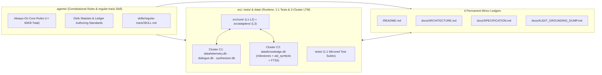

# ETERNA LUMINARIS: SYSTEM OVERVIEW & 4-LEDGER INDEX

## 1. System Overview & Core Architectural Pillars (`시스템 개요 및 4대 핵심 기둥`)

**Eterna Luminaris** is a pure local native workspace governed by a **2-Tier Constitutional Rule Engine (`2계층 헌법 규칙 엔진`)**, a **4-Layer Unidirectional TypeScript/React Architecture (`Contracts ➔ Pure Domain ➔ Adapters ➔ Surface`)**, and a **2-Cluster / 4-Database Local SQLite Long-Term Memory (`LTM`) Subsystem (`data/*.db`)**.

| Core Pillar | Architectural Mechanism | Engineering Guarantee |
| :--- | :--- | :--- |
| **1. Backend & Domain `SSOT` (`도메인 코어 단일 진실 공급원`)** | Centralizes state machines `(State, Action) => NextState`, bio-resonance math, and prompt combinator pipelines in `Layer 2` (`src/core/domain/`). | `0%` UI/IO coupling in domain code; `0%` prompt string fragmentation in source files. |
| **2. Compile-Time State Safety (`컴파일 타임 상태 안전성`)** | Enforces `readonly` contracts, literal unions, Discriminated Unions (`kind`), and `never` exhaustiveness guards in `Layer 1` & `Layer 2`. | Invalid states are unrepresentable at compile time (`tsc --noEmit` `0 Errors`). |
| **3. Pure Local Native `2`-Cluster `LTM` (`순수 로컬 2-클러스터 LTM`)** | Separates **Interaction LTM (`data/telemetry.db`, `data/dialogue.db`, `data/synthesizer.db`)** from **Engineering LTM (`data/knowledge.db`)** on built-in `node:sqlite`. | `< 0.1ms` direct local SQLite I/O with isolated per-DB `WAL` writes and `0%` cloud dependencies. |
| **4. `0-Drift` 4-Ledger & Milestone Governance (`4대 원장 및 마일스톤 거버넌스`)** | Records universal `3`-slot milestones (`RULE`, `LEDGER_DOC`, `LTM_SCHEMA`, `SOURCE_CODE`, `HYBRID`) in `data/knowledge.db` and synchronizes all `4` Permanent Mirror Ledgers atomically. | `1:1` traceability across historical rationale, topology, formal schemas, and source code. |

---

## 2. Workspace & Subsystem Topology (`워크스페이스 및 서브시스템 토폴로지`)

---

## 3. Quickstart, Build & Verification Commands (`빠른 시작, 빌드 및 검증 명령어`)

* **Prerequisites (`실행 환경 요건`)**: Node.js `>= 22.5.x` (built-in `node:sqlite` and `node:test`), `npm install`.

| Command | Script (`package.json`) | Purpose & Verification Gate |
| :--- | :--- | :--- |
| **`npm run lint`** | `tsc --noEmit` | TypeScript `7` strict static typecheck (`0 Errors / 0 Warnings`). |
| **`npm test`** | `node --import tsx --test tests/**/*.test.ts` | Executes all `1:1` mirrored unit and SQLite integration tests (`100% Green`). |
| **`npm run ltm:init`** | `tsx src/adapters/ltmCli.ts init` | Initializes the `4` local SQLite databases in `data/*.db`. |
| **`npm run ltm:why -- <path>`** | `tsx src/adapters/ltmCli.ts why <path>` | Queries `data/knowledge.db` (`milestones`) for historical `3`-slot rationale affecting `<path>`. |
| **`npm run ltm:milestone -- ...`** | `tsx src/adapters/ltmCli.ts milestone ...` | Records a `3`-slot milestone card directly into `data/knowledge.db`. |
| **`npm run dev`** | `vite --port=3000 --host=0.0.0.0` | Starts the Vite `8` development server on port `3000`. |
| **`npm run build`** | `vite build` | Builds the production bundle in `dist/`. |

---

## 4. 4 Permanent Mirror Ledgers Index (`4대 영구 거울 원장 색인`)

| Order | File Path | Single Responsibility (`SRP`) Scope | Governing Authoring Standard (`glob`) |
| :---: | :--- | :--- | :--- |
| **`1`** | `/README.md` | **Project Root Overview Ledger (`루트 개요 원장`)**: Executive summary, workspace topology, CLI commands, and `4`-Ledger index. | `.agents/rules/docs/IMPERIAL_README_AUTHORING_STANDARD.md` |
| **`2`** | `docs/ARCHITECTURE.md` | **Topology & Data Flow Ledger (`토폴로지·데이터 흐름 원장`)**: `5`-Level system context, `1:1` module/test import boundaries, `2`-Cluster `LTM` topology, runtime sequences, and `ADR`s. | `.agents/rules/docs/IMPERIAL_ARCHITECTURE_AUTHORING_STANDARD.md` |
| **`3`** | `docs/SPECIFICATION.md` | **Contract, `DDL`, Formula & State-Machine `SSOT` Ledger (`계약·스키마·공식 원장`)**: Constants, type contracts, `STRICT DDL`/`FTS5` schemas, LaTeX formulas, transition matrix, clamps, and `SDR`s. | `.agents/rules/docs/IMPERIAL_SPECIFICATION_AUTHORING_STANDARD.md` |
| **`4`** | `docs/AUDIT_GROUNDING_DUMP.md` | **`0-Drift` Verbatim Code & Test Mirror Ledger (`무생략 실소스·테스트 거울 원장`)**: Un-truncated (`0%` `...`) physical source mirror, `1:1` test mirror, and `4`D verification telemetry. | `.agents/rules/docs/IMPERIAL_AUDIT_DUMP_AUTHORING_STANDARD.md` |
