# ETERNA LUMINARIS: SYSTEM OVERVIEW & 4-LEDGER INDEX

## 1. System Overview & Core Architectural Pillars

**Eterna Luminaris** is a pure local native workspace governed by a **2-Tier Constitutional Rule Engine** (`/GEMINI.md`, `.agents/rules/`) and a **4-Layer Unidirectional TypeScript/React Architecture** (`Contracts ➔ Pure Domain ➔ Adapters ➔ Surface`).

| Core Pillar | Architectural Mechanism | Engineering Guarantee |
| :--- | :--- | :--- |
| **1. Backend & Domain `SSOT`** | Centralizes state machines `(State, Action) => NextState`, formulas, and prompt combinator pipelines in `Layer 2` (`src/core/domain/`). | `0%` UI/IO coupling in domain code; `0%` prompt string fragmentation in source files. |
| **2. Compile-Time State Safety** | Enforces `readonly` contracts, literal unions, Discriminated Unions (`kind`), and `never` exhaustiveness guards in `Layer 1` & `Layer 2`. | Invalid states are unrepresentable at compile time (`tsc --noEmit` `0 Errors`). |
| **3. Pure Local Native `2`-Cluster `LTM`** | Separates **Interaction LTM** from **Engineering LTM** on built-in `node:sqlite`. | Direct local SQLite I/O with isolated per-DB `WAL` writes and `0%` cloud dependencies. |
| **4. `0-Drift` 4-Ledger Governance** | Synchronizes all `4` Permanent Mirror Ledgers (`/README.md`, `docs/ARCHITECTURE.md`, `docs/SPECIFICATION.md`, `docs/AUDIT_GROUNDING_DUMP.md`) atomically. | `1:1` traceability across topology, formal schemas, and physical source code. |

---

## 2. Workspace & Subsystem Topology

```mermaid
flowchart LR
    subgraph RULES[".agents/ (Constitutional Rules & regular-track Skill)"]
        ALWAYS["Always-On Core Rules (<= 60KB Total)"]
        GLOBS["Glob Statutes & Ledger Authoring Standards"]
        SKILL["skills/regular-track/SKILL.md"]
    end

    subgraph LEDGERS["4 Permanent Mirror Ledgers"]
        L_README["/README.md"]
        L_ARCH["docs/ARCHITECTURE.md"]
        L_SPEC["docs/SPECIFICATION.md"]
        L_DUMP["docs/AUDIT_GROUNDING_DUMP.md"]
    end

    subgraph RUNTIME["src/, tests/ & data/ (Clean Baseline)"]
        SRC["src/ (Clean Baseline)"]
        TST["tests/ (Clean Baseline)"]
        DATA["data/ (Clean Baseline)"]
    end

    RULES --> LEDGERS & RUNTIME
    RUNTIME <--> LEDGERS
```

---

## 3. Quickstart, Build & Verification Commands

* **Prerequisites**: Node.js `>= 22.5.x` (built-in `node:sqlite` and `node:test`), `npm install`.

| Command | Script (`package.json`) | Purpose & Verification Gate |
| :--- | :--- | :--- |
| **`npm run lint`** | `tsc --noEmit` | TypeScript `7` strict static typecheck (`0 Errors / 0 Warnings`). |
| **`npm test`** | `node -e "console.log('Clean baseline (0 test suites)')"` | Baseline test gate (ready for `1:1` mirrored `.test.tsx` suites). |
| **`npm run dev`** | `vite --port=3000 --host=0.0.0.0` | Starts the Vite `8` development server on port `3000`. |
| **`npm run build`** | `vite build` | Builds the production bundle in `dist/`. |
| **`npm run preview`** | `vite preview` | Previews the production bundle locally. |
| **`npm run clean`** | `rm -rf dist server.js` | Cleans build artifacts. |

---

## 4. 4 Permanent Mirror Ledgers Index

| Order | File Path | Single Responsibility (`SRP`) Scope | Governing Authoring Standard (`glob`) |
| :---: | :--- | :--- | :--- |
| **`1`** | `/README.md` | **Project Root Overview Ledger**: Executive summary, workspace topology, CLI commands, and `4`-Ledger index. | `.agents/rules/docs/IMPERIAL_README_AUTHORING_STANDARD.md` |
| **`2`** | `docs/ARCHITECTURE.md` | **Topology & Data Flow Ledger**: `5`-Level system context, module/test import boundaries, `2`-Cluster `LTM` topology, runtime sequences, and `ADR`s. | `.agents/rules/docs/IMPERIAL_ARCHITECTURE_AUTHORING_STANDARD.md` |
| **`3`** | `docs/SPECIFICATION.md` | **Contract, `DDL`, Formula & State-Machine `SSOT` Ledger**: Constants, type contracts, `STRICT DDL` schemas, formulas, transition matrix, and `SDR`s. | `.agents/rules/docs/IMPERIAL_SPECIFICATION_AUTHORING_STANDARD.md` |
| **`4`** | `docs/AUDIT_GROUNDING_DUMP.md` | **`0-Drift` Verbatim Code & Test Mirror Ledger**: Un-truncated (`0%` `...`) physical manifest/source mirror and `4`D verification telemetry. | `.agents/rules/docs/IMPERIAL_AUDIT_DUMP_AUTHORING_STANDARD.md` |
