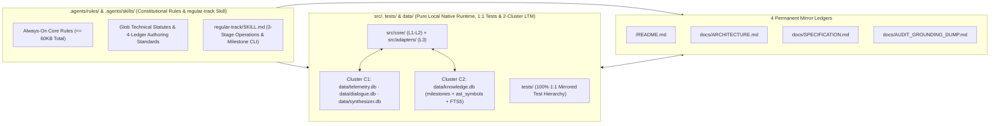

# ETERNA LUMINARIS: SYSTEM OVERVIEW & 4-LEDGER INDEX

## 1. System Overview & Core Value Proposition (시스템 개요 및 핵심 지향점)

**Eterna Luminaris** is a pure local native enterprise software workspace governed by a strict **2-Tier Constitutional Rule Engine** and a **4-Layer Unidirectional TypeScript/React Runtime Architecture** (`Contracts ➔ Pure Domain ➔ Adapters ➔ Presentational Surface`) integrated with an orthogonally partitioned **2-Cluster / 4-Database Local SQLite Long-Term Memory (`LTM`) Subsystem** (`data/*.db`).

| Core Pillar | Architectural Mechanism | Engineering Guarantee |
| :--- | :--- | :--- |
| **1. Backend & Domain `SSOT`** | Centralizes all state machines `(State, Action) => NextState`, mathematical equations, and prompt combinator assembly pipelines in `Layer 2` (`src/core/domain/`). | `0%` coupling between core business rules and UI/IO frameworks; `0%` prompt string fragmentation in source code. |
| **2. Compile-Time State Safety** | Enforces `readonly` interfaces, literal types, Discriminated Unions (`kind`), and `never` exhaustiveness guards in `Layer 1` & `Layer 2`. | Impossible runtime states are unrepresentable at compile time (`tsc --noEmit` `0 Errors`). |
| **3. Pure Local Native `2`-Cluster `LTM`** | Separates **Interaction LTM (`data/telemetry.db`, `data/dialogue.db`, `data/synthesizer.db`)** from **Engineering & Workspace Knowledge LTM (`data/knowledge.db`)** on built-in `node:sqlite`. | `< 0.1ms` direct local disk I/O with `0%` intermediate serialization bridges, `0%` rule-to-DB drift, and `0%` external cloud dependencies. |
| **4. `0-Drift` 4-Ledger & Universal Milestone Governance** | Records universal `3`-slot milestones (`RULE`, `LEDGER_DOC`, `LTM_SCHEMA`, `SOURCE_CODE`, `HYBRID`) in `data/knowledge.db` and synchronizes `/README.md`, `docs/ARCHITECTURE.md`, `docs/SPECIFICATION.md`, and `docs/AUDIT_GROUNDING_DUMP.md` atomically. | Guarantees `1:1` traceability across historical rationale (`Chesterton's Fence`), topology, formal contracts, and physical source code. |

---

## 2. Subsystem & Directory Topology Overview (서브시스템 및 디렉토리 위상 요약)



---

## 3. Quickstart, Build & Verification Commands (실행·빌드 및 무결성 검증 명령어)

### 3.1 Prerequisites & Dependency Installation
* **Runtime**: Node.js `>= 22.5.x` (includes built-in `node:sqlite` and `node:test` with `0` native C++ addon compilation overhead)
* **Install Dependencies**:
  ```bash
  npm install
  ```

### 3.2 Canonical Verification, LTM & Execution Scripts (`package.json`)

| Command | Underlying Script (`package.json`) | Execution Target & Verification Gate Criteria |
| :--- | :--- | :--- |
| **`npm run lint`** | `tsc --noEmit` | Runs the TypeScript `7` strict static typechecker (`0 Errors / 0 Warnings` mandatory). |
| **`npm test`** | `node --import tsx --test tests/**/*.test.ts` | Executes the `1:1` mirrored unit and SQLite integration test suite (`100% Green` mandatory). |
| **`npm run ltm:init`** | `tsx src/adapters/ltmCli.ts init` | Initializes the `4` local SQLite databases in `data/*.db` (`Cluster C1` & `C2`). |
| **`npm run ltm:why -- <path>`** | `tsx src/adapters/ltmCli.ts why <path>` | Queries `data/knowledge.db` (`milestones`) for historical `3`-slot rationale affecting `<path>`. |
| **`npm run ltm:milestone -- ...`** | `tsx src/adapters/ltmCli.ts milestone ...` | Records a universal `3`-slot milestone card directly into `data/knowledge.db`. |
| **`npm run dev`** | `vite --port=3000 --host=0.0.0.0` | Launches the local Vite `8` development server on port `3000`. |
| **`npm run build`** | `vite build` | Produces the verified production bundle in `dist/`. |

---

## 4. Canonical 4 Permanent Mirror Ledgers Navigation Index (4대 영구 거울 원장 네비게이션)

| Ledger Order | Canonical File Path | Single Responsibility (`SRP`) Scope | Governing Authoring Standard (`glob`) |
| :---: | :--- | :--- | :--- |
| **`1`** | `/README.md` | **Project Root Overview Ledger**: Executive summary, workspace topology overview, CLI command table, and `4`-Ledger navigation map. | `.agents/rules/docs/IMPERIAL_README_AUTHORING_STANDARD.md` |
| **`2`** | `docs/ARCHITECTURE.md` | **Topology & Data Flow Ledger**: `5`-Level system context, module & `1:1` test import boundaries, pure local native `2`-Cluster `LTM` topology, runtime sequences, and `ADR`s. | `.agents/rules/docs/IMPERIAL_ARCHITECTURE_AUTHORING_STANDARD.md` |
| **`3`** | `docs/SPECIFICATION.md` | **Contract, `DDL`, Formula & State-Machine `SSOT` Ledger**: `5`-Section constant tables, static type contracts, `2`-Cluster / `4`-DB `STRICT DDL`/`FTS5` schemas, `4`-part LaTeX equations, state transition matrices, boundary clamps, and `SDR`s. | `.agents/rules/docs/IMPERIAL_SPECIFICATION_AUTHORING_STANDARD.md` |
| **`4`** | `docs/AUDIT_GROUNDING_DUMP.md` | **`0-Drift` Verbatim Code & Test Mirror Ledger**: Un-truncated (`0%` `...`) physical source code mirror, `1:1` test assertion mirror, and same-turn `4`-dimensional audit telemetry. | `.agents/rules/docs/IMPERIAL_AUDIT_DUMP_AUTHORING_STANDARD.md` |
