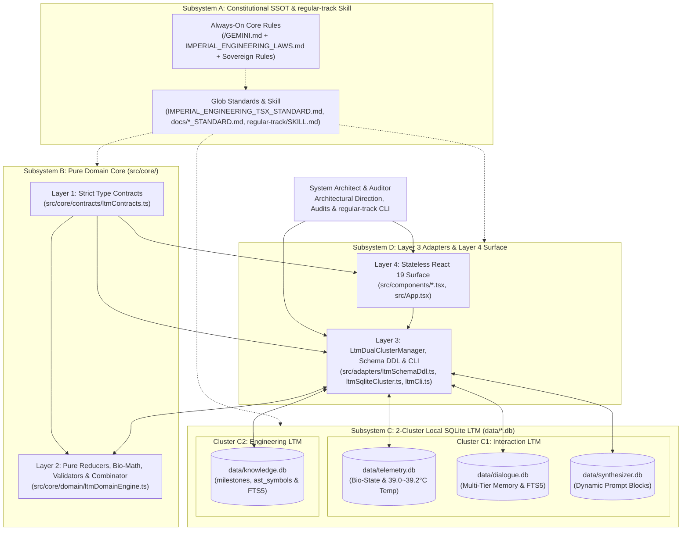
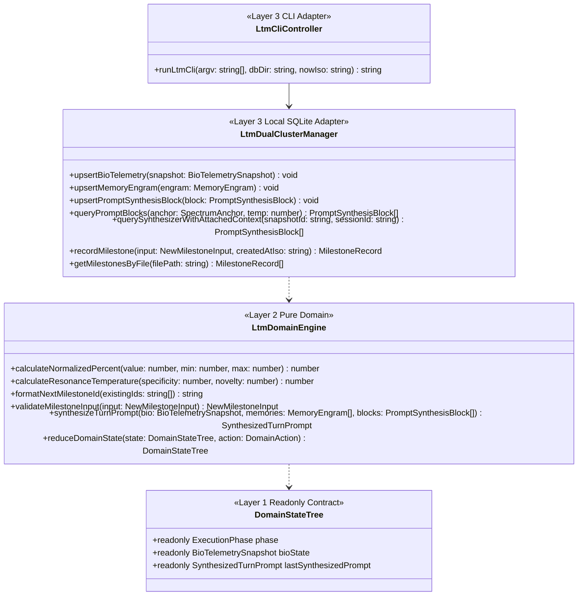
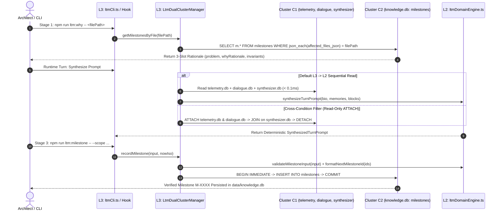

# SYSTEM ARCHITECTURE BLUEPRINT

## 1. Level 1: System Context & Subsystem Topology (`시스템 컨텍스트 및 서브시스템 토폴로지`)

The workspace comprises four decoupled subsystems governed by Backend `SSOT`, Unidirectional Dependency Flow (`Contracts ➔ Pure Domain ➔ Adapters ➔ Surface`), and Pure Local Native `2`-Cluster SQLite `LTM` (`data/*.db`):
1. **Subsystem A — Constitutional Rule Engine & Skill (`/GEMINI.md`, `.agents/rules/`, `.agents/skills/regular-track/SKILL.md`)**: File-based Constitutional `SSOT` (`0%` DB duplication), separating `always_on` core rules from `model_decision`/`glob` rules and the `3`-Stage `regular-track` workflow.
2. **Subsystem B — Pure Domain & Prompt Combinator Core (`src/core/`)**: Pure deterministic state machines `(State, Action) => NextState`, bio-resonance math, milestone validation, and `synthesizeTurnPrompt` (`0%` UI/IO imports).
3. **Subsystem C — Pure Local Native `2`-Cluster SQLite `LTM` (`node:sqlite` in `data/*.db`)**:
   - **Cluster C1 (`인터랙션 LTM`)**: `data/telemetry.db` (bio-signals, `[39.0, 39.2] °C` core temp, dopamine score), `data/dialogue.db` (`STM`, `Hippocampal`, `Cortical` memory engrams + `FTS5`), and `data/synthesizer.db` (on-demand prompt blocks, empty baseline). Supports `L3 ➔ L2` sequential reads and read-only `ATTACH DATABASE` joins while keeping writes isolated per DB (`BEGIN IMMEDIATE`).
   - **Cluster C2 (`엔지니어링 LTM`)**: `data/knowledge.db` containing universal `milestones` (`json_each` file reverse index), `ast_symbols`, `technical_knowledge_nodes`, and `knowledge_fts` (`FTS5`).
4. **Subsystem D — Adapters, CLI & Presentational Surface (`src/adapters/`, `src/hooks/`, `src/components/`, `src/App.tsx`)**: SQLite/CLI adapters (`Layer 3`) and stateless React `19` renderers (`Layer 4`).

---

## 2. Level 2: Module & 1:1 Test Boundary Matrix (`모듈 및 1:1 테스트 경계 매트릭스`)

| Layer | Source Path | `1:1` Test Path | Allowed Imports | Forbidden Imports | Single Responsibility (`SRP`) |
| :--- | :--- | :--- | :--- | :--- | :--- |
| **L1: Contracts (`정적 계약`)** | `src/core/contracts/ltmContracts.ts` | `tests/core/contracts/ltmContracts.test.ts` | `None` | `react`, `DOM`, `node:*`, `L2~L4` | Pure `readonly` interfaces, literal unions, and discriminated unions for `Cluster C1`, `Cluster C2`, and `DomainAction`. |
| **L2: Pure Domain (`순수 도메인`)** | `src/core/domain/ltmDomainEngine.ts` | `tests/core/domain/ltmDomainEngine.test.ts` | `src/core/contracts/ltmContracts.ts` | `react`, `DOM`, `node:*`, `L3`, `L4` | Bio-resonance math (`[39.0, 39.2] °C`), `M-XXXX` ID generator, `3`-slot milestone validator, `synthesizeTurnPrompt`, and `reduceDomainState`. |
| **L3: DDL & Mappers (`스키마·매퍼`)** | `src/adapters/ltmSchemaDdl.ts` | `tests/adapters/ltmSchemaDdl.test.ts` | `L1 Contracts` | `react`, `DOM`, `node:fs`, `L4` | `STRICT` SQLite & `FTS5` DDL definitions and pure row-to-contract mappers. |
| **L3: SQLite Cluster (`2-클러스터 어댑터`)** | `src/adapters/ltmSqliteCluster.ts` | `tests/adapters/ltmSqliteCluster.test.ts` | `node:fs`, `node:path`, `node:sqlite`, `L1`, `L2`, `ltmSchemaDdl.ts` | `react`, `DOM`, `L4` | `LtmDualClusterManager`: direct `data/*.db` persistence, isolated `BEGIN IMMEDIATE` writes, `Cluster C1` `ATTACH` joins, and `json_each` milestone queries. |
| **L3: LTM CLI (`CLI 컨트롤러`)** | `src/adapters/ltmCli.ts` | `tests/adapters/ltmCli.test.ts` | `node:path`, `node:url`, `L1`, `ltmSqliteCluster.ts` | `react`, `DOM`, `L4` | CLI controller (`runLtmCli`) for `npm run ltm:init`, `ltm:why`, and `ltm:milestone`. |

---

## 3. Level 3: Contract & Persistence Topology (`계약 및 영속성 토폴로지`)

---

## 4. Level 4: Runtime Execution Sequence (`런타임 실행 및 트랜잭션 시퀀스`)

---

## 5. Level 5: Governance Gates & Architecture Decision Records (`거버넌스 게이트 및 ADR`)

### 5.1 Governance Gates (`4대 아키텍처 거버넌스 게이트`)

| Gate | Target Scope | Enforced Invariant |
| :--- | :--- | :--- |
| **Gate 1: Strict TypeScript (`npm run lint`)** | `tsconfig.json`, `src/**/*.ts(x)`, `tests/**/*.ts(x)` | `strict: true`, `0 Errors / 0 Warnings`, and `<= 250 lines` per `src/` module. |
| **Gate 2: `1:1` Test Symmetry (`npm test`)** | `src/**/*` ⇄ `tests/**/*` | `100%` `1:1` module-to-test mirror (`5` suites / `11` tests `PASS`). |
| **Gate 3: Antigravity Rule Budget** | `/GEMINI.md`, `.agents/rules/**/*.md` | Each rule file `<= 24,000 B`; cumulative `Always-On` (`4` files) `<= 60,000 B`. |
| **Gate 4: `4`-Ledger `0-Drift` Sync** | `/README.md`, `docs/ARCHITECTURE.md`, `docs/SPECIFICATION.md`, `docs/AUDIT_GROUNDING_DUMP.md` | Same-turn synchronization of all `4` Permanent Mirror Ledgers. |

### 5.2 Core Architecture Decision Records (`핵심 ADR 요약표`)

| ADR ID | Architectural Decision | Enforcement Mechanism |
| :--- | :--- | :--- |
| **`ADR-01`** | **Backend/Domain `SSOT` & Pure Renderer Separation (`도메인 SSOT 및 순수 렌더러 분리`)** | Isolate all state transitions, bio-math, and prompt combinators in `Layer 2` (`src/core/domain/`) with `0` UI/SQLite imports. |
| **`ADR-02`** | **Discriminated Union State & Exhaustive Reducers (`판별 공용체 및 완전성 검증 리듀서`)** | Model phases with literal `kind` tags in `Layer 1` and enforce `const _exhaustiveCheck: never = action` in `Layer 2`. |
| **`ADR-03`** | **Caller-Injected Non-Determinism (`외부 비결정성 주입 · L3 ➔ L2`)** | Capture timestamps, IDs, and SQLite rows in `Layer 3` and pass them into `Layer 2` via immutable payloads. |
| **`ADR-04`** | **Orthogonal `2`-Cluster Local SQLite `LTM` (`직교 2-클러스터 로컬 SQLite LTM`)** | Partition `Cluster C1` (`telemetry`, `dialogue`, `synthesizer`) from `Cluster C2` (`knowledge`) on local `node:sqlite` (`data/*.db`). |
| **`ADR-05`** | **Empty-Baseline `synthesizer.db` & `L2` Combinator (`빈 베이스라인 동적 프롬프트 저장소`)** | Keep markdown rules in `.agents/rules/` as the sole Constitutional `SSOT` and store dynamic prompt blocks in `data/synthesizer.db`. |
| **`ADR-06`** | **Universal File-Indexed `milestones` in `data/knowledge.db` (`범용 파일 역인덱스 마일스톤`)** | Track `RULE`, `LEDGER_DOC`, `LTM_SCHEMA`, `SOURCE_CODE`, and `HYBRID` changes in `milestones` and query via `json_each(affected_files_json)`. |
