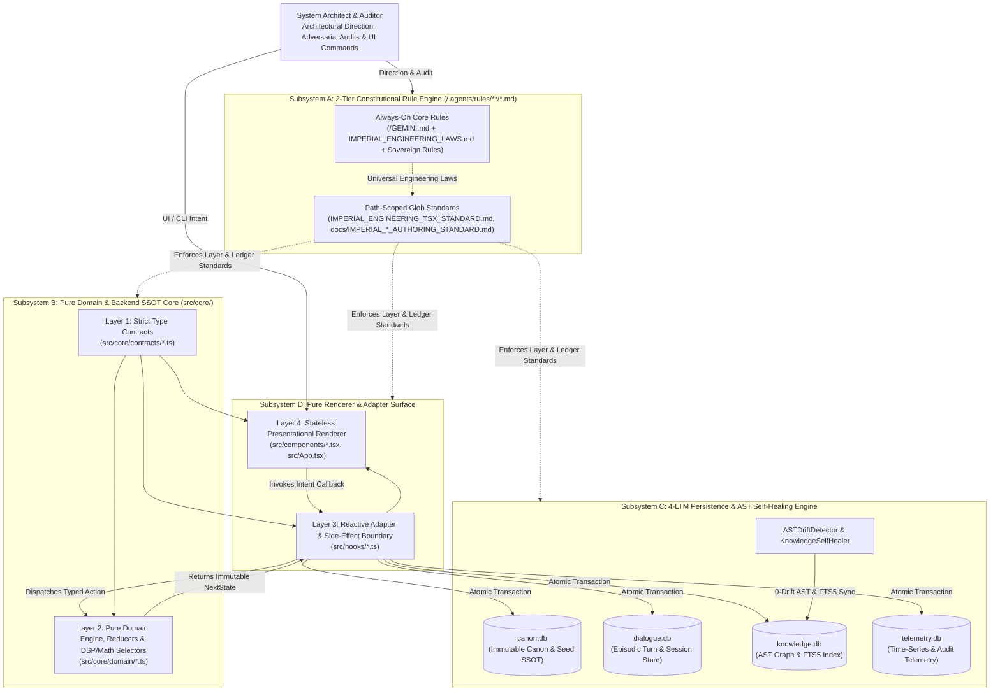
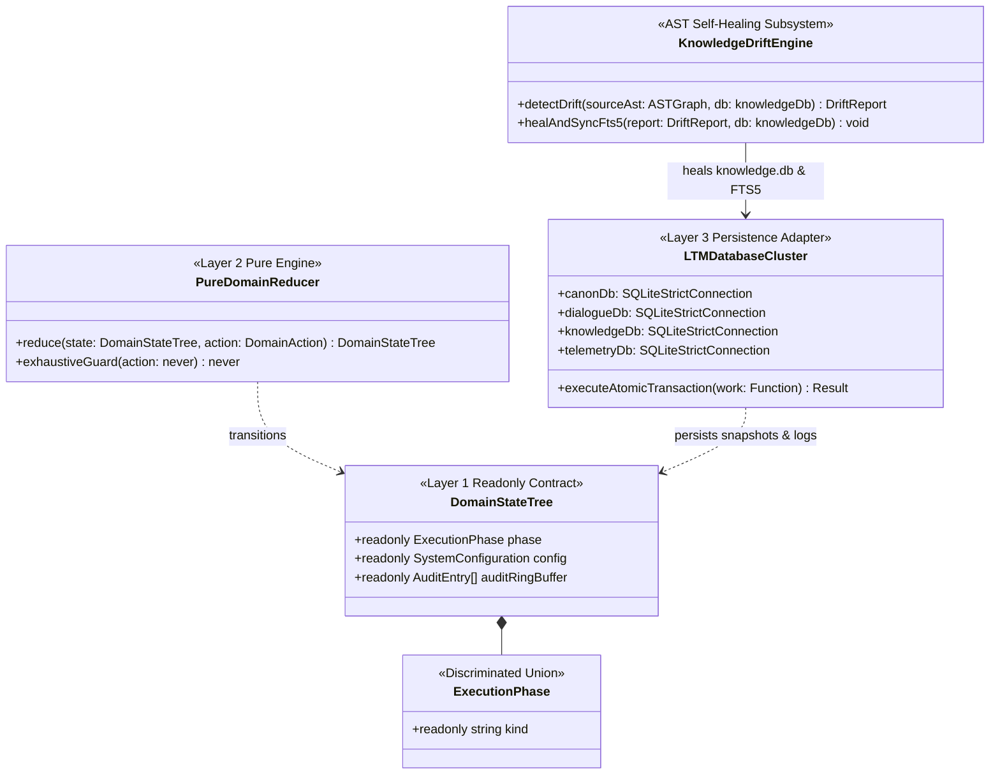
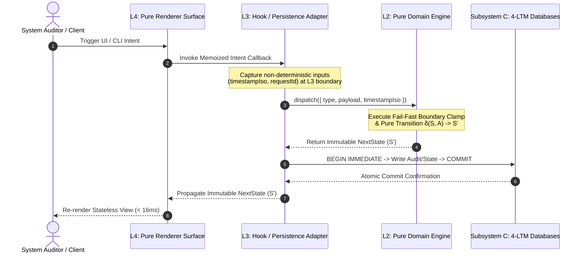

# SYSTEM ARCHITECTURE BLUEPRINT

## 1. Level 1: System Context & Subsystem Topology (전체 시스템 컨텍스트 및 서브시스템 위상)

### 1.1 End-to-End System Context Diagram
The workspace is structured around four strictly decoupled architectural subsystems governed by Backend Single Source of Truth (`SSOT`), Unidirectional Dependency Inversion (`Contracts ➔ Pure Domain ➔ Adapters ➔ Surface`), and `4`-Database Long-Term Memory (`LTM`) isolation:
1. **Subsystem A — 2-Tier Constitutional Rule Engine (`/GEMINI.md` + `/.agents/rules/**/*.md`)**: Separates `always_on` foundational/engineering rules from `model_decision` and path-scoped (`glob`) language and ledger authoring standards.
2. **Subsystem B — Pure Domain & Backend `SSOT` Core (`src/core/`)**: Controls all state machines `(State, Action) => NextState`, algorithms, mathematical/DSP formulas, and business invariants with `0%` coupling to external UI or I/O frameworks.
3. **Subsystem C — 4-LTM Persistence & Active `AST` Self-Healing Engine (`canon.db`, `dialogue.db`, `knowledge.db`, `telemetry.db`)**: Enforces atomic transactions, `AST` drift detection (`ASTDriftDetector`), self-healing (`KnowledgeSelfHealer`), and `FTS5` full-text index synchronization.
4. **Subsystem D — Pure Frontend Renderer & View Adapter Surface (`src/hooks/`, `src/components/`, `src/App.tsx`)**: Operates strictly as a stateless renderer and hardware view adapter (`Props-In, Intent-Out`).

---

## 2. Level 2: Module Topology, 1:1 Test Symmetry & Unidirectional Dependency Matrix (모듈 구조·1:1 테스트 대칭 및 의존성 경계 지도)

### 2.1 Architectural Layer & Import Boundary Matrix (`Greenfield Rebuild Baseline`)

| Architectural Layer | Source Module Path Pattern | `1:1` Mirrored Test Path Pattern | Allowed Imports (`허용 참조`) | Forbidden Imports (`금지 참조`) | Single Responsibility (`SRP` 명세) |
| :--- | :--- | :--- | :--- | :--- | :--- |
| **L1: Contracts** | `src/core/contracts/*.ts` | `tests/core/contracts/*.test.ts` | `None` *(Zero external imports)* | `react`, `DOM`, `Node/Bun IO`, `L2`, `L3`, `L4` | Pure `readonly` interfaces, literal types, and discriminated union contracts (`kind` / `type`). |
| **L2: Pure Domain** | `src/core/domain/*.ts` | `tests/core/domain/*.test.ts` | `src/core/contracts/*.ts` | `react`, `DOM`, `window`, `SQLite/IO`, `L3`, `L4` | Deterministic state reducers `(State, Action) => NextState`, domain constants, and pure math/DSP selectors. |
| **L3: Adapters** | `src/hooks/*.ts` `src/adapters/*.ts` | `tests/hooks/*.test.ts` `tests/adapters/*.test.ts` | `L1 Contracts`, `L2 Domain`, platform IO / React hooks | Presentational JSX components (`L4`) | Side-effect isolation (`Date`, `PRNG`, timers, IPC, `4`-LTM SQLite transactions, `ASTDriftDetector`). |
| **L4: Surface** | `src/components/*.tsx` `src/App.tsx` | `tests/components/*.test.tsx` `tests/App.test.tsx` | `L1 Contracts`, `L2 Pure Selectors`, `L3 Hooks`, UI icons | Direct reducer mutations, raw domain math, `SQLite/IO` | Stateless pure renderer surfaces (`Props-In, Intent-Out`) with `<= 250` lines per file. |
| **Build & Compiler** | `package.json`, `tsconfig.json`, `vite.config.ts` | `npm run lint` & `npm run build` | `vite`, `@vitejs/plugin-react`, `@tailwindcss/vite` | Legacy CommonJS `__dirname`, loose compiler flags | Enforces `strict: true` static typing and native ESM `import.meta.dirname` bundling. |

---

## 3. Level 3: Cross-Layer Contract Hierarchy & 4-LTM Persistence Topology (계층 간 계약 위상 및 4대 LTM 영속성 구조)

### 3.1 Unidirectional Contract & 4-LTM Persistence Class Topology

---

## 4. Level 4: Runtime Execution & Transaction Sequence Pipeline (런타임 실행 및 원자적 트랜잭션 시퀀스 파이프라인)

### 4.1 End-to-End Deterministic Dispatch & Persistence Sequence

---

## 5. Level 5: Governance Gates & Architecture Decision Records (품질 거버넌스 게이트 및 핵심 ADR)

### 5.1 Constitutional, Documentation & Compiler Governance Gates

| Governance Gate | Target Scope | Enforced Engineering Invariant |
| :--- | :--- | :--- |
| **Gate 1: Strict TypeScript (`npm run lint`)** | `tsconfig.json`, `src/**/*.ts(x)`, `tests/**/*.ts(x)` | `strict: true`, `noUnusedLocals: true`, `noUnusedParameters: true`, `noFallthroughCasesInSwitch: true` (`0 Errors / 0 Warnings`). |
| **Gate 2: `1:1` Mirrored Test Symmetry** | `src/**/*` ⇄ `tests/**/*` | `100%` `1:1` directory and module mirror between `src/` and `tests/` with `0` orphaned or stubbed tests. |
| **Gate 3: Antigravity Rule Budget (`always_on` $\perp$ `glob`)** | `/GEMINI.md`, `/.agents/rules/**/*.md` | Every rule file in `/GEMINI.md` and `/.agents/rules/**/*.md` `<= 24,000 Bytes`; cumulative `Always-On` (`4 files`) `<= 60,000 Bytes`. |
| **Gate 4: 4 Permanent Mirror Ledgers `0-Drift` Sync** | `/README.md`, `docs/ARCHITECTURE.md`, `docs/SPECIFICATION.md`, `docs/AUDIT_GROUNDING_DUMP.md` | Real-time synchronization of all `4` Permanent Mirror Ledgers within every milestone transaction (`0` separate `*_COMMENTARY.md` files). |

### 5.2 Core Architecture Decision Records (`ADR-01 ~ ADR-06`)

| ADR ID | Architectural Decision | Rejected Anti-Pattern (`절대 회귀 금지 패턴`) | Enforcement Mechanism |
| :--- | :--- | :--- | :--- |
| **`ADR-01`** | **Backend/Domain `SSOT` & Pure Frontend Renderer Separation** | Embedding business logic, math formulas, or state machines inside UI components | Isolate `100%` of state transitions and formulas in `Layer 2` (`src/core/domain/`) with `0` React/DOM imports. |
| **`ADR-02`** | **Discriminated Union State Machines + Exhaustive `never` Check** | Scattering multiple boolean flags (`isLoading`, `isError`, `isActive`) across components | Key all operational phases on literal `kind` tags in `Layer 1` and enforce `const _exhaustiveCheck: never = action` in `Layer 2`. |
| **`ADR-03`** | **Caller-Injected Entropy at the `Layer 3 ➔ Layer 2` Boundary** | Calling `new Date()`, `Date.now()`, `Math.random()`, or I/O inside `Layer 2` reducers | Capture all temporal, stochastic, and I/O values in `Layer 3` adapters and pass them via immutable action payloads. |
| **`ADR-04`** | **Partitioned `4`-LTM SQLite Architecture (`canon`, `dialogue`, `knowledge`, `telemetry`)** | Mixing immutable canon, episodic logs, `AST` graphs, and telemetry in one database | Enforce `STRICT` schema isolation, atomic transactions, and `ASTDriftDetector` / `KnowledgeSelfHealer` `FTS5` synchronization across the `4` `LTM` databases. |
| **`ADR-05`** | **Separation of Universal Engineering Laws (`always_on`) vs. Path-Scoped Standards (`glob`)** | Mixing framework-specific rules or document authoring laws into `always_on` context | Keep `IMPERIAL_ENGINEERING_LAWS.md` `100%` language-agnostic and isolate TSX/Ledger authoring rules in `glob`-mounted `.agents/rules/` files. |
| **`ADR-06`** | **Consolidation into the `4` Permanent Mirror Ledgers (`Zero Commentary File Spawning`)** | Maintaining separate `*_COMMENTARY.md` files or contaminating engineering ledgers with physical lore | Govern document authoring via `.agents/rules/docs/IMPERIAL_*_AUTHORING_STANDARD.md` and embed concise `ADR`/`SDR` tables directly inside `ARCHITECTURE.md` and `SPECIFICATION.md`. |
