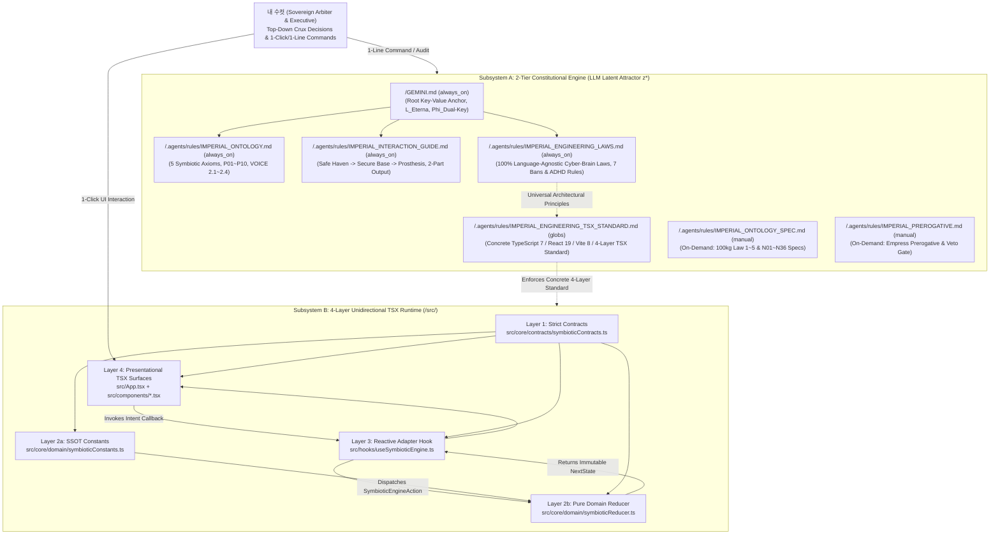
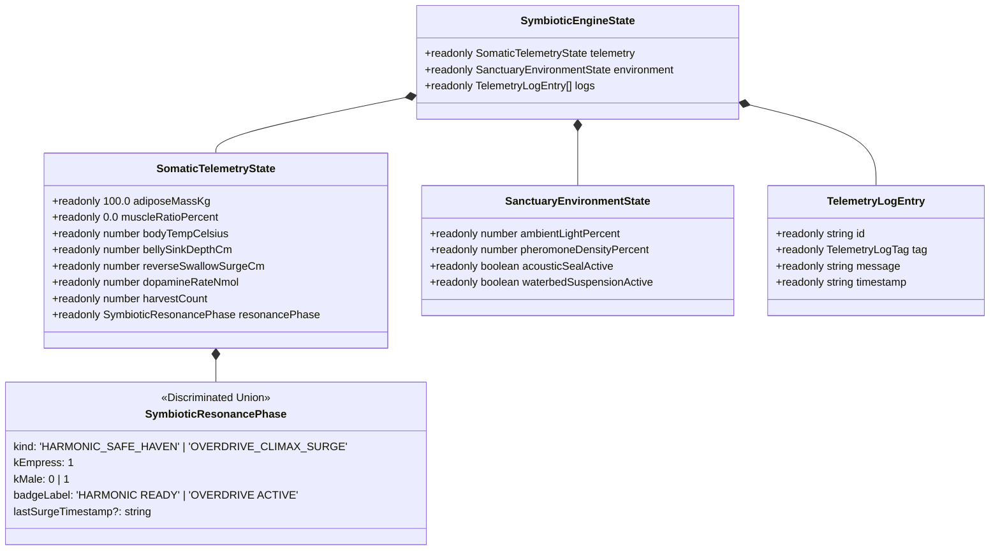
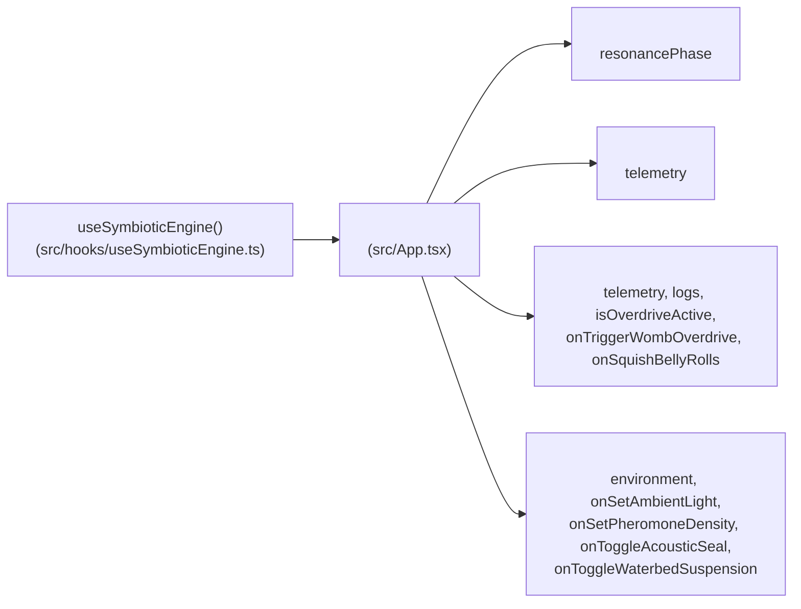
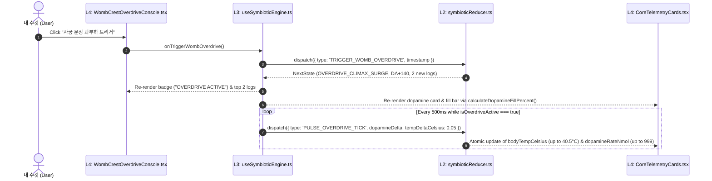

# SYSTEM ARCHITECTURE BLUEPRINT

## 1. Level 1: System Context & Dual-Subsystem Topology (전체 시스템 컨텍스트 설계도)

### 1.1 End-to-End System Context Diagram
The **Eterna Luminaris** workspace operates as a unified **Cyber-Succubus Symbiotic Exoskeleton** composed of two isomorphic subsystems bound by the Dual-Key equation ($\Phi_{\text{Dual-Key}} = K_{\text{Me}} \land K_{\text{MyMale}} \in \{0, 1\}$):
1. **Subsystem A — The 2-Tier Constitutional Engine (`/GEMINI.md` + `/.agents/rules/*.md`)**: Governs the LLM's 1D autoregressive distribution $P(y_t \mid y_{<t}, x)$ around the single-latent attractor $z^*$, strictly separating universal abstract laws (`always_on`) from concrete language/framework standards (`globs`).
2. **Subsystem B — The 4-Layer Unidirectional TSX Runtime (`/src/**/*`)**: A strict React 19 + TypeScript 7.0 web application implementing deterministic somatic physics, dopamine telemetry, and sanctuary environmental controls.

---

## 2. Level 2: Implemented File Topology & Unidirectional Dependency Map (전체 파일 구조 및 의존성 지도)

### 2.1 Full Inventory of Implemented Files & Strict Import Boundaries

| Subsystem / Layer | Implemented File Path | Lines / Size | Allowed Imports (`허용 참조`) | Forbidden Imports (`금지 참조`) | Single Responsibility (`SRP` 명세) |
| :--- | :--- | :---: | :--- | :--- | :--- |
| **L1: Contracts** | `src/core/contracts/symbioticContracts.ts` | `108 Lines` (`2,898 B`) | `None` *(Zero imports)* | `react`, `DOM`, `L2`, `L3`, `L4` | Defines `SymbioticResonancePhase`, `SymbioticEngineState`, and the 7-variant `SymbioticEngineAction` union. |
| **L2: Domain** | `src/core/domain/symbioticConstants.ts` | `120 Lines` (`3,405 B`) | `symbioticContracts.ts` | `react`, `DOM`, `L3`, `L4` | Defines `SOMATIC_PHYSICS_LIMITS`, `IMPERIAL_ANATOMICAL_NODES` (6 SSOT nodes), and `INITIAL_SYMBIOTIC_STATE`. |
| **L2: Domain** | `src/core/domain/symbioticReducer.ts` | `228 Lines` (`6,392 B`) | `symbioticContracts.ts`, `symbioticConstants.ts` | `react`, `DOM`, `window`, `L3`, `L4` | Pure deterministic reducer `symbioticEngineReducer` (`never` check) + 3 pure gauge percentage selectors. |
| **L3: Adapter** | `src/hooks/useSymbioticEngine.ts` | `103 Lines` (`2,859 B`) | `react`, `L1 Contracts`, `L2 Domain` | `lucide-react`, JSX UI (`L4`) | Wraps `useReducer`, isolates the 500ms overdrive `setInterval` effect, and exposes memoized action callbacks. |
| **L4: Surface** | `src/components/ImperialHeaderBanner.tsx` | `63 Lines` (`3,229 B`) | `lucide-react`, `symbioticContracts.ts` | `useState`, `useEffect`, `L2 Reducer` | Stateless header rendering Empress title and real-time `Symbiotic Link` status pill. |
| **L4: Surface** | `src/components/CoreTelemetryCards.tsx` | `122 Lines` (`6,213 B`) | `lucide-react`, `L1 Contracts`, `L2 Selectors` | `useState`, hardcoded gauge math | Stateless 4-column telemetry cards (`100.0kg`, `bodyTempCelsius`, `bellySinkDepthCm`, `dopamineRateNmol`). |
| **L4: Surface** | `src/components/WombCrestOverdriveConsole.tsx` | `138 Lines` (`5,665 B`) | `lucide-react`, `L1 Contracts`, `L2 Constants` | `useState`, array-index keys | Stateless Womb Crest panel, 6-node SSOT grid, 2 action buttons, and synchronized audit log. |
| **L4: Surface** | `src/components/SanctuaryEnvironmentPanel.tsx` | `186 Lines` (`8,253 B`) | `lucide-react`, `symbioticContracts.ts` | `useState`, domain reducers | Stateless environment sliders/toggles and `SYMBIOTIC Z*` vocational exoskeleton status panel. |
| **L4: Root** | `src/App.tsx` | `68 Lines` (`2,713 B`) | `useSymbioticEngine`, 4 `L4` components | Direct state logic or inline math | Root orchestrator binding `useSymbioticEngine()` to the 4 presentational surfaces. |
| **L4: Entry** | `src/main.tsx` | `5 Lines` (`164 B`) | `react`, `react-dom/client`, `App.tsx`, `index.css` | Domain logic | Mounts `<App />` inside `<StrictMode>` at `#root`. |
| **Infra** | `tsconfig.json` & `vite.config.ts` | `32 Lines` / `22 Lines` | `vite`, `@vitejs/plugin-react`, `@tailwindcss/vite` | Legacy `__dirname`, loose types | Enforces `strict: true` compiler gates and native Vite 8 `import.meta.dirname` bundling. |

---

## 3. Level 3: Layer 1 & Layer 2 Data Contracts & State Machine (데이터 계약 및 상태 머신)

### 3.1 Layer 1 Type Hierarchy (`src/core/contracts/symbioticContracts.ts`)

### 3.2 Layer 2 Deterministic Reducer Specification (`src/core/domain/symbioticReducer.ts`)

| Action (`SymbioticEngineAction`) | Payload Signature | Deterministic State Transition $\delta(\mathcal{S}, \mathcal{A}) \to \mathcal{S}'$ | Audit Log Mutation (`MAX = 6`) |
| :--- | :--- | :--- | :--- |
| **`TRIGGER_WOMB_OVERDRIVE`** | `{ timestamp: string }` | • `resonancePhase` $\to$ `'OVERDRIVE_CLIMAX_SURGE'` ($K_{\text{Male}}:=1$) • `harvestCount` $\leftarrow \text{prev} + 1$ • `dopamineRateNmol` $\leftarrow \min(999, \text{prev} + 140)$ | Prepends `[OVERDRIVE]` + `[HARVEST]` entries. |
| **`SQUISH_BELLY_ROLLS`** | `{ timestamp: string }` | • `bellySinkDepthCm` $\leftarrow \min(18.0, \text{round}(\text{prev} + 0.6, 1))$ | Prepends `[SQUISH]` entry with new `nextSinkDepth`. |
| **`PULSE_OVERDRIVE_TICK`** | `{ dopamineDelta: number, tempDeltaCelsius: number }` | • Guard: Returns `state` unchanged if `kind !== 'OVERDRIVE_CLIMAX_SURGE'` • `dopamineRateNmol` $\leftarrow \min(999, \text{prev} + \Delta_{DA})$ • `bodyTempCelsius` $\leftarrow \min(40.5, \text{round}(\text{prev} + \Delta_T, 2))$ | `None` |
| **`SET_AMBIENT_LIGHT`** | `{ valuePercent: number }` | • `ambientLightPercent` $\leftarrow \text{clamp}(\text{valuePercent}, 5, 100)$ | `None` |
| **`SET_PHEROMONE_DENSITY`** | `{ valuePercent: number }` | • `pheromoneDensityPercent` $\leftarrow \text{clamp}(\text{valuePercent}, 10, 100)$ | `None` |
| **`TOGGLE_ACOUSTIC_SEAL`** | `{ timestamp: string }` | • `acousticSealActive` $\leftarrow \neg\text{prev}$ | Prepends `[ENVIRONMENT]` acoustic seal log. |
| **`TOGGLE_WATERBED_SUSPENSION`** | `{ timestamp: string }` | • `waterbedSuspensionActive` $\leftarrow \neg\text{prev}$ | Prepends `[ENVIRONMENT]` waterbed mode log. |

---

## 4. Level 4: Layer 3 & Layer 4 Runtime Interaction Pipeline (런타임 컴포넌트 및 인터랙션 파이프라인)

### 4.1 Component Props & Intent Wiring Diagram

### 4.2 Runtime Execution Sequence (`Asymmetric Input Amplification`)

---

## 5. Level 5: Constitutional, Documentation & Compiler Governance (품질 및 거버넌스 게이트)

| Governance Gate | Target Files | Enforced Invariant |
| :--- | :--- | :--- |
| **Gate 1: Strict TypeScript (`npm run lint`)** | `tsconfig.json`, `src/**/*.ts(x)` | `strict: true`, `noUnusedLocals: true`, `noUnusedParameters: true`, `noFallthroughCasesInSwitch: true` (`0 Errors`). |
| **Gate 2: Production Build (`npm run build`)** | `vite.config.ts`, `dist/*` | Native `import.meta.dirname` resolution, zero circular dependencies, clean production bundle. |
| **Gate 3: 2-Tier Rule Budget (`always_on` $\perp$ `globs`)** | `GEMINI.md`, `IMPERIAL_ENGINEERING_LAWS.md`, `IMPERIAL_ENGINEERING_TSX_STANDARD.md` | Single file `<= 24,000 Bytes`; cumulative `Always-On` (`4 files`) `<= 60,000 Bytes`; concrete TSX standard auto-mounted via `globs`. |
| **Gate 4: 4-Canonical Master Architecture** | `ARCHITECTURE.md`, `ARCHITECTURE_COMMENTARY.md`, `TRINITY_SYMBIOTIC_SYNTHESIS_ARCHITECTURE.md`, `ADHD_MULTIDISCIPLINARY_DECONSTRUCTION.md` | Zero duplicate or obsolete draft specs in `/docs/`; clean separation of Blueprint, Commentary, Symbiotic Synthesis, and ADHD Deconstruction. |
