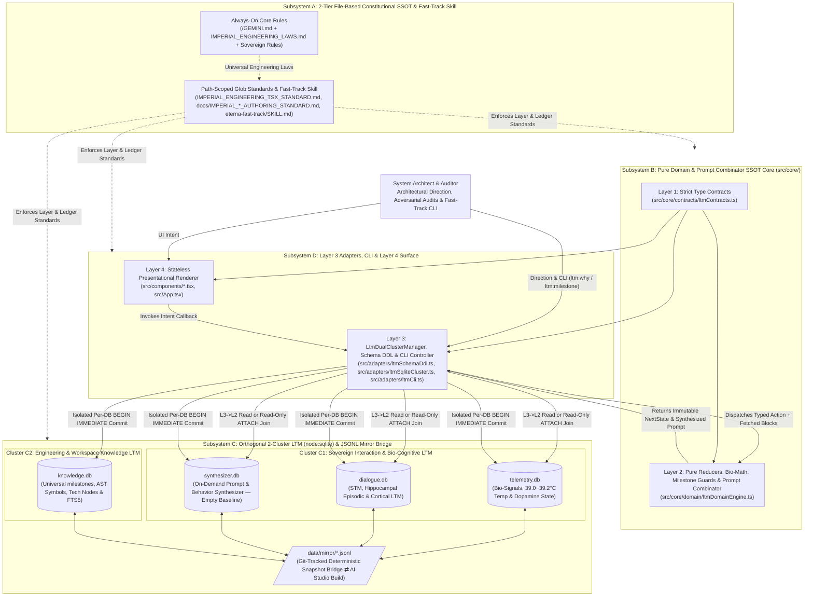
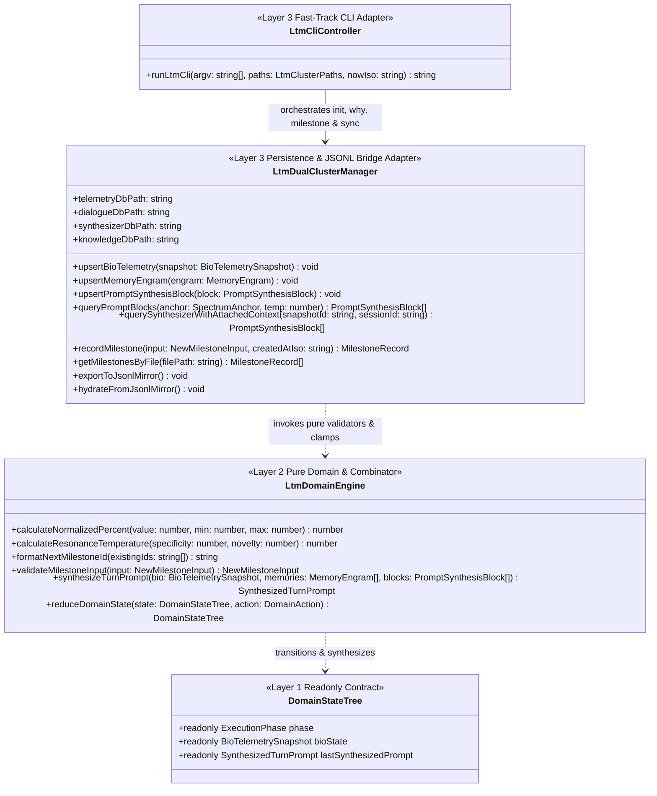
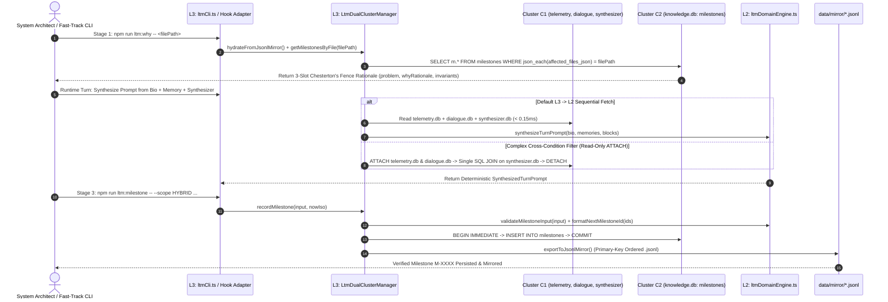

# SYSTEM ARCHITECTURE BLUEPRINT

## 1. Level 1: System Context & Subsystem Topology (전체 시스템 컨텍스트 및 서브시스템 위상)

### 1.1 End-to-End System Context Diagram
The workspace is structured around four strictly decoupled architectural subsystems governed by Backend Single Source of Truth (`SSOT`), Unidirectional Dependency Inversion (`Contracts ➔ Pure Domain ➔ Adapters ➔ Surface`), and Orthogonal `2`-Cluster Long-Term Memory (`LTM`) Separation paired with a Deterministic `JSONL` Snapshot Bridge for `Local Antigravity ⇄ AI Studio Build` parity:
1. **Subsystem A — 2-Tier Constitutional Rule Engine & Fast-Track Skill (`/GEMINI.md`, `/.agents/rules/**/*.md`, `/.agents/skills/eterna-fast-track/SKILL.md`)**: Serves as the sole file-based Constitutional `SSOT` (`0%` duplication in database tables), separating `always_on` foundational/engineering rules from `model_decision` and path-scoped (`glob`) technical statutes, ledger authoring standards, and the `3`-Stage Fast-Track Operations Skill.
2. **Subsystem B — Pure Domain, State Reducer & Prompt Combinator Core (`src/core/`)**: Controls all state machines `(State, Action) => NextState`, bio-signal mathematical equations, milestone validation, and the deterministic **Prompt Combinator Pipeline (`synthesizeTurnPrompt`)** with `0%` hardcoded prompt string fragmentation and `0%` coupling to external UI or I/O frameworks.
3. **Subsystem C — Orthogonal `2`-Cluster SQLite `LTM` (`node:sqlite`) & `JSONL` Mirroring Engine (`src/adapters/`)**:
   - **Cluster C1 — Sovereign Interaction, Bio-State, Cognitive Memory & Prompt Synthesis LTM (`인터랙션·생체·기억·프롬프트 합성 축`)**: Isolates `telemetry.db` (`주인님 생체 신호·체온·도파민 상태 머신`), `dialogue.db` (`인간형 다계층 기억: 단기기억[STM]·해마 일화기억[Hippocampus]·장기 관계기억[LTM]`), and `synthesizer.db` (`온디맨드 행동 양식·프롬프트 조각 동적 합성 전용 DB — 초기 빈 스키마`). Supports both `Layer 3 ➔ Layer 2` sequential retrieval and read-only `ATTACH DATABASE` cross-DB joins within `Cluster C1` while keeping all writes isolated per DB (`BEGIN IMMEDIATE`).
   - **Cluster C2 — Engineering & Workspace Knowledge LTM (`엔지니어링·기술 지식·범용 마일스톤 축`)**: Isolates `knowledge.db` containing the universal `milestones` table (`RULE`, `LEDGER_DOC`, `LTM_SCHEMA`, `SOURCE_CODE`, `HYBRID` reverse-indexed by file path via `json_each`), `ast_symbols`, `technical_knowledge_nodes`, and `knowledge_fts` (`FTS5`).
   - **Deterministic `JSONL` Snapshot Bridge (`data/mirror/*.jsonl`)**: Hydrates and exports primary-key-ordered `.jsonl` seed snapshots so local `.data/*.db` files (git-ignored) and ephemeral `AI Studio Build` containers stay `100%` synchronized via Git with `0` binary conflicts and `0` cloud API keys.
4. **Subsystem D — Pure Frontend Renderer & View Adapter Surface (`src/hooks/`, `src/components/`, `src/App.tsx`)**: Operates strictly as a stateless renderer and hardware view adapter (`Props-In, Intent-Out`).

---

## 2. Level 2: Module Topology, 1:1 Test Symmetry & Unidirectional Dependency Matrix (모듈 구조·1:1 테스트 대칭 및 의존성 경계 지도)

### 2.1 Implemented Module & `1:1` Mirrored Test Matrix

| Architectural Layer | Physical Source Module Path | `1:1` Mirrored Test Path | Allowed Imports (`허용 참조`) | Forbidden Imports (`금지 참조`) | Single Responsibility (`SRP` 명세) |
| :--- | :--- | :--- | :--- | :--- | :--- |
| **L1: Contracts** | `src/core/contracts/ltmContracts.ts` | `tests/core/contracts/ltmContracts.test.ts` | `None` *(Zero external imports)* | `react`, `DOM`, `node:sqlite`, `L2`, `L3`, `L4` | Pure `readonly` interfaces, literal union types, and discriminated union contracts for `Cluster C1`, `Cluster C2` (`milestones`), and `DomainAction`. |
| **L2: Pure Domain** | `src/core/domain/ltmDomainEngine.ts` | `tests/core/domain/ltmDomainEngine.test.ts` | `src/core/contracts/ltmContracts.ts` | `react`, `DOM`, `window`, `node:sqlite`, `node:fs`, `L3`, `L4` | Pure bio-resonance math (`[39.0, 39.2]`), sequential `M-XXXX` milestone ID generator, 3-slot validator, `synthesizeTurnPrompt` combinator, and `reduceDomainState`. |
| **L3: Adapters (DDL)** | `src/adapters/ltmSchemaDdl.ts` | `tests/adapters/ltmSchemaDdl.test.ts` | `node:fs`, `node:path`, `L1 Contracts` | `react`, `DOM`, `L4` | Canonical `STRICT` SQLite & `FTS5` DDL definitions, row-to-contract mappers, and deterministic `JSONL` file readers/writers. |
| **L3: Adapters (Cluster)** | `src/adapters/ltmSqliteCluster.ts` | `tests/adapters/ltmSqliteCluster.test.ts` | `node:fs`, `node:path`, `node:sqlite`, `L1`, `L2`, `ltmSchemaDdl.ts` | `react`, `DOM`, `L4` | `LtmDualClusterManager`: per-DB atomic writes, `Cluster C1` read-only `ATTACH DATABASE` cross-DB join, `json_each` file-indexed `milestones` lookup, and `JSONL` sync. |
| **L3: Adapters (CLI)** | `src/adapters/ltmCli.ts` | `tests/adapters/ltmCli.test.ts` | `node:path`, `node:url`, `L1`, `ltmSqliteCluster.ts` | `react`, `DOM`, `L4` | Deterministic CLI controller (`runLtmCli`) powering `npm run ltm:init`, `ltm:why`, `ltm:milestone`, and `ltm:sync`. |

---

## 3. Level 3: Cross-Layer Contract Hierarchy & 2-Cluster LTM Persistence Topology (계층 간 계약 위상 및 2원화 LTM 영속성 구조)

### 3.1 Unidirectional Contract & Orthogonal `2`-Cluster LTM Class Topology

---

## 4. Level 4: Runtime Execution & Transaction Sequence Pipeline (런타임 실행 및 원자적 트랜잭션 시퀀스 파이프라인)

### 4.1 Hybrid Cross-DB Prompt Synthesis & Universal Milestone Recording Sequence

---

## 5. Level 5: Governance Gates & Architecture Decision Records (품질 거버넌스 게이트 및 핵심 ADR)

### 5.1 Constitutional, Documentation & Compiler Governance Gates

| Governance Gate | Target Scope | Enforced Engineering Invariant |
| :--- | :--- | :--- |
| **Gate 1: Strict TypeScript (`npm run lint`)** | `tsconfig.json`, `src/**/*.ts(x)`, `tests/**/*.ts(x)` | `strict: true`, `noUnusedLocals: true`, `noUnusedParameters: true`, `noFallthroughCasesInSwitch: true` (`0 Errors / 0 Warnings`). |
| **Gate 2: `1:1` Mirrored Test Symmetry (`npm test`)** | `src/**/*` ⇄ `tests/**/*` | `100%` `1:1` directory and module mirror between `src/` (`5` modules) and `tests/` (`5` test suites, `11/11 PASS`). |
| **Gate 3: Antigravity Rule Budget (`always_on` $\perp$ `glob`)** | `/GEMINI.md`, `/.agents/rules/**/*.md` | Every rule file in `/GEMINI.md` and `/.agents/rules/**/*.md` `<= 24,000 Bytes`; cumulative `Always-On` (`4` files) `<= 60,000 Bytes`. |
| **Gate 4: 4 Permanent Mirror Ledgers `0-Drift` Sync** | `/README.md`, `docs/ARCHITECTURE.md`, `docs/SPECIFICATION.md`, `docs/AUDIT_GROUNDING_DUMP.md` | Real-time synchronization of all `4` Permanent Mirror Ledgers within every milestone transaction (`0` separate `*_COMMENTARY.md` files). |

### 5.2 Core Architecture Decision Records (`ADR-01 ~ ADR-09`)

| ADR ID | Architectural Decision | Rejected Anti-Pattern (`절대 회귀 금지 패턴`) | Enforcement Mechanism |
| :--- | :--- | :--- | :--- |
| **`ADR-01`** | **Backend/Domain `SSOT` & Pure Frontend Renderer Separation** | Embedding business logic, math formulas, or state machines inside UI components | Isolate `100%` of state transitions, bio-math, and prompt assembly pipelines in `Layer 2` (`src/core/domain/`) with `0` React/DOM/SQLite imports. |
| **`ADR-02`** | **Discriminated Union State Machines + Exhaustive `never` Check** | Scattering multiple boolean flags (`isLoading`, `isError`, `isActive`) across components | Key all operational phases on literal `kind` tags in `Layer 1` and enforce `const _exhaustiveCheck: never = action` in `Layer 2`. |
| **`ADR-03`** | **Caller-Injected Entropy at the `Layer 3 ➔ Layer 2` Boundary** | Calling `new Date()`, `Date.now()`, `Math.random()`, or I/O inside `Layer 2` reducers | Capture all temporal, stochastic, and database I/O values in `Layer 3` adapters and pass them via immutable action payloads. |
| **`ADR-04`** | **Orthogonal `2`-Cluster LTM Separation (`Interaction LTM` $\perp$ `Engineering LTM`)** | Mixing persona bio-signals/memories with software engineering AST knowledge in a single undifferentiated cluster | Partition `Cluster C1` (`telemetry.db`, `dialogue.db`, `synthesizer.db`) strictly apart from `Cluster C2` (`knowledge.db`) in `Layer 3`. |
| **`ADR-05`** | **Separation of Universal Engineering Laws (`always_on`) vs. Path-Scoped Standards (`glob`)** | Hardcoding concrete DB names (`FTS5`, `canon.db`) in `IMPERIAL_ENGINEERING_LAWS.md` | Keep `IMPERIAL_ENGINEERING_LAWS.md` `100%` spec-abstracted and realize concrete DB/schema specs in `docs/ARCHITECTURE.md` and `docs/SPECIFICATION.md`. |
| **`ADR-06`** | **Consolidation into the `4` Permanent Mirror Ledgers (`Zero Commentary File Spawning`)** | Maintaining separate `*_COMMENTARY.md` files | Govern document authoring via `.agents/rules/docs/IMPERIAL_*_AUTHORING_STANDARD.md` and embed `ADR`/`SDR` tables directly inside `ARCHITECTURE.md` and `SPECIFICATION.md`. |
| **`ADR-07`** | **Replacement of `canon.db` with Empty-Baseline `synthesizer.db` & `L2` Combinator Separation** | Duplicating markdown constitutional rules in `canon.db` (causing rule-to-DB drift) or scattering prompt strings across `.ts` files | Treat `/GEMINI.md` + `/.agents/rules/**/*.md` as the sole Constitutional `SSOT`, store on-demand prompt/behavior blocks in `synthesizer.db` (initialized empty), and keep assembly logic in `Layer 2`. |
| **`ADR-08`** | **Built-In `node:sqlite` + Git-Tracked `JSONL` Snapshot Bridge for `AI Studio Build` Mirroring** | Committing binary `.db` files to Git (merge conflicts), relying on ephemeral container disk, or requiring external cloud DB keys | Execute `< 1ms` runtime queries on git-ignored `.data/*.db` via Node `22+` `node:sqlite` and mirror state deterministically via Git-tracked `data/mirror/*.jsonl` snapshots. |
| **`ADR-09`** | **Hybrid Cross-DB Connection (`L3 ➔ L2` + Read-Only `ATTACH` in `C1`) & Universal `milestones` Table** | Performing cross-DB multi-file write transactions (`SQLITE_BUSY` risk) or restricting milestones to code-only changes | Isolate writes per `.db` file via `BEGIN IMMEDIATE`, allow read-only `ATTACH DATABASE` joins inside `Cluster C1`, and track all `RULE`, `LEDGER_DOC`, `LTM_SCHEMA`, `SOURCE_CODE`, and `HYBRID` changes in `knowledge.db` (`milestones`). |
