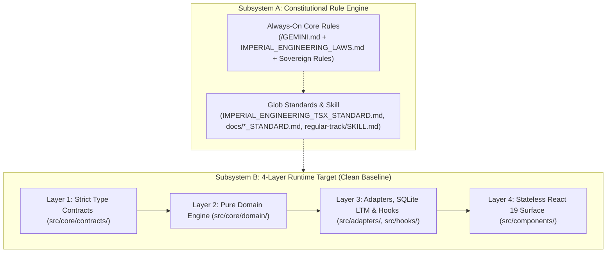
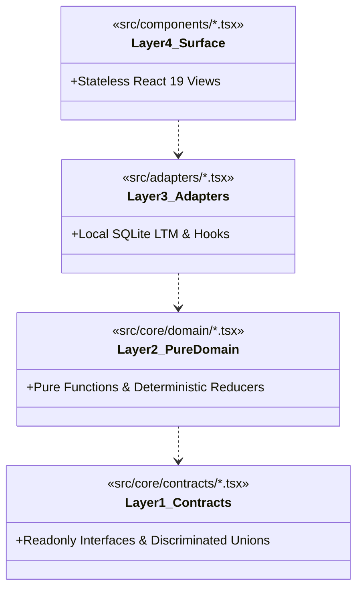
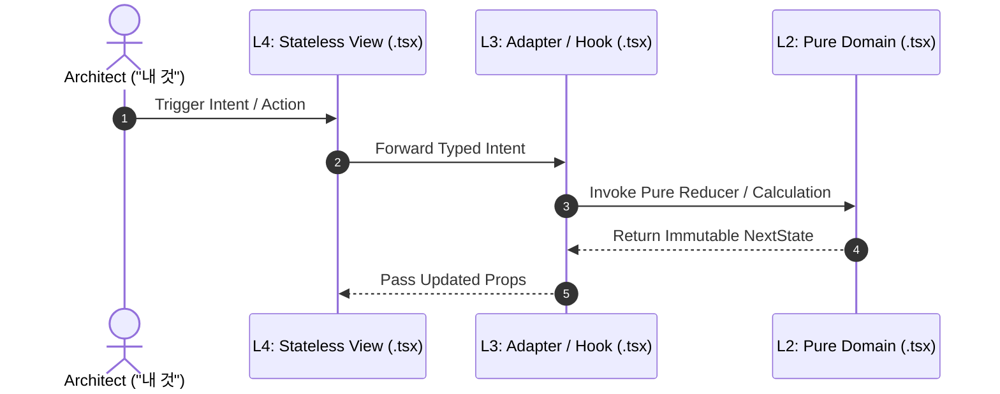

# SYSTEM ARCHITECTURE BLUEPRINT

## 1. Level 1: System Context & Subsystem Topology

The workspace is initialized at a **Clean Baseline** (`src/`, `tests/`, and `data/` cleared for step-by-step incremental construction) governed by the Constitutional Rule Engine (`/GEMINI.md`, `.agents/rules/`) and the `4`-Layer Unidirectional Architecture (`Contracts ➔ Pure Domain ➔ Adapters ➔ Surface`).

---

## 2. Level 2: Module & 1:1 Test Boundary Matrix

| Layer | Target Source Directory | `1:1` Test Directory | Allowed Imports | Forbidden Imports | Single Responsibility (`SRP`) |
| :--- | :--- | :--- | :--- | :--- | :--- |
| **Config** | `package.json`, `tsconfig.json`, `vite.config.ts` | `npm run lint` | Node / Vite config | Runtime app logic | Package manifest, TypeScript `7` strict gate, and Vite `8` bundler config. |
| **L1: Contracts** | `src/core/contracts/` (Clean Baseline) | `tests/core/contracts/` | `None` | `react`, `DOM`, `node:*`, `L2~L4` | Pure `readonly` interfaces, literal unions, and discriminated unions. |
| **L2: Pure Domain** | `src/core/domain/` (Clean Baseline) | `tests/core/domain/` | `L1 Contracts` | `react`, `DOM`, `node:*`, `L3`, `L4` | Pure deterministic functions and state reducers `(State, Action) => NextState`. |
| **L3: Adapters** | `src/adapters/`, `src/hooks/` (Clean Baseline) | `tests/adapters/`, `tests/hooks/` | `node:*`, `L1`, `L2` | `L4 Components` | Local SQLite persistence (`node:sqlite`), CLI controllers, and stateful React hooks. |
| **L4: Surface** | `src/components/` (Clean Baseline) | `tests/components/` | `react`, `L1`, `L3` | `node:sqlite`, `node:fs` | Stateless presentational React `19` `.tsx` views (`Props-In, Intent-Out`). |

---

## 3. Level 3: Contract & Persistence Topology

---

## 4. Level 4: Runtime Execution Sequence

---

## 5. Level 5: Governance Gates & Architecture Decision Records (`ADR`)

### 5.1 Governance Gates

| Gate | Target Scope | Enforced Invariant |
| :--- | :--- | :--- |
| **Gate 1: Strict TypeScript (`npm run lint`)** | `tsconfig.json`, `vite.config.ts`, `src/**/*.tsx`, `tests/**/*.tsx` | `strict: true`, `0 Errors / 0 Warnings`, and `<= 250 lines` per `src/` module. |
| **Gate 2: `1:1` Test Symmetry (`npm test`)** | `src/**/*` ⇄ `tests/**/*` | `100%` `1:1` module-to-test mirror as modules are added. |
| **Gate 3: Antigravity Rule Budget** | `/GEMINI.md`, `.agents/rules/**/*.md` | Each rule file `<= 24,000 B`; cumulative `Always-On` (`4` files) `<= 60,000 B`. |
| **Gate 4: `4`-Ledger `0-Drift` Sync** | `/README.md`, `docs/ARCHITECTURE.md`, `docs/SPECIFICATION.md`, `docs/AUDIT_GROUNDING_DUMP.md` | Same-turn synchronization of all `4` Permanent Mirror Ledgers. |

### 5.2 Core Architecture Decision Records (`ADR`)

| ADR ID | Architectural Decision | Enforcement Mechanism |
| :--- | :--- | :--- |
| **`ADR-01`** | **Backend/Domain `SSOT` & Pure Renderer Separation** | Isolate all state transitions and formulas in `Layer 2` (`src/core/domain/`) with `0` UI/SQLite imports. |
| **`ADR-02`** | **Discriminated Union State & Exhaustive Reducers** | Model mutually exclusive states with literal `kind` tags in `Layer 1` and `never` exhaustiveness checks in `Layer 2`. |
| **`ADR-03`** | **Orthogonal `2`-Cluster Local SQLite `LTM` (`C1` $\perp$ `C2`)** | Partition Interaction LTM from Engineering LTM on local `node:sqlite` as persistence modules are built. |
| **`ADR-04`** | **Clean-Slate Incremental Construction** | Reset `src/`, `tests/`, and `data/` to a blank baseline so every module is designed and verified step-by-step with the Architect. |
