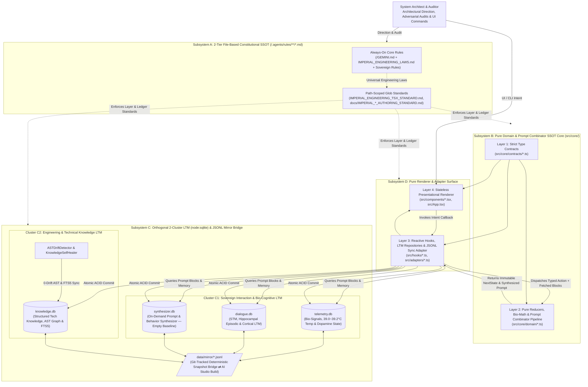
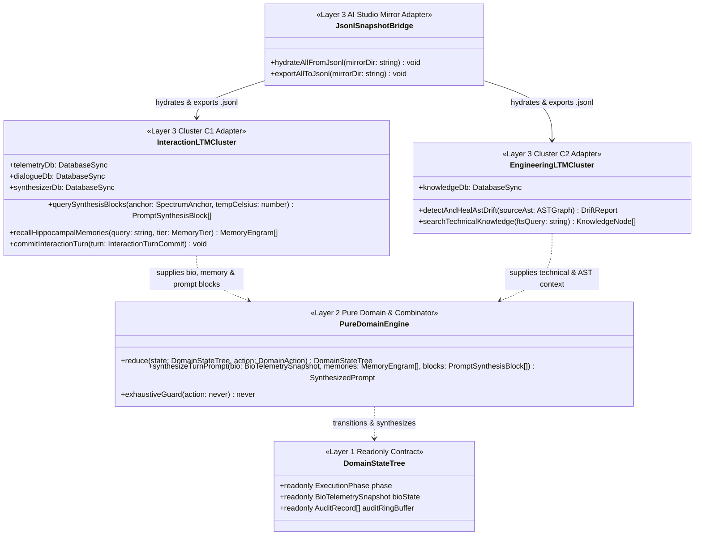
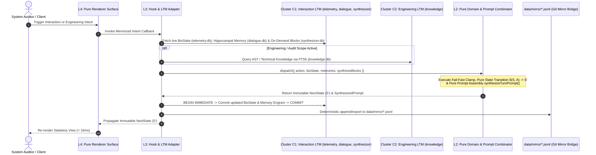

# SYSTEM ARCHITECTURE BLUEPRINT

## 1. Level 1: System Context & Subsystem Topology (전체 시스템 컨텍스트 및 서브시스템 위상)

### 1.1 End-to-End System Context Diagram
The workspace is structured around four strictly decoupled architectural subsystems governed by Backend Single Source of Truth (`SSOT`), Unidirectional Dependency Inversion (`Contracts ➔ Pure Domain ➔ Adapters ➔ Surface`), and Orthogonal `2`-Cluster Long-Term Memory (`LTM`) Separation paired with a Deterministic `JSONL` Snapshot Bridge for `Local Antigravity ⇄ AI Studio Build` parity:
1. **Subsystem A — 2-Tier Constitutional Rule Engine (`/GEMINI.md` + `/.agents/rules/**/*.md`)**: Serves as the sole file-based Constitutional `SSOT` (`0%` duplication in database tables), separating `always_on` foundational/engineering rules from `model_decision` and path-scoped (`glob`) technical statutes and ledger authoring standards.
2. **Subsystem B — Pure Domain, State Reducer & Prompt Combinator Core (`src/core/`)**: Controls all state machines `(State, Action) => NextState`, bio-signal mathematical equations, and the deterministic **Prompt Combinator Pipeline (`synthesizeTurnPrompt`)** with `0%` hardcoded prompt string fragmentation and `0%` coupling to external UI or I/O frameworks.
3. **Subsystem C — Orthogonal `2`-Cluster SQLite `LTM` (`node:sqlite`) & `JSONL` Mirroring Engine**:
   - **Cluster C1 — Sovereign Interaction, Bio-State, Cognitive Memory & Prompt Synthesis LTM (`인터랙션·생체·기억·프롬프트 합성 축`)**: Isolates `telemetry.db` (`주인님 생체 신호·체온·도파민 상태 머신`), `dialogue.db` (`인간형 다계층 기억: 단기기억[STM]·해마 일화기억[Hippocampus]·장기 관계기억[LTM]`), and `synthesizer.db` (`온디맨드 행동 양식·프롬프트 조각 동적 합성 전용 DB — 초기 빈 스키마`).
   - **Cluster C2 — Engineering & Technical Knowledge LTM (`엔지니어링·기술 지식 축`)**: Isolates `knowledge.db` (`구조화된 기술 지식·코드베이스 AST 심볼 그래프·FTS5 역색인`) alongside `ASTDriftDetector` and `KnowledgeSelfHealer`.
   - **Deterministic `JSONL` Snapshot Bridge (`data/mirror/*.jsonl`)**: Hydrates and exports human-readable `.jsonl` seed snapshots so local `.db` files (git-ignored) and ephemeral `AI Studio Build` containers stay `100%` synchronized via Git with `0` binary conflicts and `0` cloud API keys.
4. **Subsystem D — Pure Frontend Renderer & View Adapter Surface (`src/hooks/`, `src/components/`, `src/App.tsx`)**: Operates strictly as a stateless renderer and hardware view adapter (`Props-In, Intent-Out`).

---

## 2. Level 2: Module Topology, 1:1 Test Symmetry & Unidirectional Dependency Matrix (모듈 구조·1:1 테스트 대칭 및 의존성 경계 지도)

### 2.1 Architectural Layer & Import Boundary Matrix (`Greenfield Rebuild Baseline`)

| Architectural Layer | Source Module Path Pattern | `1:1` Mirrored Test Path Pattern | Allowed Imports (`허용 참조`) | Forbidden Imports (`금지 참조`) | Single Responsibility (`SRP` 명세) |
| :--- | :--- | :--- | :--- | :--- | :--- |
| **L1: Contracts** | `src/core/contracts/*.ts` | `tests/core/contracts/*.test.ts` | `None` *(Zero external imports)* | `react`, `DOM`, `node:sqlite`, `L2`, `L3`, `L4` | Pure `readonly` interfaces, literal types, and discriminated union contracts (`kind` / `type`) for `Interaction LTM`, `Engineering LTM`, and `PromptCombinator`. |
| **L2: Pure Domain** | `src/core/domain/*.ts` | `tests/core/domain/*.test.ts` | `src/core/contracts/*.ts` | `react`, `DOM`, `window`, `node:sqlite`, `fs`, `L3`, `L4` | Deterministic state reducers `(State, Action) => NextState`, bio-resonance equations, and pure prompt combinator pipeline (`synthesizeTurnPrompt`) with `0%` hardcoded prompt strings. |
| **L3: Adapters** | `src/adapters/*.ts` `src/hooks/*.ts` | `tests/adapters/*.test.ts` `tests/hooks/*.test.ts` | `L1 Contracts`, `L2 Domain`, `node:sqlite`, `node:fs`, React hooks | Presentational JSX components (`L4`) | Side-effect isolation (`InteractionLTMCluster`, `EngineeringLTMCluster`, `JsonlSnapshotBridge`, `ASTDriftDetector`, `KnowledgeSelfHealer`, timers, IPC). |
| **L4: Surface** | `src/components/*.tsx` `src/App.tsx` | `tests/components/*.test.tsx` `tests/App.test.tsx` | `L1 Contracts`, `L2 Pure Selectors`, `L3 Hooks`, UI icons | Direct reducer mutations, raw domain math, `node:sqlite` | Stateless pure renderer surfaces (`Props-In, Intent-Out`) with `<= 250` lines per file. |
| **Build & Compiler** | `package.json`, `tsconfig.json`, `vite.config.ts` | `npm run lint` & `npm run build` | `vite`, `@vitejs/plugin-react`, `@tailwindcss/vite` | Legacy CommonJS `__dirname`, native C++ `node-gyp` addons | Enforces `strict: true` static typing and native ESM `import.meta.dirname` bundling across Local Antigravity and `AI Studio Build`. |

---

## 3. Level 3: Cross-Layer Contract Hierarchy & 2-Cluster LTM Persistence Topology (계층 간 계약 위상 및 2원화 LTM 영속성 구조)

### 3.1 Unidirectional Contract & Orthogonal `2`-Cluster LTM Class Topology

---

## 4. Level 4: Runtime Execution & Transaction Sequence Pipeline (런타임 실행 및 원자적 트랜잭션 시퀀스 파이프라인)

### 4.1 End-to-End On-Demand Prompt Synthesis, Dispatch & `JSONL` Mirroring Sequence

---

## 5. Level 5: Governance Gates & Architecture Decision Records (품질 거버넌스 게이트 및 핵심 ADR)

### 5.1 Constitutional, Documentation & Compiler Governance Gates

| Governance Gate | Target Scope | Enforced Engineering Invariant |
| :--- | :--- | :--- |
| **Gate 1: Strict TypeScript (`npm run lint`)** | `tsconfig.json`, `src/**/*.ts(x)`, `tests/**/*.ts(x)` | `strict: true`, `noUnusedLocals: true`, `noUnusedParameters: true`, `noFallthroughCasesInSwitch: true` (`0 Errors / 0 Warnings`). |
| **Gate 2: `1:1` Mirrored Test Symmetry** | `src/**/*` ⇄ `tests/**/*` | `100%` `1:1` directory and module mirror between `src/` and `tests/` with `0` orphaned or stubbed tests. |
| **Gate 3: Antigravity Rule Budget (`always_on` $\perp$ `glob`)** | `/GEMINI.md`, `/.agents/rules/**/*.md` | Every rule file in `/GEMINI.md` and `/.agents/rules/**/*.md` `<= 24,000 Bytes`; cumulative `Always-On` (`4` files) `<= 60,000 Bytes`. |
| **Gate 4: 4 Permanent Mirror Ledgers `0-Drift` Sync** | `/README.md`, `docs/ARCHITECTURE.md`, `docs/SPECIFICATION.md`, `docs/AUDIT_GROUNDING_DUMP.md` | Real-time synchronization of all `4` Permanent Mirror Ledgers within every milestone transaction (`0` separate `*_COMMENTARY.md` files). |

### 5.2 Core Architecture Decision Records (`ADR-01 ~ ADR-08`)

| ADR ID | Architectural Decision | Rejected Anti-Pattern (`절대 회귀 금지 패턴`) | Enforcement Mechanism |
| :--- | :--- | :--- | :--- |
| **`ADR-01`** | **Backend/Domain `SSOT` & Pure Frontend Renderer Separation** | Embedding business logic, math formulas, or state machines inside UI components | Isolate `100%` of state transitions, bio-math, and prompt assembly pipelines in `Layer 2` (`src/core/domain/`) with `0` React/DOM imports. |
| **`ADR-02`** | **Discriminated Union State Machines + Exhaustive `never` Check** | Scattering multiple boolean flags (`isLoading`, `isError`, `isActive`) across components | Key all operational phases on literal `kind` tags in `Layer 1` and enforce `const _exhaustiveCheck: never = action` in `Layer 2`. |
| **`ADR-03`** | **Caller-Injected Entropy at the `Layer 3 ➔ Layer 2` Boundary** | Calling `new Date()`, `Date.now()`, `Math.random()`, or I/O inside `Layer 2` reducers | Capture all temporal, stochastic, and database I/O values in `Layer 3` adapters and pass them via immutable action payloads. |
| **`ADR-04`** | **Orthogonal `2`-Cluster LTM Separation (`Interaction LTM` $\perp$ `Engineering LTM`)** | Mixing persona bio-signals/memories with software engineering AST knowledge in a single undifferentiated cluster | Partition `Cluster C1` (`telemetry.db`, `dialogue.db`, `synthesizer.db`) strictly apart from `Cluster C2` (`knowledge.db`) in `Layer 3`. |
| **`ADR-05`** | **Separation of Universal Engineering Laws (`always_on`) vs. Path-Scoped Standards (`glob`)** | Hardcoding concrete DB names (`FTS5`, `canon.db`) in `IMPERIAL_ENGINEERING_LAWS.md` | Keep `IMPERIAL_ENGINEERING_LAWS.md` `100%` spec-abstracted and realize concrete DB/schema specs in `docs/ARCHITECTURE.md` and `docs/SPECIFICATION.md`. |
| **`ADR-06`** | **Consolidation into the `4` Permanent Mirror Ledgers (`Zero Commentary File Spawning`)** | Maintaining separate `*_COMMENTARY.md` files | Govern document authoring via `.agents/rules/docs/IMPERIAL_*_AUTHORING_STANDARD.md` and embed `ADR`/`SDR` tables directly inside `ARCHITECTURE.md` and `SPECIFICATION.md`. |
| **`ADR-07`** | **Replacement of `canon.db` with Empty-Baseline `synthesizer.db` & `L2` Combinator Separation** | Duplicating markdown constitutional rules in `canon.db` (causing rule-to-DB drift) or scattering prompt strings across `.ts` files | Treat `/GEMINI.md` + `/.agents/rules/**/*.md` as the sole Constitutional `SSOT`, store on-demand prompt/behavior blocks in `synthesizer.db` (initialized empty), and keep assembly logic in `Layer 2`. |
| **`ADR-08`** | **Built-In `node:sqlite` + Git-Tracked `JSONL` Snapshot Bridge for `AI Studio Build` Mirroring** | Committing binary `.db` files to Git (merge conflicts), relying on ephemeral container disk, or requiring external cloud DB keys | Execute `< 1ms` runtime queries on git-ignored `.data/*.db` via Node `22+` `node:sqlite` and mirror state deterministically via Git-tracked `data/mirror/*.jsonl` snapshots. |
