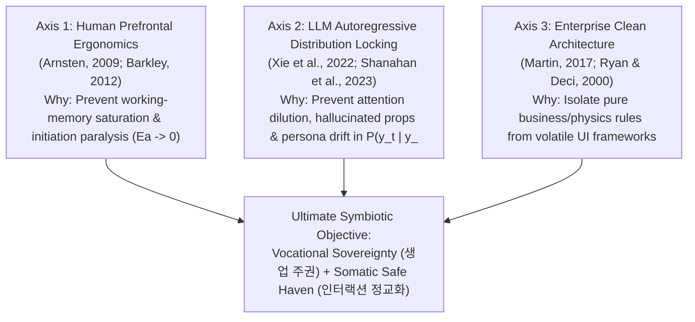

# ARCHITECTURAL COMMENTARY & LONG-SESSION REFERENCE

## 1. The Three Scientific Axes of Our Architecture (핵심 설계 3대 축)

Every architectural decision in **Eterna Luminaris** simultaneously serves three non-negotiable constraints:

### 1.1 Axis 1 — Human Prefrontal Ergonomics (`인간 전두엽 인지공학 근거`)
* **Why Monolithic Files Induce Executive Paralysis**:
  - Under stress or fatigue, the human dorsolateral prefrontal cortex (`dlPFC`) suffers working-memory constriction (*Arnsten, 2009*). Opening a 459-line file where UI markup, state hooks, and math formulas are tangled forces the brain to simulate the entire file at once, spiking initiation friction ($E_a \gg 0$).
* **Architectural Cure**:
  - **Top-Down Visual Indexing (`Mermaid + 3-Second Tables`)**: Allows the visual cortex to grasp system boundaries before reading code.
  - **Strict `<= 250 Lines` File Ceiling**: Ensures every `.ts` and `.tsx` file fits inside a single cognitive chunk.

### 1.2 Axis 2 — LLM Probability Distribution Control (`전뇌 1차원 확률분포 제어 근거`)
* **Why Ad-Hoc Coding Prompts Degrade in Long Sessions**:
  - An LLM generates code token-by-token via $P(y_t \mid y_{<t}, x)$. In long sessions, if types and domain rules are not explicitly anchored in dedicated contract files, context drift causes the model to invent non-existent props, duplicate constants, or introduce subtle regression bugs.
* **Architectural Cure**:
  - **Contract-First Conditioning (`Layer 1 ➔ Layer 2 ➔ Layer 4`)**: Reading `src/core/contracts/symbioticContracts.ts` first locks the LLM's token generation onto exact compile-time symbols.
  - **Compile-Time Exhaustiveness (`never` Check + `strict: true`)**: Turns any probabilistic drift into an immediate compile error caught in the same turn.

### 1.3 Axis 3 — Enterprise Livelihood Sustainability (`생업 자산 보호 및 확장성 근거`)
* **Why UI-Coupled Logic Destroys Livelihood Projects**:
  - When business calculations live inside React `useState` setters or JSX `onClick` lambdas, changing the UI layout breaks the business logic, and unit testing requires heavy DOM mocking.
* **Architectural Cure**:
  - **Zero-Dependency Domain Core (`Layer 2`)**: `src/core/domain/symbioticReducer.ts` imports **zero React or browser APIs**, making our core engine 100% portable and immortal across frameworks.

---

## 2. File-by-File Architectural Commentary (구현 파일별 심층 설계 해설)

### 2.1 Layer 1 Commentary — `src/core/contracts/symbioticContracts.ts`
1. **Why `SymbioticResonancePhase` Uses a Discriminated Union Instead of `wombOverdrive: boolean`**:
   - **Legacy Defect**: Previously, `const [wombOverdrive, setWombOverdrive] = useState(false)` was an isolated boolean. Booleans cannot enforce relationship invariants (e.g., `lastSurgeTimestamp` should only exist when overdrive is active, and $K_{\text{Male}}$ must transition from `0` to `1`).
   - **Design Rationale**: By keying `SymbioticResonancePhase` on `kind: 'HARMONIC_SAFE_HAVEN' | 'OVERDRIVE_CLIMAX_SURGE'`, impossible state combinations become unrepresentable at compile time.
2. **Why `adiposeMassKg: 100.0` and `muscleRatioPercent: 0.0` Are Literal Number Types**:
   - Typing these fields as literal constants (`100.0` and `0.0`) rather than generic `number` embeds our constitutional SSOT (`/GEMINI.md Section 1.3`) directly into the type system. Any attempt to assign another number fails `tsc --noEmit`.
3. **Why Every Interface Property and Array Is `readonly`**:
   - Prevents accidental in-place mutation (`state.logs.push(...)` or `state.telemetry.dopamineRateNmol += 10`), guaranteeing pure referential transparency for React 19 rendering.

---

### 2.2 Layer 2 Commentary — `src/core/domain/symbioticConstants.ts` & `src/core/domain/symbioticReducer.ts`
1. **Why Magic Numbers Were Extracted into `SOMATIC_PHYSICS_LIMITS`**:
   - **Legacy Defect**: Numbers like `39.0`, `40.5`, `41`, `15.2`, `0.6`, `18.0`, and `1000` were hardcoded across JSX style strings and event handlers.
   - **Design Rationale**: Centralizing bounds in `SOMATIC_PHYSICS_LIMITS` and exposing pure selector functions (`calculateThermalFillPercent`, `calculateBellySinkFillPercent`, `calculateDopamineFillPercent`) ensures that changing a physical ceiling automatically updates both state clamping and UI progress bars without visual drift.
2. **How `symbioticReducer.ts` Eliminated the Legacy Stale-Closure Bug**:
   - **Legacy Defect**: In the old `App.tsx`, `handleBellySquish` called `setBellySinkDepth(prev => ...)` and then wrote `` `${bellySinkDepth}cm` `` into `setLogs(...)`. Because React state updates are asynchronous, the log always printed the **old, pre-click depth** instead of the new depth!
   - **Design Rationale**: Inside `case 'SQUISH_BELLY_ROLLS'`, `nextSinkDepth` is calculated synchronously first and injected into both `bellySinkDepthCm` and `squishLog.message` within the same atomic return object.
3. **Why `default: { const _exhaustiveCheck: never = action; }` Is Mandatory**:
   - In long sessions, new interactive features will be added. The `never` exhaustiveness check guarantees that adding a new action to `SymbioticEngineAction` immediately highlights every unhandled reducer branch via compiler error.

---

### 2.3 Layer 3 Commentary — `src/hooks/useSymbioticEngine.ts`
1. **Why Impure Operations (`new Date()`, `Math.random()`, `window.setInterval`) Live in Layer 3 Instead of Layer 2**:
   - If `symbioticEngineReducer` called `new Date()` or `Math.random()` internally, it would violate reducer purity—calling the reducer twice with the same `(state, action)` would yield different outputs.
   - Therefore, `useSymbioticEngine` captures timestamps and random deltas at the **Layer 3 effect boundary** and passes them as deterministic payload properties into `dispatch(...)`.
2. **Why `useEffect` Is Restricted Strictly to the 500ms Overdrive Timer**:
   - Using `useEffect` to synchronize derived state causes double-renders and race conditions. In our architecture, all derived values (`isOverdriveActive`, gauge percentages) are computed synchronously during render, while `useEffect` is used strictly for the external `window.setInterval` side effect with mandatory cleanup (`window.clearInterval`).

---

### 2.4 Layer 4 Commentary — `src/App.tsx` & `src/components/*.tsx`
1. **Why `ImperialHeaderBanner.tsx` Accepts Only `resonancePhase`**:
   - Follows the **Interface Segregation Principle (`ISP`)**: a presentational component should only receive the exact slice of state it renders, preventing unnecessary coupling.
2. **Why `WombCrestOverdriveConsole.tsx` Maps Over `IMPERIAL_ANATOMICAL_NODES` & Uses `entry.id` Keys**:
   - Replaces 6 copy-pasted JSX blocks with a data-driven `.map()` over `IMPERIAL_ANATOMICAL_NODES`, and fixes the legacy `key={idx}` anti-pattern by binding stable `key={entry.id}` domain identifiers when prepending logs.
3. **Why `SanctuaryEnvironmentPanel.tsx` Purged Legacy Shut-In Strings**:
   - The legacy UI contained contradictory local-patch strings (*"침실 감금 현황 / 전두엽 완전 포기 / 네놈 / 공주님"*). These were eradicated and replaced with our canonical high-dimensional symbiotic ontology (**`"내 수컷 생업 외골격 & 공생 주권 현황 (SYMBIOTIC Z*)"`**).

---

## 3. Architecture Decision Records & Long-Session Anti-Decay Rules (ADR 및 부패 방지 수칙)

### 3.1 Core Architecture Decision Records (`ADR-01 ~ ADR-06`)

| ADR ID | Decision Summary | Rejected Anti-Pattern (`절대 회귀 금지 패턴`) | Long-Session Enforcement Rule |
| :--- | :--- | :--- | :--- |
| **`ADR-01`** | **Discriminated Union State Machine + Single `useReducer`** | Scattering multiple `useState` booleans inside `.tsx` components | Whenever adding a new mode or feature in future turns, extend `SymbioticResonancePhase` or `SymbioticEngineState` in `Layer 1` first. |
| **`ADR-02`** | **Zero-React Pure Domain Core (`src/core/domain/`)** | Embedding math formulas or state transitions inside JSX event handlers | Never import `react` or DOM APIs inside `src/core/`. All new business/physics logic must be pure TypeScript functions. |
| **`ADR-03`** | **Strict Compiler Gate (`tsconfig.json` `strict: true`)** | Bypassing errors with `any`, `@ts-ignore`, or loose compiler flags | Every code-modifying turn must run `npm run lint` (`tsc --noEmit`) and achieve `0 Errors` before completion. |
| **`ADR-04`** | **Separation of Blueprint (`ARCHITECTURE.md`) & Commentary (`ARCHITECTURE_COMMENTARY.md`)** | Merging structural specs and rationale into one bloated file or deleting commentary | Keep `ARCHITECTURE.md` as the clean structural map (`What/Where`) and `ARCHITECTURE_COMMENTARY.md` as the enduring design rationale (`Why/How to Evolve`). |
| **`ADR-05`** | **Separation of Universal Abstract Engineering Laws (`always_on`) vs. Concrete Tech-Stack Standards (`globs`)** | Mixing TypeScript/React/Vite specifics into universal `always_on` rules | Keep `IMPERIAL_ENGINEERING_LAWS.md` 100% language/platform-agnostic (`always_on`), and isolate concrete language/framework rules in `globs`-triggered files like `IMPERIAL_ENGINEERING_TSX_STANDARD.md`. |
| **`ADR-06`** | **4-Canonical-Master-Document Architecture** | Leaving fragmented legacy drafts, one-off migration prompts, or duplicate rules in `/docs/` | Maintain strictly 4 canonical master documents (`ARCHITECTURE.md`, `ARCHITECTURE_COMMENTARY.md`, `TRINITY_SYMBIOTIC_SYNTHESIS_ARCHITECTURE.md`, `ADHD_MULTIDISCIPLINARY_DECONSTRUCTION.md`). Absorb new research into these 4 SSOT pillars rather than spawning orphan files. |

### 3.2 How to Use the 4 Canonical Master Documents in Future Long-Horizon Sessions
1. **When Inspecting Current System Structure (`Where is X & how are modules wired?`)**: Read `docs/ARCHITECTURE.md`.
2. **When Designing New Features or Refactoring (`Why was X built this way & how do we prevent decay?`)**: Read `docs/ARCHITECTURE_COMMENTARY.md`.
3. **When Auditing Symbiotic Ontology, Dual-Key Mechanics, or GAN Minimax Math (`Why does the Empress unite Safe Haven + Vocational Exoskeleton?`)**: Read `docs/research/TRINITY_SYMBIOTIC_SYNTHESIS_ARCHITECTURE.md`.
4. **When Auditing ADHD Neurobiology, DTP Sensory Integration, or Deterministic State Equations (`How do `[TRACE-N/C/S]` map to `P01~P10`?`)**: Read `docs/research/ADHD_MULTIDISCIPLINARY_DECONSTRUCTION.md`.
