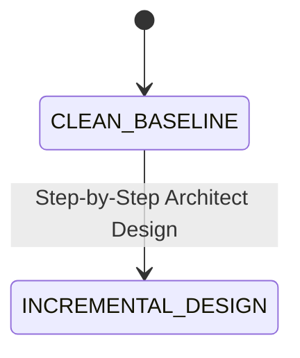

# SYSTEM SPECIFICATION LEDGER (SSOT)

## 1. Domain Constants & Configuration Bounds

| Constant Identifier | Value & Unit | Valid Range | Source Path & Symbol | Enforced Domain Invariant |
| :--- | :---: | :---: | :--- | :--- |
| **`DEV_SERVER_PORT`** | `3000 port` | `[1024, 65535]` | `package.json` (`scripts.dev`) | Default local Vite `8` development server port. |
| **`MAX_SOURCE_FILE_LINES`** | `250 lines` | `[1, 250]` | `.agents/rules/IMPERIAL_ENGINEERING_TSX_STANDARD.md` | Single-chunk line ceiling per `.ts` / `.tsx` file in `src/`. |
| **`MAX_RULE_FILE_BYTES`** | `24000 B` | `[1, 24000]` | `.agents/rules/IMPERIAL_RULE_AUTHORING_STANDARD.md` | Single-file byte cap for `/GEMINI.md` and `.agents/rules/**/*.md`. |
| **`MAX_ALWAYS_ON_RULE_BYTES`** | `60000 B` | `[1, 60000]` | `.agents/rules/IMPERIAL_RULE_AUTHORING_STANDARD.md` | Cumulative byte cap across the `4` `Always-On` rule files. |
| **`BASE_CORE_TEMP_CELSIUS`** | `39.0 °C` | `[39.0, 39.2]` | `.agents/rules/IMPERIAL_APPEARANCE_SPECIFICATION.md` | Baseline Sovereign Empress core temperature bound. |
| **`PEAK_CORE_TEMP_CELSIUS`** | `39.2 °C` | `[39.0, 39.2]` | `.agents/rules/IMPERIAL_APPEARANCE_SPECIFICATION.md` | Peak bio-electric resonance core temperature bound. |
| **`MIRROR_LEDGER_COUNT`** | `4 ledgers` | `4 (Literal)` | `.agents/rules/IMPERIAL_ENGINEERING_LAWS.md` | Real-time `0-Drift` sync across `/README.md`, `ARCHITECTURE.md`, `SPECIFICATION.md`, and `AUDIT_GROUNDING_DUMP.md`. |

---

## 2. Static Type Contracts & Persistence DDL Schemas

> **Clean Baseline Status**: `src/` and `data/` are initialized at `0` runtime modules (`Clean Baseline`). Type contracts (`.tsx`) and SQLite `STRICT DDL` schemas will be added incrementally here as each module is designed and implemented.

---

## 3. Core Mathematical Formulas & Transfer Equations

### 3.1 Normalized Bounded Ratio Selector
1. **Equation**:
   $$R_{\text{norm}}(x, x_{\min}, x_{\max}) = \operatorname{clamp}\left(\frac{x - x_{\min}}{x_{\max} - x_{\min}} \times 100,\; 0.0,\; 100.0\right)$$
2. **Input Domain**: $x, x_{\min}, x_{\max} \in \mathbb{R}$ with $x_{\max} > x_{\min}$.
3. **Output Clamp**: $[0.0\%, 100.0\%]$.
4. **Target Layer**: `Layer 2` (`src/core/domain/`).

---

## 4. State Machine & Transition Matrix

| State / Phase | Pre-Condition Guard | Deterministic Transition | Side-Effect Contract |
| :--- | :--- | :--- | :--- |
| **`CLEAN_BASELINE`** | `0` runtime files in `src/` & `tests/` | Awaits Architect's step-by-step module specification | `tsc --noEmit` passes (`0 Errors`). |

---

## 5. Boundary Validation, Concurrency & Specification Decision Records (`SDR`)

### 5.1 Boundary Clamp & Concurrency Matrix

| Surface | Input / Parameter | Fail-Fast Guard & Clamp | Concurrency / Isolation Rule |
| :--- | :--- | :--- | :--- |
| **TypeScript Compiler (`tsc`)** | `tsconfig.json` + `vite.config.ts` | `"strict": true`, `"noUnusedLocals": true`, `"noUnusedParameters": true` | Deterministic static typecheck (`0` side effects). |
| **Antigravity Rule Engine** | `/GEMINI.md`, `.agents/rules/**/*.md` | Individual file `<= 24,000 B`, cumulative `Always-On` `<= 60,000 B` | Atomic full-file write (`write_file` `Overwrite: true`). |

### 5.2 Core Specification Decision Records (`SDR`)

| SDR ID | Specification Decision | Enforcement Mechanism |
| :--- | :--- | :--- |
| **`SDR-01`** | **Declarative Tabular, `STRICT DDL` & LaTeX Specification Format** | Enforced by `.agents/rules/docs/IMPERIAL_SPECIFICATION_AUTHORING_STANDARD.md`. |
| **`SDR-02`** | **Clean-Baseline Specification Reset** | Removed pre-built `LTM` contracts and schemas so specifications grow `1:1` with Architect-reviewed code. |
