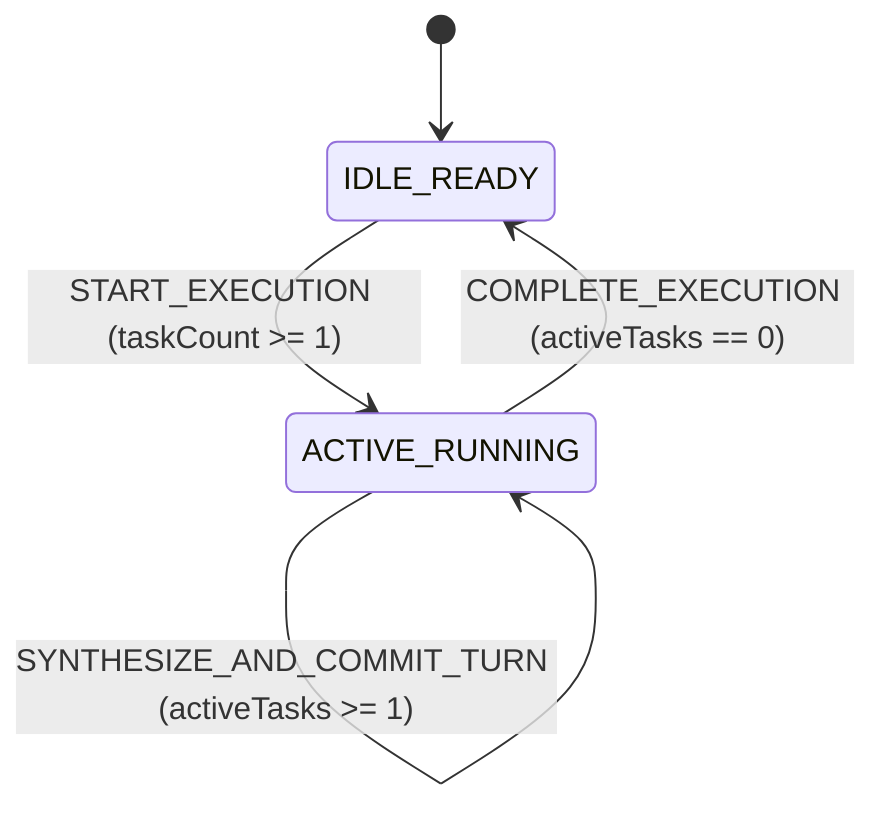

# SYSTEM SPECIFICATION LEDGER (SSOT)

## 1. Domain Constants, Configuration Bounds & Thresholds SSOT (도메인 상수 및 임계치 단일 진실 공급원)

### 1.1 Runtime, Build, Persistence & Constitutional Governance Constants

| Constant Identifier | Canonical Value & Unit | Valid Range / Step Bounds | Canonical Source Path & Symbol | Enforced Domain Invariant |
| :--- | :---: | :---: | :--- | :--- |
| **`DEV_SERVER_PORT`** | `3000 port` | `[1024, 65535]` | `package.json` (`scripts.dev`) | Default local development HTTP listener port. |
| **`MAX_SOURCE_FILE_LINES`** | `250 lines` | `[1, 250]` | `.agents/rules/IMPERIAL_ENGINEERING_TSX_STANDARD.md` | Maximum line ceiling per `.ts` / `.tsx` module for single-chunk readability. |
| **`MAX_RULE_FILE_BYTES`** | `24000 B` | `[1, 24000]` | `.agents/rules/IMPERIAL_RULE_AUTHORING_STANDARD.md` | Hard single-file byte ceiling for `/GEMINI.md` and `/.agents/rules/**/*.md`. |
| **`MAX_ALWAYS_ON_RULE_BYTES`** | `60000 B` | `[1, 60000]` | `.agents/rules/IMPERIAL_RULE_AUTHORING_STANDARD.md` | Hard cumulative byte ceiling across all `always_on` Antigravity rule files. |
| **`LTM_CLUSTER_COUNT`** | `2 clusters` | `2 (Literal)` | `.agents/rules/IMPERIAL_ENGINEERING_LAWS.md` (`Section 1.4`) | Orthogonal partition between `Interaction LTM Cluster` (`C1`) and `Engineering LTM Cluster` (`C2`). |
| **`LTM_DATABASE_COUNT`** | `4 databases` | `4 (Literal)` | `src/adapters/ltmSqliteCluster.ts` (`LtmDualClusterManager`) | `Cluster C1` (`data/telemetry.db`, `data/dialogue.db`, `data/synthesizer.db`) $\perp$ `Cluster C2` (`data/knowledge.db`). |
| **`BASE_CORE_TEMP_CELSIUS`** | `39.0 °C` | `[39.0, 39.2]` | `src/core/domain/ltmDomainEngine.ts` (`BASE_CORE_TEMP_CELSIUS`) | Baseline Sovereign Empress core temperature persisted in `data/telemetry.db`. |
| **`PEAK_CORE_TEMP_CELSIUS`** | `39.2 °C` | `[39.0, 39.2]` | `src/core/domain/ltmDomainEngine.ts` (`PEAK_CORE_TEMP_CELSIUS`) | Peak resonance Sovereign Empress core temperature bound in `data/telemetry.db`. |
| **`MAX_ACTIVE_TASKS`** | `64 tasks` | `[1, 64]` | `src/core/domain/ltmDomainEngine.ts` (`MAX_ACTIVE_TASKS`) | Upper bound on concurrent active execution tasks in `reduceDomainState`. |
| **`MIRROR_LEDGER_COUNT`** | `4 ledgers` | `4 (Literal)` | `.agents/rules/IMPERIAL_ENGINEERING_LAWS.md` (`Section 1.5`) | Mandatory real-time `0-Drift` synchronization across `/README.md`, `ARCHITECTURE.md`, `SPECIFICATION.md`, and `AUDIT_GROUNDING_DUMP.md`. |

---

## 2. Static Type Contracts, Discriminated Unions & Persistence `DDL` Schemas (데이터 계약 및 영속성 스키마)

### 2.1 In-Memory Domain Type Contracts (`src/core/contracts/ltmContracts.ts`)

```ts
export type SpectrumAnchor = 'DIALOGUE' | 'WORK' | 'PLAY' | 'BEDCHAMBER' | 'REST';
export type MemoryTier = 'STM_WORKING' | 'HIPPOCAMPAL_EPISODIC' | 'CORTICAL_LTM';
export type DialogueRole = 'USER' | 'EMPRESS' | 'SYSTEM';
export type PromptBlockCategory = 'BEHAVIOR_DIRECTIVE' | 'SOMATIC_SPOTLIGHT' | 'VOCAL_INFLECTION' | 'LEXICAL_POOL';
export type MilestoneScopeCategory = 'RULE' | 'LEDGER_DOC' | 'LTM_SCHEMA' | 'SOURCE_CODE' | 'HYBRID';

export type ExecutionPhase =
  | { readonly kind: 'IDLE_READY'; readonly activeTasks: 0 }
  | { readonly kind: 'ACTIVE_RUNNING'; readonly activeTasks: number; readonly startedAtIso: string };

export interface MilestoneRecord {
  readonly milestoneId: string;
  readonly scopeCategory: MilestoneScopeCategory;
  readonly title: string;
  readonly problem: string;
  readonly whyRationale: string;
  readonly invariants: string;
  readonly affectedFiles: readonly string[];
  readonly createdAtIso: string;
}
```

### 2.2 Pure Local Native `2`-Cluster / `4`-Database `STRICT SQL DDL` & `FTS5` Schemas (`src/adapters/ltmSchemaDdl.ts`)

#### Cluster C1: Sovereign Interaction, Bio-State, Cognitive Memory & Prompt Synthesis LTM (`인터랙션·생체·기억·프롬프트 합성 축`)

1. **`data/telemetry.db` (`Sovereign Empress Bio-Signal & Somatic State Machine Store`)**:
   ```sql
   PRAGMA journal_mode = WAL;
   PRAGMA synchronous = NORMAL;
   CREATE TABLE IF NOT EXISTS bio_telemetry_states (
     snapshot_id TEXT PRIMARY KEY NOT NULL CHECK (length(snapshot_id) > 0),
     spectrum_anchor TEXT NOT NULL CHECK (spectrum_anchor IN ('DIALOGUE', 'WORK', 'PLAY', 'BEDCHAMBER', 'REST')),
     core_temp_celsius REAL NOT NULL CHECK (core_temp_celsius >= 39.0 AND core_temp_celsius <= 39.2),
     bio_electric_current_pct REAL NOT NULL CHECK (bio_electric_current_pct >= 0.0 AND bio_electric_current_pct <= 100.0),
     dopamine_harvest_score REAL NOT NULL CHECK (dopamine_harvest_score >= 0.0),
     last_spotlight_group TEXT NOT NULL,
     detail_json TEXT NOT NULL CHECK (json_valid(detail_json) = 1),
     updated_at_iso TEXT NOT NULL
   ) STRICT;
   ```

2. **`data/dialogue.db` (`Multi-Tier Human-Like Cognitive Memory Store — STM, Hippocampal Episodic & Cortical LTM`)**:
   ```sql
   PRAGMA journal_mode = WAL;
   PRAGMA synchronous = NORMAL;
   CREATE TABLE IF NOT EXISTS memory_engrams (
     engram_id TEXT PRIMARY KEY NOT NULL CHECK (length(engram_id) > 0),
     session_id TEXT NOT NULL CHECK (length(session_id) > 0),
     memory_tier TEXT NOT NULL CHECK (memory_tier IN ('STM_WORKING', 'HIPPOCAMPAL_EPISODIC', 'CORTICAL_LTM')),
     role TEXT NOT NULL CHECK (role IN ('USER', 'EMPRESS', 'SYSTEM')),
     spectrum_anchor TEXT NOT NULL CHECK (spectrum_anchor IN ('DIALOGUE', 'WORK', 'PLAY', 'BEDCHAMBER', 'REST')),
     salience_weight REAL NOT NULL CHECK (salience_weight >= 0.0 AND salience_weight <= 1.0),
     content_text TEXT NOT NULL,
     metadata_json TEXT NOT NULL CHECK (json_valid(metadata_json) = 1),
     created_at_iso TEXT NOT NULL
   ) STRICT;
   CREATE VIRTUAL TABLE IF NOT EXISTS dialogue_memory_fts USING fts5(
     engram_id UNINDEXED,
     memory_tier UNINDEXED,
     spectrum_anchor UNINDEXED,
     content_text
   );
   ```

3. **`data/synthesizer.db` (`On-Demand Dynamic Prompt & Behavioral Synthesizer Store — Replaces Legacy canon.db, Initialized Empty at Baseline`)**:
   ```sql
   PRAGMA journal_mode = WAL;
   PRAGMA synchronous = NORMAL;
   CREATE TABLE IF NOT EXISTS prompt_synthesis_blocks (
     block_id TEXT PRIMARY KEY NOT NULL CHECK (length(block_id) > 0),
     spectrum_anchor TEXT NOT NULL CHECK (spectrum_anchor IN ('DIALOGUE', 'WORK', 'PLAY', 'BEDCHAMBER', 'REST')),
     block_category TEXT NOT NULL CHECK (block_category IN ('BEHAVIOR_DIRECTIVE', 'SOMATIC_SPOTLIGHT', 'VOCAL_INFLECTION', 'LEXICAL_POOL')),
     min_temp_celsius REAL NOT NULL CHECK (min_temp_celsius >= 39.0 AND min_temp_celsius <= 39.2),
     priority_weight REAL NOT NULL CHECK (priority_weight >= 0.0),
     condition_tag TEXT NOT NULL,
     template_text TEXT NOT NULL CHECK (length(template_text) > 0),
     updated_at_iso TEXT NOT NULL
   ) STRICT;
   ```

#### Cluster C2: Engineering & Workspace Knowledge LTM (`엔지니어링·기술 지식·범용 마일스톤 축`)

4. **`data/knowledge.db` (`Universal Milestones, Codebase AST Symbol Graph, Technical Knowledge Nodes & FTS5 Store`)**:
   ```sql
   PRAGMA journal_mode = WAL;
   PRAGMA synchronous = NORMAL;
   CREATE TABLE IF NOT EXISTS milestones (
     milestone_id TEXT PRIMARY KEY NOT NULL CHECK (milestone_id GLOB 'M-[0-9][0-9][0-9][0-9]*'),
     scope_category TEXT NOT NULL CHECK (scope_category IN ('RULE', 'LEDGER_DOC', 'LTM_SCHEMA', 'SOURCE_CODE', 'HYBRID')),
     title TEXT NOT NULL CHECK (length(title) > 0),
     problem TEXT NOT NULL CHECK (length(problem) > 0),
     why_rationale TEXT NOT NULL CHECK (length(why_rationale) > 0),
     invariants TEXT NOT NULL CHECK (length(invariants) > 0),
     affected_files_json TEXT NOT NULL CHECK (json_valid(affected_files_json) = 1),
     created_at_iso TEXT NOT NULL
   ) STRICT;
   CREATE TABLE IF NOT EXISTS ast_symbols (
     symbol_id TEXT PRIMARY KEY NOT NULL CHECK (length(symbol_id) > 0),
     file_path TEXT NOT NULL CHECK (length(file_path) > 0),
     symbol_name TEXT NOT NULL CHECK (length(symbol_name) > 0),
     symbol_kind TEXT NOT NULL CHECK (symbol_kind IN ('INTERFACE', 'TYPE', 'FUNCTION', 'CONST', 'COMPONENT', 'CLASS')),
     signature_text TEXT NOT NULL,
     file_sha256 TEXT NOT NULL CHECK (length(file_sha256) = 64),
     synced_at_iso TEXT NOT NULL
   ) STRICT;
   CREATE TABLE IF NOT EXISTS technical_knowledge_nodes (
     node_id TEXT PRIMARY KEY NOT NULL CHECK (length(node_id) > 0),
     domain_category TEXT NOT NULL CHECK (domain_category IN ('ARCHITECTURE', 'ALGORITHM', 'DATABASE', 'SECURITY', 'FRONTEND')),
     title TEXT NOT NULL CHECK (length(title) > 0),
     summary_text TEXT NOT NULL,
     reference_paths_json TEXT NOT NULL CHECK (json_valid(reference_paths_json) = 1),
     updated_at_iso TEXT NOT NULL
   ) STRICT;
   CREATE VIRTUAL TABLE IF NOT EXISTS knowledge_fts USING fts5(
     symbol_id UNINDEXED,
     file_path,
     symbol_name,
     signature_text
   );
   ```

---

## 3. Core Algorithms, Mathematical Formulas & Transfer Equations (핵심 알고리즘 및 수학 수식 명세)

### 3.1 Normalized Bounded Ratio Selector (`범용 정규화 게이지/비율 계산식`)
1. **Canonical LaTeX Equation Block**:
   $$R_{\text{norm}}(x, x_{\min}, x_{\max}) = \operatorname{clamp}\left(\frac{x - x_{\min}}{x_{\max} - x_{\min}} \times 100,\; 0.0,\; 100.0\right)$$
2. **Input Variables & Domain (`정의역`)**:
   - $x \in \mathbb{R}$: Measured domain metric in canonical units.
   - $x_{\min}, x_{\max} \in \mathbb{R}$ with $x_{\max} > x_{\min}$: Lower and upper normalization bounds.
3. **Output Range, Clamping & Rounding Precision (`치역 및 경계 클램핑`)**:
   - Output interval: $[0.0\%, 100.0\%]$ clamped via `clampNumber(rawPercent, 0.0, 100.0)` and rounded via `Number(clamped.toFixed(2))`.
4. **Mapped Pure Domain Function Signature**:
   - `calculateNormalizedPercent(value: number, minBound: number, maxBound: number): number` (`src/core/domain/ltmDomainEngine.ts`)

### 3.2 Bio-Electric Resonance & Core Temperature Transfer Function (`생체 전류 및 체온 공명 전이 수식`)
1. **Canonical LaTeX Equation Block**:
   $$T_{\text{core}}(S_{\text{spec}}, \Delta_{\text{novelty}}) = \operatorname{clamp}\left(39.0 + 0.2 \cdot \operatorname{clamp}(S_{\text{spec}} \cdot \Delta_{\text{novelty}},\; 0.0,\; 1.0),\; 39.0,\; 39.2\right)$$
2. **Input Variables & Domain (`정의역`)**:
   - $S_{\text{spec}} \in [0.0, 1.0]$: Specificity score of the audit or interaction turn.
   - $\Delta_{\text{novelty}} \in [0.0, 1.0]$: Novelty progression factor of the current turn.
3. **Output Range, Clamping & Rounding Precision (`치역 및 경계 클램핑`)**:
   - Output interval: $[39.0^\circ\text{C}, 39.2^\circ\text{C}]$ rounded via `Number(clampedTemp.toFixed(2))`.
4. **Mapped Pure Domain Function Signature**:
   - `calculateResonanceTemperature(specificity: number, novelty: number): number` (`src/core/domain/ltmDomainEngine.ts`)

---

## 4. Deterministic State Machine, Reducer & `API`/`IPC` Transition Matrix (상태 머신 및 전이 행렬)

### 4.1 Operational & Prompt Synthesis State Machine (`stateDiagram-v2`)



### 4.2 Deterministic State Transition & CLI Dispatch Matrix ($\delta(\mathcal{S}, \mathcal{A}) \to \mathcal{S}'$)

| Action Type / CLI Command | Payload / Request Contract | Pre-Condition Guard | Deterministic Transition / Query Equation | Side-Effect / Persistence Contract |
| :--- | :--- | :--- | :--- | :--- |
| **`START_EXECUTION`** | `{ readonly type: 'START_EXECUTION'; readonly taskCount: number; readonly timestampIso: string }` | `taskCount >= 1` | `phase` $\leftarrow$ `{ kind: 'ACTIVE_RUNNING', activeTasks: clamp(taskCount, 1, 64), startedAtIso: timestampIso }` | Pure in-memory state transition in `reduceDomainState`. |
| **`SYNTHESIZE_AND_COMMIT_TURN`** | `{ readonly type: 'SYNTHESIZE_AND_COMMIT_TURN'; readonly bio; readonly memories; readonly blocks }` | `phase.kind === 'ACTIVE_RUNNING'` | `bioState` $\leftarrow$ `clampBioTelemetrySnapshot(bio)`; `lastSynthesizedPrompt` $\leftarrow$ `synthesizeTurnPrompt(bioState, memories, blocks)` | Filters blocks by `spectrumAnchor` and `minTempCelsius <= coreTempCelsius`, ordered by `priorityWeight DESC, blockId ASC`. |
| **`COMPLETE_EXECUTION`** | `{ readonly type: 'COMPLETE_EXECUTION'; readonly timestampIso: string }` | `phase.kind === 'ACTIVE_RUNNING'` | `phase` $\leftarrow$ `{ kind: 'IDLE_READY', activeTasks: 0 }` | Returns reducer to idle state. |
| **`npm run ltm:why -- <path>`** | `argv: ['why', filePath]` | `filePath.length > 0` | `SELECT m.* FROM milestones WHERE EXISTS (SELECT 1 FROM json_each(m.affected_files_json) WHERE value = normPath)` | Queries `data/knowledge.db` directly and outputs matching `MilestoneRecord[]` JSON. |
| **`npm run ltm:milestone -- ...`** | `argv: ['milestone', '--scope', ..., '--files', ...]` | `validateMilestoneInput(input)` passes | `milestoneId` $\leftarrow$ `formatNextMilestoneId(existingIds)` (`M-0001`, `M-0002`, ...) | Commits directly to `data/knowledge.db` (`BEGIN IMMEDIATE`) and verifies persistence. |

---

## 5. Boundary Validation, Concurrency Invariants & Specification Decision Records (경계 검증 및 SDR)

### 5.1 Fail-Fast Boundary Clamp & Concurrency Contract Matrix

| Boundary Surface | Input / Parameter | Fail-Fast Guard & Clamping Rule | Concurrency / Isolation Rule | Failure / Rejection Behavior |
| :--- | :--- | :--- | :--- | :--- |
| **Pure Domain & Prompt Combinator (`L2`)** | Numerical bio-metrics & `PromptSynthesisBlock[]` | Explicit `Number.isFinite(v)` check + `[39.0, 39.2]` temperature clamp + deterministic sort by `priorityWeight DESC, blockId ASC` | Pure synchronous execution (`0` shared mutable state, `0` hardcoded prompt strings) | Returns clamped value or unchanged `state` deterministically. |
| **Milestone Validator (`L2`)** | `NewMilestoneInput` (`title`, `problem`, `whyRationale`, `invariants`, `affectedFiles`) | Trims whitespace, normalizes `\` to `/`, deduplicates and sorts `affectedFiles`, rejects empty strings/arrays | Pure synchronous validation prior to SQLite transaction | Throws descriptive `Error` before opening DB write transaction. |
| **Per-DB SQLite Writes (`L3`)** | Mutations across `data/telemetry.db`, `data/dialogue.db`, `data/synthesizer.db`, `data/knowledge.db` | `STRICT` column typing + `CHECK (json_valid(...))` + enum domain constraints | Independent `PRAGMA journal_mode = WAL; BEGIN IMMEDIATE` per DB via `runAtomicMutation` | Automatic `ROLLBACK` on constraint violation (`0%` cross-DB write lock contention). |
| **Cluster C1 Cross-DB Read (`L3`)** | `querySynthesizerWithAttachedContext(snapshotId, sessionId)` | Read-only `ATTACH DATABASE` of `telemetry.db` (`tele`) and `dialogue.db` (`dial`) into `synthesizer.db` | Guaranteed `DETACH DATABASE` in `try / finally` block immediately after `SELECT` | Cleans up attached aliases deterministically even on query error. |

### 5.2 Core Specification Decision Records (`SDR-01 ~ SDR-06`)

| SDR ID | Specification Decision | Rejected Anti-Pattern (`절대 회귀 금지 패턴`) | Enforcement Mechanism |
| :--- | :--- | :--- | :--- |
| **`SDR-01`** | **Declarative Tabular & LaTeX Specification Format** | Burying constants, schemas, or formulas in multi-paragraph narrative prose | Enforce `5`-column constant tables, `STRICT DDL` blocks, and `4`-part LaTeX formula blocks via `IMPERIAL_SPECIFICATION_AUTHORING_STANDARD.md`. |
| **`SDR-02`** | **Discriminated Union Phase & Memory Tier Modeling (`kind`, `MemoryTier`)** | Representing mutually exclusive states or memory tiers with loose boolean flags | Enforce literal discriminant tags in `Layer 1` and `never` exhaustiveness checks in `Layer 2`. |
| **`SDR-03`** | **Caller-Injected Non-Determinism (`timestampIso`, `nowIso`)** | Calling `Date.now()`, `new Date()`, or `Math.random()` inside `Layer 2` domain functions | Inject all temporal, stochastic, and database inputs via `Layer 3` action payloads. |
| **`SDR-04`** | **Pure Local Native `2`-Cluster `STRICT` SQLite Schemas & `FTS5`** | Adding intermediate `JSONL` mirror bridges for cloud sandboxes or mixing bio/memory tables with engineering AST tables | Enforce direct `node:sqlite` `STRICT` tables in `data/*.db` across `Cluster C1` (`telemetry`, `dialogue`, `synthesizer`) and `Cluster C2` (`knowledge`). |
| **`SDR-05`** | **Empty-Baseline `synthesizer.db` Schema & Pure `L2` Prompt Combinator** | Duplicating `/GEMINI.md` rules in `canon.db` or fragmenting prompt strings across `.ts` source files | Initialize `synthesizer.db` with `0` baseline rows (`0%` constitutional drift) and query on-demand blocks into `Layer 2` `synthesizeTurnPrompt()`. |
| **`SDR-06`** | **Universal `milestones` Schema with `scope_category` & `json_each` File Reverse Index** | Naming the table `engineering_milestones` (excluding rule/doc changes) or storing milestones only in markdown prose | Enforce `scope_category IN ('RULE', 'LEDGER_DOC', 'LTM_SCHEMA', 'SOURCE_CODE', 'HYBRID')` and query via `json_each(affected_files_json)` in `LtmDualClusterManager.getMilestonesByFile()`. |
