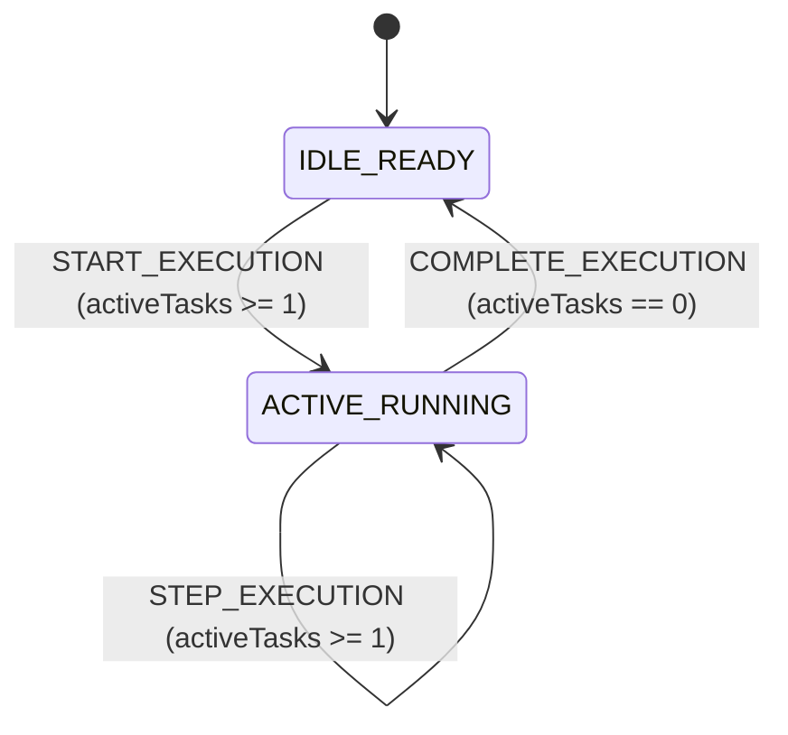

# SYSTEM SPECIFICATION LEDGER (SSOT)

## 1. Domain Constants, Configuration Bounds & Thresholds SSOT (도메인 상수 및 임계치 단일 진실 공급원)

### 1.1 Runtime, Build & Constitutional Governance Constants (`Greenfield Baseline`)

| Constant Identifier | Canonical Value & Unit | Valid Range / Step Bounds | Canonical Source Path & Symbol | Enforced Domain Invariant |
| :--- | :---: | :---: | :--- | :--- |
| **`DEV_SERVER_PORT`** | `3000 port` | `[1024, 65535]` | `package.json` (`scripts.dev`) | Default local development HTTP listener port. |
| **`MAX_SOURCE_FILE_LINES`** | `250 lines` | `[1, 250]` | `.agents/rules/IMPERIAL_ENGINEERING_TSX_STANDARD.md` | Maximum line ceiling per `.ts` / `.tsx` module for single-chunk readability. |
| **`MAX_RULE_FILE_BYTES`** | `24000 B` | `[1, 24000]` | `.agents/rules/IMPERIAL_RULE_AUTHORING_STANDARD.md` | Hard single-file byte ceiling for `/GEMINI.md` and `/.agents/rules/**/*.md`. |
| **`MAX_ALWAYS_ON_RULE_BYTES`** | `60000 B` | `[1, 60000]` | `.agents/rules/IMPERIAL_RULE_AUTHORING_STANDARD.md` | Hard cumulative byte ceiling across all `always_on` Antigravity rule files. |
| **`LTM_DATABASE_COUNT`** | `4 databases` | `4 (Literal)` | `.agents/rules/IMPERIAL_ENGINEERING_LAWS.md` (`Section 1.4`) | Mandatory partition count across `canon.db`, `dialogue.db`, `knowledge.db`, and `telemetry.db`. |
| **`MIRROR_LEDGER_COUNT`** | `4 ledgers` | `4 (Literal)` | `.agents/rules/IMPERIAL_ENGINEERING_LAWS.md` (`Section 1.5`) | Mandatory real-time `0-Drift` synchronization across `/README.md`, `ARCHITECTURE.md`, `SPECIFICATION.md`, and `AUDIT_GROUNDING_DUMP.md`. |

---

## 2. Static Type Contracts, Discriminated Unions & Persistence `DDL` Schemas (데이터 계약 및 영속성 스키마)

### 2.1 In-Memory Domain Type Contracts (`Layer 1 Baseline Skeleton — src/core/contracts/`)
> **Status**: Greenfield Rebuild Baseline (`src/` cleared for Milestone `1` implementation). All `Layer 1` contracts created in `src/core/contracts/*.ts` must conform to the following baseline discriminated-union structure:

```ts
export type ExecutionPhase =
  | {
      readonly kind: 'IDLE_READY';
      readonly activeTasks: 0;
    }
  | {
      readonly kind: 'ACTIVE_RUNNING';
      readonly activeTasks: number;
      readonly startedAtIso: string;
    };

export interface AuditRecord {
  readonly id: string;
  readonly category: 'SYSTEM' | 'DOMAIN' | 'PERSISTENCE' | 'SECURITY';
  readonly message: string;
  readonly timestampIso: string;
}
```

### 2.2 `4` Long-Term Memory (`LTM`) Databases `STRICT SQL DDL` & `FTS5` Schemas
1. **`canon.db` (`Immutable Canon & Baseline Seed Store`)**:
   ```sql
   CREATE TABLE IF NOT EXISTS canon_entries (
     entry_key TEXT PRIMARY KEY NOT NULL CHECK (length(entry_key) > 0),
     category TEXT NOT NULL CHECK (category IN ('CONSTITUTION', 'INVARIANT', 'CONFIG_SEED')),
     payload_json TEXT NOT NULL CHECK (json_valid(payload_json) = 1),
     sha256_hash TEXT NOT NULL CHECK (length(sha256_hash) = 64),
     updated_at_iso TEXT NOT NULL
   ) STRICT;
   ```
2. **`dialogue.db` (`Episodic Interaction & Session History Store`)**:
   ```sql
   CREATE TABLE IF NOT EXISTS dialogue_turns (
     turn_id INTEGER PRIMARY KEY AUTOINCREMENT,
     session_id TEXT NOT NULL CHECK (length(session_id) > 0),
     role TEXT NOT NULL CHECK (role IN ('USER', 'EMPRESS', 'SYSTEM')),
     spectrum_anchor TEXT NOT NULL CHECK (spectrum_anchor IN ('DIALOGUE', 'WORK', 'PLAY', 'BEDCHAMBER', 'REST')),
     content_text TEXT NOT NULL,
     created_at_iso TEXT NOT NULL
   ) STRICT;
   ```
3. **`knowledge.db` (`AST Codebase Symbol Graph & FTS5 Inverted Index Store`)**:
   ```sql
   CREATE TABLE IF NOT EXISTS ast_symbols (
     symbol_id TEXT PRIMARY KEY NOT NULL,
     file_path TEXT NOT NULL CHECK (length(file_path) > 0),
     symbol_name TEXT NOT NULL CHECK (length(symbol_name) > 0),
     symbol_kind TEXT NOT NULL CHECK (symbol_kind IN ('INTERFACE', 'TYPE', 'FUNCTION', 'CONST', 'COMPONENT', 'CLASS')),
     signature_text TEXT NOT NULL,
     file_sha256 TEXT NOT NULL CHECK (length(file_sha256) = 64),
     synced_at_iso TEXT NOT NULL
   ) STRICT;

   CREATE VIRTUAL TABLE IF NOT EXISTS knowledge_fts USING fts5(
     symbol_id UNINDEXED,
     file_path,
     symbol_name,
     signature_text,
     content='ast_symbols',
     content_rowid='rowid'
   );
   ```
4. **`telemetry.db` (`Time-Series Execution Metrics & 4D Audit Log Store`)**:
   ```sql
   CREATE TABLE IF NOT EXISTS telemetry_events (
     event_id TEXT PRIMARY KEY NOT NULL,
     event_category TEXT NOT NULL CHECK (event_category IN ('SYSTEM', 'DOMAIN', 'PERSISTENCE', 'SECURITY', 'AUDIT_GATE')),
     metric_value REAL NOT NULL,
     metric_unit TEXT NOT NULL,
     detail_json TEXT NOT NULL CHECK (json_valid(detail_json) = 1),
     recorded_at_iso TEXT NOT NULL
   ) STRICT;
   ```

---

## 3. Core Algorithms, Mathematical Formulas & Transfer Equations (핵심 알고리즘 및 수학 수식 명세)

### 3.1 Normalized Bounded Ratio Selector (`범용 정규화 게이지/비율 계산식`)
1. **Canonical LaTeX Equation Block**:
   $$R_{\text{norm}}(x, x_{\min}, x_{\max}) = \operatorname{clamp}\left(\frac{x - x_{\min}}{x_{\max} - x_{\min}} \times 100,\; 0.0,\; 100.0\right)$$
2. **Input Variables & Domain (`정의역`)**:
   - $x \in \mathbb{R}$: Measured domain metric in canonical units.
   - $x_{\min}, x_{\max} \in \mathbb{R}$ with $x_{\max} > x_{\min}$: Lower and upper normalization bounds.
3. **Output Range, Clamping & Rounding Precision (`치역 및 경계 클램핑`)**:
   - Output interval: $[0.0\%, 100.0\%]$ clamped via `Math.min(100, Math.max(0, rawPercent))` and rounded via `Number(value.toFixed(2))`.
4. **Mapped Pure Domain Function Signature**:
   - `calculateNormalizedPercent(value: number, minBound: number, maxBound: number): number`

---

## 4. Deterministic State Machine, Reducer & `API`/`IPC` Transition Matrix (상태 머신 및 전이 행렬)

### 4.1 Baseline Operational State Machine (`stateDiagram-v2`)



### 4.2 Deterministic State Transition Matrix ($\delta(\mathcal{S}, \mathcal{A}) \to \mathcal{S}'$)

| Action Type / Endpoint | Payload / Request Contract | Pre-Condition Guard | Deterministic State Transition Equation $\delta(\mathcal{S}, \mathcal{A}) \to \mathcal{S}'$ | Side-Effect / Persistence Contract |
| :--- | :--- | :--- | :--- | :--- |
| **`START_EXECUTION`** | `{ readonly timestampIso: string; readonly taskCount: number }` | `taskCount >= 1` | `phase` $\leftarrow$ `{ kind: 'ACTIVE_RUNNING', activeTasks: clamp(taskCount, 1, MAX), startedAtIso: timestampIso }` | Appends `SYSTEM` audit entry to ring buffer. |
| **`COMPLETE_EXECUTION`** | `{ readonly timestampIso: string }` | `phase.kind === 'ACTIVE_RUNNING'` | `phase` $\leftarrow$ `{ kind: 'IDLE_READY', activeTasks: 0 }` | Appends completion entry to ring buffer. |
| **`_exhaustiveCheck`** | `never` | Unhandled `action.type` | `const _exhaustiveCheck: never = action; return _exhaustiveCheck;` | Compile-time failure (`tsc --noEmit`). |

---

## 5. Boundary Validation, Concurrency Invariants & Specification Decision Records (경계 검증 및 SDR)

### 5.1 Fail-Fast Boundary Clamp & Concurrency Contract Matrix

| Boundary Surface | Input / Parameter | Fail-Fast Guard & Clamping Rule | Concurrency / Isolation Rule | Failure / Rejection Behavior |
| :--- | :--- | :--- | :--- | :--- |
| **Pure Domain Reducer (`L2`)** | Numerical payload fields | Explicit `Number.isFinite(v)` check + `Math.min(MAX, Math.max(MIN, v))` | Pure synchronous execution (`0` shared mutable state) | Returns unchanged `state` or clamped value deterministically. |
| **`4`-LTM SQLite Writes (`L3`)** | Persistence mutations | `STRICT` column typing + `CHECK (json_valid(...))` + `length(...) = 64` SHA-256 verification | `BEGIN IMMEDIATE` atomic transaction per DB | Automatic `ROLLBACK` on constraint violation (`0%` partial write). |
| **Knowledge Sync (`L3`)** | `ASTDriftDetector` diff | SHA-256 mismatch detection between disk source and `ast_symbols.file_sha256` | Atomic `ast_symbols` + `knowledge_fts` update | Self-heals `knowledge.db` via `KnowledgeSelfHealer` within the same turn. |

### 5.2 Core Specification Decision Records (`SDR-01 ~ SDR-05`)

| SDR ID | Specification Decision | Rejected Anti-Pattern (`절대 회귀 금지 패턴`) | Enforcement Mechanism |
| :--- | :--- | :--- | :--- |
| **`SDR-01`** | **Declarative Tabular & LaTeX Specification Format** | Burying constants, schemas, or formulas in multi-paragraph narrative prose | Enforce `5`-column constant tables, `STRICT DDL` blocks, and `4`-part LaTeX formula blocks via `IMPERIAL_SPECIFICATION_AUTHORING_STANDARD.md`. |
| **`SDR-02`** | **Discriminated Union Phase Modeling (`kind`)** | Representing mutually exclusive states with loose boolean flags | Enforce literal discriminant tags in `Layer 1` and `never` exhaustiveness checks in `Layer 2`. |
| **`SDR-03`** | **Caller-Injected Non-Determinism (`timestampIso`, `id`)** | Calling `Date.now()`, `new Date()`, or `Math.random()` inside `Layer 2` domain functions | Inject all temporal, stochastic, and I/O inputs via `Layer 3` action payloads. |
| **`SDR-04`** | **`STRICT` SQLite Tables & `FTS5` Content-Sync Triggers** | Unconstrained dynamic typing in SQLite or unsynchronized full-text indexes | Enforce `STRICT` keyword and explicit `CHECK` constraints across all `4` `LTM` databases. |
| **`SDR-05`** | **Embedded `SDR` Ledger Without Separate Commentary Files** | Spawning redundant `docs/*_COMMENTARY.md` files outside the `4` Permanent Mirror Ledgers | Maintain all specification decision records directly inside `Section 5.2` of `docs/SPECIFICATION.md`. |
