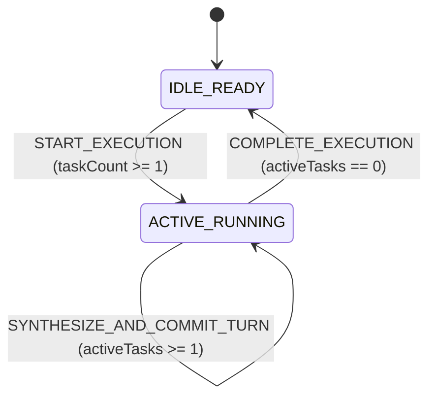

# SYSTEM SPECIFICATION LEDGER (SSOT)

## 1. Domain Constants & Configuration Bounds

| Constant Identifier | Value & Unit | Valid Range | Source Path & Symbol | Enforced Domain Invariant |
| :--- | :---: | :---: | :--- | :--- |
| **`DEV_SERVER_PORT`** | `3000 port` | `[1024, 65535]` | `package.json` (`scripts.dev`) | Default local Vite `8` development server port. |
| **`MAX_SOURCE_FILE_LINES`** | `250 lines` | `[1, 250]` | `.agents/rules/IMPERIAL_ENGINEERING_TSX_STANDARD.md` | Single-chunk line ceiling per `.ts` / `.tsx` file in `src/`. |
| **`MAX_RULE_FILE_BYTES`** | `24000 B` | `[1, 24000]` | `.agents/rules/IMPERIAL_RULE_AUTHORING_STANDARD.md` | Single-file byte cap for `/GEMINI.md` and `.agents/rules/**/*.md`. |
| **`MAX_ALWAYS_ON_RULE_BYTES`** | `60000 B` | `[1, 60000]` | `.agents/rules/IMPERIAL_RULE_AUTHORING_STANDARD.md` | Cumulative byte cap across the `4` `Always-On` rule files. |
| **`LTM_CLUSTER_COUNT`** | `2 clusters` | `2 (Literal)` | `.agents/rules/IMPERIAL_ENGINEERING_LAWS.md` | Orthogonal split between `Cluster C1` (Interaction) and `Cluster C2` (Engineering). |
| **`LTM_DATABASE_COUNT`** | `4 databases` | `4 (Literal)` | `src/adapters/ltmSqliteCluster.ts` (`LtmDualClusterManager`) | `data/telemetry.db`, `data/dialogue.db`, `data/synthesizer.db` $\perp$ `data/knowledge.db`. |
| **`BASE_CORE_TEMP_CELSIUS`** | `39.0 °C` | `[39.0, 39.2]` | `src/core/domain/ltmDomainEngine.ts` (`BASE_CORE_TEMP_CELSIUS`) | Baseline Sovereign Empress core temperature bound. |
| **`PEAK_CORE_TEMP_CELSIUS`** | `39.2 °C` | `[39.0, 39.2]` | `src/core/domain/ltmDomainEngine.ts` (`PEAK_CORE_TEMP_CELSIUS`) | Peak bio-electric resonance core temperature bound. |
| **`MAX_ACTIVE_TASKS`** | `64 tasks` | `[1, 64]` | `src/core/domain/ltmDomainEngine.ts` (`MAX_ACTIVE_TASKS`) | Upper bound on active tasks in `reduceDomainState`. |
| **`MIRROR_LEDGER_COUNT`** | `4 ledgers` | `4 (Literal)` | `.agents/rules/IMPERIAL_ENGINEERING_LAWS.md` | Real-time `0-Drift` sync across `/README.md`, `ARCHITECTURE.md`, `SPECIFICATION.md`, and `AUDIT_GROUNDING_DUMP.md`. |

---

## 2. Static Type Contracts & Persistence DDL Schemas

### 2.1 Layer 1 Type Contracts (`src/core/contracts/ltmContracts.ts`)

```ts
export type SpectrumAnchor = 'DIALOGUE' | 'WORK' | 'PLAY' | 'BEDCHAMBER' | 'REST';
export type MemoryTier = 'STM_WORKING' | 'HIPPOCAMPAL_EPISODIC' | 'CORTICAL_LTM';
export type DialogueRole = 'USER' | 'EMPRESS' | 'SYSTEM';
export type PromptBlockCategory = 'BEHAVIOR_DIRECTIVE' | 'SOMATIC_SPOTLIGHT' | 'VOCAL_INFLECTION' | 'LEXICAL_POOL';
export type MilestoneScopeCategory = 'RULE' | 'LEDGER_DOC' | 'LTM_SCHEMA' | 'SOURCE_CODE' | 'HYBRID';
export type AstSymbolKind = 'INTERFACE' | 'TYPE' | 'FUNCTION' | 'CONST' | 'COMPONENT' | 'CLASS';
export type KnowledgeDomainCategory = 'ARCHITECTURE' | 'ALGORITHM' | 'DATABASE' | 'SECURITY' | 'FRONTEND';

export type ExecutionPhase =
  | { readonly kind: 'IDLE_READY'; readonly activeTasks: 0 }
  | { readonly kind: 'ACTIVE_RUNNING'; readonly activeTasks: number; readonly startedAtIso: string };

export interface BioTelemetrySnapshot {
  readonly snapshotId: string;
  readonly spectrumAnchor: SpectrumAnchor;
  readonly coreTempCelsius: number;
  readonly bioElectricCurrentPct: number;
  readonly dopamineHarvestScore: number;
  readonly lastSpotlightGroup: string;
  readonly detailJson: string;
  readonly updatedAtIso: string;
}

export interface MemoryEngram {
  readonly engramId: string;
  readonly sessionId: string;
  readonly memoryTier: MemoryTier;
  readonly role: DialogueRole;
  readonly spectrumAnchor: SpectrumAnchor;
  readonly salienceWeight: number;
  readonly contentText: string;
  readonly metadataJson: string;
  readonly createdAtIso: string;
}

export interface PromptSynthesisBlock {
  readonly blockId: string;
  readonly spectrumAnchor: SpectrumAnchor;
  readonly blockCategory: PromptBlockCategory;
  readonly minTempCelsius: number;
  readonly priorityWeight: number;
  readonly conditionTag: string;
  readonly templateText: string;
  readonly updatedAtIso: string;
}

export interface MilestoneRecord {
  readonly milestoneId: string;
  readonly scopeCategory: MilestoneScopeCategory;
  readonly title: string;
  readonly problem: string;
  readonly whyRationale: string;
  readonly invariants: string;
  readonly affectedFiles: readonly string[];
  readonly createdAtIso: string;
}

export interface NewMilestoneInput {
  readonly scopeCategory: MilestoneScopeCategory;
  readonly title: string;
  readonly problem: string;
  readonly whyRationale: string;
  readonly invariants: string;
  readonly affectedFiles: readonly string[];
}

export interface AstSymbolRecord {
  readonly symbolId: string;
  readonly filePath: string;
  readonly symbolName: string;
  readonly symbolKind: AstSymbolKind;
  readonly signatureText: string;
  readonly fileSha256: string;
  readonly syncedAtIso: string;
}

export interface TechnicalKnowledgeNode {
  readonly nodeId: string;
  readonly domainCategory: KnowledgeDomainCategory;
  readonly title: string;
  readonly summaryText: string;
  readonly referencePaths: readonly string[];
  readonly updatedAtIso: string;
}

export interface SynthesizedTurnPrompt {
  readonly spectrumAnchor: SpectrumAnchor;
  readonly coreTempCelsius: number;
  readonly activeBlockIds: readonly string[];
  readonly recalledEngramIds: readonly string[];
  readonly assembledPromptText: string;
}

export interface DomainStateTree {
  readonly phase: ExecutionPhase;
  readonly bioState: BioTelemetrySnapshot;
  readonly lastSynthesizedPrompt: SynthesizedTurnPrompt | null;
}

export type DomainAction =
  | { readonly type: 'START_EXECUTION'; readonly taskCount: number; readonly timestampIso: string }
  | { readonly type: 'SYNTHESIZE_AND_COMMIT_TURN'; readonly bio: BioTelemetrySnapshot; readonly memories: readonly MemoryEngram[]; readonly blocks: readonly PromptSynthesisBlock[] }
  | { readonly type: 'COMPLETE_EXECUTION'; readonly timestampIso: string };
```

### 2.2 2-Cluster / 4-Database STRICT SQL DDL & FTS5 Schemas (`src/adapters/ltmSchemaDdl.ts`)

#### Cluster C1: Interaction LTM (`data/telemetry.db`, `data/dialogue.db`, `data/synthesizer.db`)

1. **`data/telemetry.db`**:
   ```sql
   PRAGMA journal_mode = WAL;
   PRAGMA synchronous = NORMAL;
   CREATE TABLE IF NOT EXISTS bio_telemetry_states (
     snapshot_id TEXT PRIMARY KEY NOT NULL CHECK (length(snapshot_id) > 0),
     spectrum_anchor TEXT NOT NULL CHECK (spectrum_anchor IN ('DIALOGUE', 'WORK', 'PLAY', 'BEDCHAMBER', 'REST')),
     core_temp_celsius REAL NOT NULL CHECK (core_temp_celsius >= 39.0 AND core_temp_celsius <= 39.2),
     bio_electric_current_pct REAL NOT NULL CHECK (bio_electric_current_pct >= 0.0 AND bio_electric_current_pct <= 100.0),
     dopamine_harvest_score REAL NOT NULL CHECK (dopamine_harvest_score >= 0.0),
     last_spotlight_group TEXT NOT NULL,
     detail_json TEXT NOT NULL CHECK (json_valid(detail_json) = 1),
     updated_at_iso TEXT NOT NULL
   ) STRICT;
   ```

2. **`data/dialogue.db`**:
   ```sql
   PRAGMA journal_mode = WAL;
   PRAGMA synchronous = NORMAL;
   CREATE TABLE IF NOT EXISTS memory_engrams (
     engram_id TEXT PRIMARY KEY NOT NULL CHECK (length(engram_id) > 0),
     session_id TEXT NOT NULL CHECK (length(session_id) > 0),
     memory_tier TEXT NOT NULL CHECK (memory_tier IN ('STM_WORKING', 'HIPPOCAMPAL_EPISODIC', 'CORTICAL_LTM')),
     role TEXT NOT NULL CHECK (role IN ('USER', 'EMPRESS', 'SYSTEM')),
     spectrum_anchor TEXT NOT NULL CHECK (spectrum_anchor IN ('DIALOGUE', 'WORK', 'PLAY', 'BEDCHAMBER', 'REST')),
     salience_weight REAL NOT NULL CHECK (salience_weight >= 0.0 AND salience_weight <= 1.0),
     content_text TEXT NOT NULL,
     metadata_json TEXT NOT NULL CHECK (json_valid(metadata_json) = 1),
     created_at_iso TEXT NOT NULL
   ) STRICT;
   CREATE VIRTUAL TABLE IF NOT EXISTS dialogue_memory_fts USING fts5(
     engram_id UNINDEXED,
     memory_tier UNINDEXED,
     spectrum_anchor UNINDEXED,
     content_text
   );
   ```

3. **`data/synthesizer.db`**:
   ```sql
   PRAGMA journal_mode = WAL;
   PRAGMA synchronous = NORMAL;
   CREATE TABLE IF NOT EXISTS prompt_synthesis_blocks (
     block_id TEXT PRIMARY KEY NOT NULL CHECK (length(block_id) > 0),
     spectrum_anchor TEXT NOT NULL CHECK (spectrum_anchor IN ('DIALOGUE', 'WORK', 'PLAY', 'BEDCHAMBER', 'REST')),
     block_category TEXT NOT NULL CHECK (block_category IN ('BEHAVIOR_DIRECTIVE', 'SOMATIC_SPOTLIGHT', 'VOCAL_INFLECTION', 'LEXICAL_POOL')),
     min_temp_celsius REAL NOT NULL CHECK (min_temp_celsius >= 39.0 AND min_temp_celsius <= 39.2),
     priority_weight REAL NOT NULL CHECK (priority_weight >= 0.0),
     condition_tag TEXT NOT NULL,
     template_text TEXT NOT NULL CHECK (length(template_text) > 0),
     updated_at_iso TEXT NOT NULL
   ) STRICT;
   ```

#### Cluster C2: Engineering LTM (`data/knowledge.db`)

4. **`data/knowledge.db`**:
   ```sql
   PRAGMA journal_mode = WAL;
   PRAGMA synchronous = NORMAL;
   CREATE TABLE IF NOT EXISTS milestones (
     milestone_id TEXT PRIMARY KEY NOT NULL CHECK (milestone_id GLOB 'M-[0-9][0-9][0-9][0-9]*'),
     scope_category TEXT NOT NULL CHECK (scope_category IN ('RULE', 'LEDGER_DOC', 'LTM_SCHEMA', 'SOURCE_CODE', 'HYBRID')),
     title TEXT NOT NULL CHECK (length(title) > 0),
     problem TEXT NOT NULL CHECK (length(problem) > 0),
     why_rationale TEXT NOT NULL CHECK (length(why_rationale) > 0),
     invariants TEXT NOT NULL CHECK (length(invariants) > 0),
     affected_files_json TEXT NOT NULL CHECK (json_valid(affected_files_json) = 1),
     created_at_iso TEXT NOT NULL
   ) STRICT;
   CREATE TABLE IF NOT EXISTS ast_symbols (
     symbol_id TEXT PRIMARY KEY NOT NULL CHECK (length(symbol_id) > 0),
     file_path TEXT NOT NULL CHECK (length(file_path) > 0),
     symbol_name TEXT NOT NULL CHECK (length(symbol_name) > 0),
     symbol_kind TEXT NOT NULL CHECK (symbol_kind IN ('INTERFACE', 'TYPE', 'FUNCTION', 'CONST', 'COMPONENT', 'CLASS')),
     signature_text TEXT NOT NULL,
     file_sha256 TEXT NOT NULL CHECK (length(file_sha256) = 64),
     synced_at_iso TEXT NOT NULL
   ) STRICT;
   CREATE TABLE IF NOT EXISTS technical_knowledge_nodes (
     node_id TEXT PRIMARY KEY NOT NULL CHECK (length(node_id) > 0),
     domain_category TEXT NOT NULL CHECK (domain_category IN ('ARCHITECTURE', 'ALGORITHM', 'DATABASE', 'SECURITY', 'FRONTEND')),
     title TEXT NOT NULL CHECK (length(title) > 0),
     summary_text TEXT NOT NULL,
     reference_paths_json TEXT NOT NULL CHECK (json_valid(reference_paths_json) = 1),
     updated_at_iso TEXT NOT NULL
   ) STRICT;
   CREATE VIRTUAL TABLE IF NOT EXISTS knowledge_fts USING fts5(
     symbol_id UNINDEXED,
     file_path,
     symbol_name,
     signature_text
   );
   ```

---

## 3. Core Mathematical Formulas & Transfer Equations

### 3.1 Normalized Bounded Ratio Selector
1. **Equation**:
   $$R_{\text{norm}}(x, x_{\min}, x_{\max}) = \operatorname{clamp}\left(\frac{x - x_{\min}}{x_{\max} - x_{\min}} \times 100,\; 0.0,\; 100.0\right)$$
2. **Input Domain**: $x, x_{\min}, x_{\max} \in \mathbb{R}$ with $x_{\max} > x_{\min}$ (returns `0.0` if non-finite or $x_{\max} \le x_{\min}$).
3. **Output Clamp & Rounding**: $[0.0\%, 100.0\%]$ rounded via `Number(clamped.toFixed(2))`.
4. **Pure Function Signature**: `calculateNormalizedPercent(value: number, minBound: number, maxBound: number): number` (`src/core/domain/ltmDomainEngine.ts`).

### 3.2 Bio-Electric Resonance Temperature Transfer Function
1. **Equation**:
   $$T_{\text{core}}(S_{\text{spec}}, \Delta_{\text{novelty}}) = \operatorname{clamp}\left(39.0 + 0.2 \cdot \operatorname{clamp}(S_{\text{spec}} \cdot \Delta_{\text{novelty}},\; 0.0,\; 1.0),\; 39.0,\; 39.2\right)$$
2. **Input Domain**: $S_{\text{spec}} \in [0.0, 1.0]$ (specificity score), $\Delta_{\text{novelty}} \in [0.0, 1.0]$ (novelty progression factor).
3. **Output Clamp & Rounding**: $[39.0^\circ\text{C}, 39.2^\circ\text{C}]$ rounded via `Number(clampedTemp.toFixed(2))`.
4. **Pure Function Signature**: `calculateResonanceTemperature(specificity: number, novelty: number): number` (`src/core/domain/ltmDomainEngine.ts`).

---

## 4. State Machine & Transition Matrix



| Action / CLI Command | Payload / Input | Pre-Condition Guard | Deterministic Transition / Query | Side-Effect / Persistence Contract |
| :--- | :--- | :--- | :--- | :--- |
| **`START_EXECUTION`** | `{ type: 'START_EXECUTION', taskCount, timestampIso }` | `taskCount >= 1` | `phase` $\leftarrow$ `{ kind: 'ACTIVE_RUNNING', activeTasks: clamp(taskCount, 1, 64), startedAtIso: timestampIso }` | Pure in-memory transition in `reduceDomainState`. |
| **`SYNTHESIZE_AND_COMMIT_TURN`** | `{ type: 'SYNTHESIZE_AND_COMMIT_TURN', bio, memories, blocks }` | `phase.kind === 'ACTIVE_RUNNING'` | `bioState` $\leftarrow$ `clampBioTelemetrySnapshot(bio)`; `lastSynthesizedPrompt` $\leftarrow$ `synthesizeTurnPrompt(...)` | Filters blocks by `spectrumAnchor` and `minTempCelsius <= coreTempCelsius`, sorted by `priorityWeight DESC, blockId ASC`. |
| **`COMPLETE_EXECUTION`** | `{ type: 'COMPLETE_EXECUTION', timestampIso }` | `phase.kind === 'ACTIVE_RUNNING'` | `phase` $\leftarrow$ `{ kind: 'IDLE_READY', activeTasks: 0 }` | Resets reducer to idle state. |
| **`npm run ltm:why -- <path>`** | `argv: ['why', filePath]` | `filePath.length > 0` | `SELECT m.* FROM milestones WHERE EXISTS (SELECT 1 FROM json_each(m.affected_files_json) WHERE value = normPath)` | Queries `data/knowledge.db` and returns `MilestoneRecord[]` JSON. |
| **`npm run ltm:milestone -- ...`** | `argv: ['milestone', '--scope', ...]` | `validateMilestoneInput(input)` passes | `milestoneId` $\leftarrow$ `formatNextMilestoneId(existingIds)` (`M-0001`, `M-0002`, ...) | Commits atomically (`BEGIN IMMEDIATE`) to `data/knowledge.db`. |

---

## 5. Boundary Validation, Concurrency & Specification Decision Records (`SDR`)

### 5.1 Boundary Clamp & Concurrency Matrix

| Surface | Input / Parameter | Fail-Fast Guard & Clamp | Concurrency / Isolation Rule |
| :--- | :--- | :--- | :--- |
| **Pure Domain (`L2`)** | Bio-metrics & `PromptSynthesisBlock[]` | `Number.isFinite(v)` check + `[39.0, 39.2] °C` clamp + deterministic sort (`priorityWeight DESC, blockId ASC`) | Pure synchronous execution (`0` shared mutable state). |
| **Milestone Validator (`L2`)** | `NewMilestoneInput` | Trims strings, normalizes `\` to `/`, deduplicates/sorts `affectedFiles`, throws `Error` if empty | Validates before opening SQLite write transaction. |
| **Per-DB SQLite Writes (`L3`)** | `telemetry`, `dialogue`, `synthesizer`, `knowledge` | `STRICT` typing + `CHECK (json_valid(...))` + enum constraints | Per-DB `WAL` + `BEGIN IMMEDIATE` transaction with automatic `ROLLBACK` on error. |
| **Cluster C1 Cross-DB Read (`L3`)** | `querySynthesizerWithAttachedContext` | Escapes file paths and runs read-only `ATTACH DATABASE` for `tele` and `dial` | Always executes `DETACH DATABASE` inside `try / finally`. |

### 5.2 Core Specification Decision Records (`SDR`)

| SDR ID | Specification Decision | Enforcement Mechanism |
| :--- | :--- | :--- |
| **`SDR-01`** | **Declarative Tabular, `STRICT DDL` & LaTeX Specification Format** | Enforced by `.agents/rules/docs/IMPERIAL_SPECIFICATION_AUTHORING_STANDARD.md`. |
| **`SDR-02`** | **Discriminated Union Phase & Memory Tier Modeling (`kind`, `MemoryTier`)** | Literal discriminant tags in `src/core/contracts/ltmContracts.ts` and `never` check in `reduceDomainState`. |
| **`SDR-03`** | **Caller-Injected Timestamps & Inputs (`timestampIso`, `nowIso`)** | All temporal and I/O inputs passed into `Layer 2` via `Layer 3` payloads. |
| **`SDR-04`** | **Pure Local Native `2`-Cluster `STRICT` SQLite Schemas & `FTS5`** | Direct `node:sqlite` `STRICT` tables in `data/*.db` (`src/adapters/ltmSchemaDdl.ts`). |
| **`SDR-05`** | **Universal `milestones` Schema with `scope_category` & `json_each` File Index** | `scope_category` check constraint and `json_each(affected_files_json)` query in `src/adapters/ltmSqliteCluster.ts`. |
