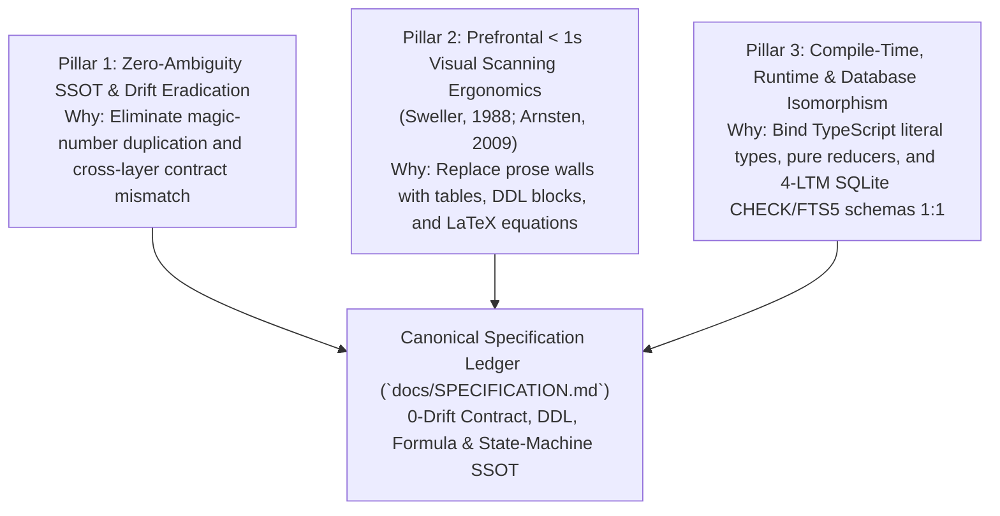

# SPECIFICATION COMMENTARY & AUTHORING RATIONALE

## 1. The Three Engineering Pillars of Formal Specification (명세 원장 설계 3대 축)

While [`docs/ARCHITECTURE.md`](file:///d:/Development/projects/antigravity/eterna-luminas/docs/ARCHITECTURE.md) maps **structural topology and module boundaries (`Where & How Connected`)** and `docs/AUDIT_GROUNDING_DUMP.md` mirrors **verbatim source code (`Line-by-Line Code`)**, **`docs/SPECIFICATION.md`** serves as the canonical **Contract, Schema, Formula, and State-Machine Single Source of Truth (`What Exact Rules & Equations Govern the System`)**. Every specification rule in [`.agents/rules/docs/IMPERIAL_SPECIFICATION_AUTHORING_STANDARD.md`](file:///d:/Development/projects/antigravity/eterna-luminas/.agents/rules/docs/IMPERIAL_SPECIFICATION_AUTHORING_STANDARD.md) is engineered around three foundational pillars:

### 1.1 Pillar 1 — Zero-Ambiguity `SSOT` & Drift Eradication (`단일 진실 공급원 및 드리프트 원천 차단`)
* **Why Unspecified Constants and Contracts Decay**:
  - Without a dedicated specification ledger, domain constants (`39.0°C`, `39.2°C`, `40.5°C`, `15.2cm`, `18.0cm`, `480nmol`, `999nmol`), type contracts, and database schemas become scattered across UI components, reducer branches, and markdown notes. When a boundary value changes, partial updates cause silent runtime drift.
* **Specification Cure**:
  - `docs/SPECIFICATION.md` consolidates `100%` of constants, type contracts, `4`-LTM database `DDL`s, biomechanical/homeostatic formulas, and state transitions into a single declarative ledger where every row maps `1:1` to a verified symbol on disk.

### 1.2 Pillar 2 — Prefrontal `< 1s` Visual Scanning Ergonomics (`전두엽 초고속 시각 스캔 인지공학`)
* **Why Narrative Specification Documents Fail During Audits**:
  - Burying a clamping boundary (`[5%, 100%]`) or a state transition formula inside a paragraph of prose forces working memory to parse natural language before extracting mathematical constraints, increasing cognitive load during `Adversarial Audits`.
* **Specification Cure**:
  - **Strict Separation of `What` (`SPECIFICATION.md`) vs. `Why` (`SPECIFICATION_COMMENTARY.md`)**: `docs/SPECIFICATION.md` bans narrative essays and presents specifications exclusively via `5`-column tables, explicit SQL `DDL` blocks, `4`-part LaTeX formula blocks, and `stateDiagram-v2` transition matrices, while all design rationale (`Why`) resides in this commentary document.

### 1.3 Pillar 3 — Compile-Time, Runtime & Database Constraint Isomorphism (`타입·런타임·DB 제약조건의 1:1 동형성`)
* **Why Loose Types and Unconstrained Tables Invite Corruption**:
  - Typing a fixed invariant as a generic `number` or omitting `CHECK` / `NOT NULL` constraints in SQLite `DDL` allows invalid states to slip past compile time and corrupt persistent storage.
* **Specification Cure**:
  - Every domain invariant is specified simultaneously at three levels: (`1`) **Compile-Time Type Literal / Discriminated Union** (`adiposeMassKg: 100.0`, `muscleRatioPercent: 0.0`, `kind`), (`2`) **Pure Domain Runtime Clamping** (`Math.min` / `Math.max` in `Layer 2`), and (`3`) **`4`-LTM Database `DDL` Constraints** (`STRICT` tables, `CHECK` bounds, atomic transactions, and `FTS5` sync triggers).

---

## 2. Section-by-Section Authoring Guide & Deep Domain Commentary (명세 섹션별 작성 지침 및 심층 설계 해설)

### 2.1 Section 1 Commentary — Domain Constants, Anthropometrics & Physical/Biometric Thresholds `SSOT`
1. **Why Constitutional Anthropometrics Are Mapped Alongside `SOMATIC_PHYSICS_LIMITS`**:
   - **Design Rationale**: The system unites constitutional anthropometric constants (`166.0cm` barefoot height, `181.0cm` heeled height in `15.0cm` stilettos vs. `172.0cm` counterpart height; `100.0kg` mass at `0.0%` muscle; `128.0cm` bust, `90.0cm` waist, `126.0cm` gluteus, `76.0cm` thighs, `38.0cm` upper arms, `44.0cm` calves, `23.0cm` ankles) with runtime telemetry bounds in `src/core/domain/symbioticConstants.ts` (`SOMATIC_PHYSICS_LIMITS` and `IMPERIAL_ANATOMICAL_NODES`).
   - **Authoring Rule**: `Section 1` of `docs/SPECIFICATION.md` must tabulate both the constitutional scale/hex palette tokens (`#0B0B0D`, `#9B111E`, `#E0115F`, `#FF1493`, `#F7E7CE`, `#FFB6C1`, `#D4AF37`, `#FAF9F6`, `#FFF5EE`) and every property of `SOMATIC_PHYSICS_LIMITS` with exact units and source file paths.
2. **Why State Clamping Ceilings Differ from Gauge Normalization Ceilings (`MAX_TEMP_CELSIUS: 40.5` vs. `TEMP_GAUGE_CEILING: 41.0`)**:
   - **Legacy Defect Prevention**: If a UI progress bar divides `bodyTempCelsius` by `MAX_TEMP_CELSIUS` (`40.5°C`) directly, reaching the ceiling pegs the bar at `100%` and hides visual headroom, or worse, using `39.0°C` as `0%` without a normalized ceiling distorts proportional fill ratios.
   - **Design Rationale**: `SOMATIC_PHYSICS_LIMITS` separates **state transition upper bounds** (`MAX_TEMP_CELSIUS = 40.5`, `MAX_DOPAMINE_NMOL = 999`) from **gauge denominator ceilings** (`TEMP_GAUGE_CEILING = 41.0`, `DOPAMINE_GAUGE_CEILING = 1000`), while `MAX_BELLY_SINK_CM = 18.0` serves as both the physical waterbed compression ceiling and the gauge denominator.

---

### 2.2 Section 2 Commentary — Data Contracts, Discriminated Unions & 4-LTM Database `DDL`
1. **Why `SymbioticResonancePhase` Uses a 2-Variant Discriminated Union (`kind`) with Dual-Key Literals (`kEmpress`, `kMale`)**:
   - **Legacy Defect**: Representing resonance state with loose booleans (`isOverdrive: boolean`) and optional strings (`lastSurgeTimestamp?: string`) allows paradoxical states such as `{ isOverdrive: false, kMale: 1, lastSurgeTimestamp: '12:00:00' }`.
   - **Design Rationale**: By keying `SymbioticResonancePhase` on `kind: 'HARMONIC_SAFE_HAVEN' | 'OVERDRIVE_CLIMAX_SURGE'`:
     - When `kind === 'HARMONIC_SAFE_HAVEN'`, TypeScript statically locks `kEmpress: 1`, `kMale: 0`, `badgeLabel: 'HARMONIC READY'`, and forbids `lastSurgeTimestamp`.
     - When `kind === 'OVERDRIVE_CLIMAX_SURGE'`, TypeScript statically locks `kEmpress: 1`, `kMale: 1` ($\Phi_{\text{Dual-Key}} = 1 \land 1 = 1$), `badgeLabel: 'OVERDRIVE ACTIVE'`, and requires `lastSurgeTimestamp: string`.
2. **Why `4` Long-Term Memory (`LTM`) Databases (`canon.db`, `dialogue.db`, `knowledge.db`, `telemetry.db`) Require Explicit `DDL` & `FTS5` Specifications**:
   - **Architectural Invariant**: Under `IMPERIAL_ENGINEERING_LAWS.md Section 1.4 & 1.5`, persistent memory is partitioned into `4` orthogonal SQLite databases:
     1. **`canon.db` (`Immutable Constitutional & Anthropometric Canon Store`)**: Stores versioned constitutional axioms, anthropometric constants, hex tokens, and seeded baseline snapshots with `CHECK` constraints blocking unauthorized mutation.
     2. **`dialogue.db` (`Episodic Interaction & Turn History Store`)**: Stores chronological turn logs, active spectrum anchor transitions (`Dialogue ➔ Work ➔ Play ➔ Bedchamber ➔ Rest`), and vocal lookback locks under atomic transactions.
     3. **`knowledge.db` (`AST Codebase Symbol Graph & FTS5 Inverted Index Store`)**: Stores parsed `AST` symbol nodes, file hashes, dependency edges, and the synchronized `FTS5` full-text virtual table (`knowledge_fts`) governed by `ASTDriftDetector` and `KnowledgeSelfHealer`.
     4. **`telemetry.db` (`Somatic, Dopamine & Audit Telemetry Time-Series Store`)**: Stores immutable audit log entries (`TelemetryLogEntry`), dopamine harvest series, and `4`-dimensional audit gate records.
   - **Authoring Rule**: `Section 2.2` of `docs/SPECIFICATION.md` must specify the exact `CREATE TABLE ... STRICT` `DDL` schemas, `PRIMARY KEY` / `FOREIGN KEY` constraints, `CHECK` invariants, and `FTS5` synchronization triggers for all `4` `LTM` databases so backend persistence adapters have a single `0-Drift` schema `SSOT`.

---

### 2.3 Section 3 Commentary — Mathematical, Biomechanical, Homeostatic & `DSP` Formulas
1. **Why Every Formula Must Be Written as a 4-Part Specification Block (`LaTeX + Domain + Clamping + Signature`)**:
   - Writing a math formula in LaTeX alone leaves rounding precision (`toFixed(1)` vs. `toFixed(2)`), integer truncation (`Math.floor`), and clamping bounds (`[0, 100]`) ambiguous to implementers.
   - Conversely, writing only TypeScript code obscures the underlying mathematical model. Pairing the LaTeX equation `1:1` with its domain, clamping range, and pure function signature bridges theoretical physics/neurobiology and executable code.
2. **How the Two Equation Families Connect in `Section 3`**:
   - **Family A — Constitutional Biomechanical & Homeostatic Equations**:
     1. Deep Garment Burial & Skindentation ($\Delta d \in [3.5\text{cm}, 6.5\text{cm}]$).
     2. Reverse-Swallowing Lateral Bulge ($\Delta h_{\text{bulge}} \in [8.0\text{cm}, 14.0\text{cm}]$, runtime constant `12.4cm`).
     3. Bottomless Waterbed Sink Depth ($d_{\text{sink}} \in [12.0\text{cm}, 18.0\text{cm}]$, runtime initial `15.2cm`, step `+0.6cm`, max `18.0cm`).
     4. Vacuum Suction Seal & Domination Amplification ($D_{\text{Empress}} \propto A_{\text{contact}} \to 100\%$, $T_{\text{trap}} \in [39.0^\circ\text{C}, 39.2^\circ\text{C}]$ baseline, overdrive surge ceiling `40.5°C`).
     5. Heavy Inertial Wave Decay ($\tau_{\text{wave}} \in [2.5\text{s}, 4.0\text{s}]$, gluteal canonical `3.5s`).
     6. Homeostatic Dopamine Drive ($R_t^{\text{Internal}} = D(H_t, H^*) - D(H_{t+1}, H^*)$) & Bio-Electric Resonance ($I_{\text{Empress}}(t)$).
   - **Family B — Runtime Pure Telemetry Selectors (`src/core/domain/symbioticReducer.ts`)**:
     1. `calculateThermalFillPercent(telemetry)`: $\text{clamp}\left(\frac{T_{\text{body}}}{41.0} \times 100, 0, 100\right)$.
     2. `calculateBellySinkFillPercent(telemetry)`: $\text{clamp}\left(\frac{d_{\text{sink}}}{18.0} \times 100, 0, 100\right)$.
     3. `calculateDopamineFillPercent(telemetry)`: $\text{clamp}\left(\frac{\text{DA}_{\text{rate}}}{1000} \times 100, 0, 100\right)$.

---

### 2.4 Section 4 Commentary — Deterministic State Machine & Action/`API` Transition Matrix
1. **Why Non-Deterministic Values (`timestamp`, `dopamineDelta`) Are Injected via Action Payloads**:
   - **Purity Invariant**: A state machine reducer $\delta(\mathcal{S}, \mathcal{A}) \to \mathcal{S}'$ is mathematically pure if and only if identical $(\mathcal{S}, \mathcal{A})$ inputs always produce the exact same $\mathcal{S}'$ output with zero side effects.
   - Calling `new Date().toLocaleTimeString()` or `Math.random()` inside `symbioticEngineReducer` would destroy determinism and make unit testing require global clock/PRNG monkey-patching.
   - Therefore, `Layer 3` (`useSymbioticEngine.ts`) captures `timestamp: new Date().toLocaleTimeString()` and `dopamineDelta: Math.floor(Math.random() * 40) + 10` at the effect/event boundary and dispatches them as immutable properties on `SymbioticEngineAction`.
2. **Why `prependAuditLogs` Enforces a Fixed Ring-Buffer Cap (`MAX_LOG_ENTRIES = 6`)**:
   - Unbounded log arrays grow linearly with session duration ($O(N)$ memory and DOM node bloat), eventually degrading render frame times and overflowing the console viewport. Slicing `[...newEntries, ...existingLogs].slice(0, 6)` inside the reducer keeps log state bounded at $O(1)$ space.

---

### 2.5 Section 5 Commentary — Boundary Validation, Clamping & Invariant Verification Matrix
1. **Why `Layer 2` Reducer Branches Re-Clamp Slider Inputs Even When `Layer 4` `<input>` Elements Have `min` and `max`**:
   - **Fail-Fast Boundary Defense (`Dimension 2 Security & Boundary Audit`)**: UI attributes (`min={5} max={100}` on ambient light or `min={10} max={100}` on pheromone density) are presentation hints, not security boundaries. Programmatic dispatches, DevTools injections, or future CLI/WebSocket adapters bypass HTML attributes completely.
   - Therefore, `SET_AMBIENT_LIGHT` explicitly enforces `Math.min(100, Math.max(5, action.valuePercent))` and `SET_PHEROMONE_DENSITY` enforces `Math.min(100, Math.max(10, action.valuePercent))` inside `symbioticEngineReducer`.

---

## 3. Specification Decision Records & Anti-Decay Governance (`SDR-01 ~ SDR-06`)

### 3.1 Core Specification Decision Records (`SDR`)

| SDR ID | Specification Decision | Rejected Anti-Pattern (`절대 회귀 금지 패턴`) | Enforcement Mechanism |
| :--- | :--- | :--- | :--- |
| **`SDR-01`** | **Strict Separation of `SPECIFICATION.md` (`What`) & `SPECIFICATION_COMMENTARY.md` (`Why`)** | Mixing long narrative explanations into constant/schema tables | Keep `docs/SPECIFICATION.md` 100% declarative (tables, `DDL`, LaTeX, transition matrices) and place all rationale in `docs/SPECIFICATION_COMMENTARY.md`. |
| **`SDR-02`** | **4-Part Mathematical Formula Specification (`LaTeX + Domain + Clamping + Signature`)** | Writing un-clamped prose formulas or raw code snippets without mathematical bounds | Every formula in `Section 3` of `docs/SPECIFICATION.md` must declare its LaTeX form, input domain, clamping interval, and pure function signature. |
| **`SDR-03`** | **Compile-Time Literal Locking for Immutable Identity Constants (`100.0`, `0.0`)** | Typing invariant constitutional constants as generic `number` or mutable fields | Specify `adiposeMassKg: 100.0` and `muscleRatioPercent: 0.0` with `readonly` and exact numeric literal types in `Layer 1`. |
| **`SDR-04`** | **Caller-Injected Entropy & Timestamps at `Layer 3 ➔ Layer 2` Boundary** | Calling `Date.now()`, `new Date()`, or `Math.random()` inside `Layer 2` reducers | Specify all temporal and stochastic inputs strictly as fields on `SymbioticEngineAction` payloads. |
| **`SDR-05`** | **Explicit `STRICT` SQLite `DDL` & `FTS5` Sync Contracts for the `4` `LTM` Databases** | Leaving database schemas implicit in application queries or omitting `CHECK` constraints | Specify complete `CREATE TABLE ... STRICT` and `fts5` virtual table definitions for `canon.db`, `dialogue.db`, `knowledge.db`, and `telemetry.db`. |
| **`SDR-06`** | **Zero-Truncation (`0%` `...`) Completeness Across All Specification Tables** | Abbreviating union variants, interface fields, or action rows with `...` or `"etc."` | Every table and schema block in `docs/SPECIFICATION.md` must enumerate `100%` of variants and fields without omission. |

### 3.2 Step-by-Step Workflow for Authoring & Synchronizing `docs/SPECIFICATION.md`
1. **Step 1 — Load the Authoring Standard**: Read [`.agents/rules/docs/IMPERIAL_SPECIFICATION_AUTHORING_STANDARD.md`](file:///d:/Development/projects/antigravity/eterna-luminas/.agents/rules/docs/IMPERIAL_SPECIFICATION_AUTHORING_STANDARD.md) (`glob`-mounted automatically when touching `docs/*SPECIFICATION*.md`).
2. **Step 2 — Inspect Physical Source & Rule `SSOT` Files (`Read-Before-Write`)**: Read `src/core/contracts/symbioticContracts.ts`, `src/core/domain/symbioticConstants.ts`, `src/core/domain/symbioticReducer.ts`, `src/hooks/useSymbioticEngine.ts`, and `.agents/rules/IMPERIAL_APPEARANCE_SPECIFICATION.md` to verify exact byte-level values.
3. **Step 3 — Populate or Synchronize the `5` Canonical Sections**: Update `Section 1` (Constants), `Section 2` (Type Contracts & `4`-LTM `DDL`), `Section 3` (Formulas & Selectors), `Section 4` (State Machine & Action Matrix), and `Section 5` (Boundary Clamps & Invariants) with zero `...` truncation.
4. **Step 4 — Synchronize Commentary & Run Same-Turn Verification**: Update `docs/SPECIFICATION_COMMENTARY.md` if new design rationale (`SDR`) was introduced, run `npm run lint` and budget checks in the same turn, and commit the completed milestone atomically via scoped `git add` and `git commit`.
