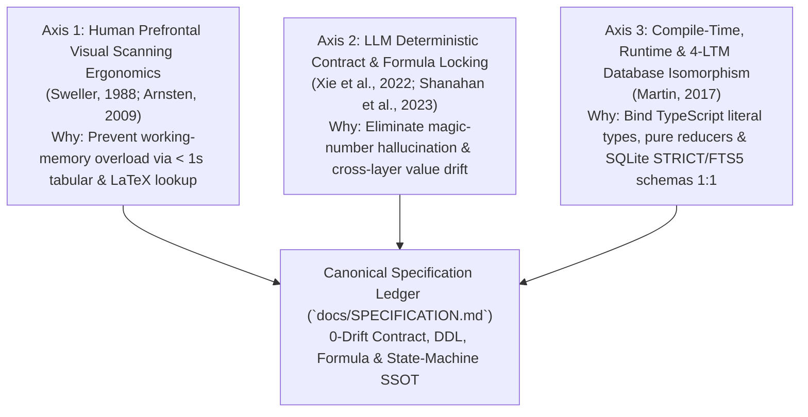

# SPECIFICATION COMMENTARY & LONG-SESSION REFERENCE

## 1. The Three Scientific Axes of Our Specification (핵심 설계 3대 축)

Every specification contract, database schema, mathematical formula, and state-transition invariant in **`docs/SPECIFICATION.md`** simultaneously serves three non-negotiable engineering constraints:

### 1.1 Axis 1 — Human Prefrontal Visual Scanning Ergonomics (`인간 전두엽 초고속 시각 스캔 인지공학 근거`)
* **Why Narrative Specification Documents Fail During Audits**:
  - Under intensive architectural review or `Adversarial Audits`, burying a clamping boundary (`[5%, 100%]`), a physical limit (`18.0cm`), or a state transition equation inside multi-paragraph prose forces the dorsolateral prefrontal cortex (`dlPFC`) to parse natural language before extracting formal constraints (*Sweller, 1988; Arnsten, 2009*).
* **Specification Cure**:
  - **Declarative Tabular & Mathematical Indexing**: `docs/SPECIFICATION.md` presents all specifications via structured `5`-column tables, explicit SQL `DDL` blocks, display LaTeX equations (`$$...$$`), and `stateDiagram-v2` transition matrices while isolating all design rationale (`Why`) inside `docs/SPECIFICATION_COMMENTARY.md`.

### 1.2 Axis 2 — LLM Deterministic Contract & Formula Locking (`전뇌 상수·계약·수식 확률분포 고정 근거`)
* **Why Unanchored Constants and Implicit Schemas Decay in Long Sessions**:
  - Without a single canonical specification ledger, domain constants (`39.0°C`, `39.2°C`, `40.5°C`, `15.2cm`, `18.0cm`, `480nmol`, `999nmol`), action payloads, and database schemas become scattered across UI components, reducer branches, and rules. When a threshold changes, partial updates cause silent cross-layer drift.
* **Specification Cure**:
  - **`1:1` Symbol-Anchored `SSOT` Tables**: Every constant, union variant, and equation in `docs/SPECIFICATION.md` is bound to its exact file path and exported symbol (`SOMATIC_PHYSICS_LIMITS`, `IMPERIAL_ANATOMICAL_NODES`, `SymbioticEngineAction`), locking token generation onto verified identifiers.

### 1.3 Axis 3 — Compile-Time, Runtime & `4`-LTM Database Constraint Isomorphism (`타입·런타임·DB 제약조건 1:1 동형성 근거`)
* **Why Loose Types and Unconstrained Tables Invite State Corruption**:
  - Typing an immutable constitutional constant as a generic `number` or omitting `STRICT` / `CHECK` constraints in SQLite `DDL` allows invalid values to bypass compile-time checks and corrupt persistent memory.
* **Specification Cure**:
  - **Three-Tier Constraint Mirroring**: Every domain invariant is enforced simultaneously as (`1`) a **Compile-Time Literal / Discriminated Union Type** (`adiposeMassKg: 100.0`, `muscleRatioPercent: 0.0`, `kind`), (`2`) a **Pure Domain Runtime Clamp** (`Math.min` / `Math.max` in `Layer 2`), and (`3`) a **`4`-LTM Database `DDL` Constraint** (`STRICT` tables, `CHECK` bounds, atomic transactions, and `FTS5` sync triggers).

---

## 2. Domain-by-Domain Specification Commentary (구현 명세 영역별 심층 설계 해설)

### 2.1 Section 1 Commentary — Domain Constants, Anthropometrics & `SOMATIC_PHYSICS_LIMITS` (`src/core/domain/symbioticConstants.ts`)
1. **Why Constitutional Anthropometrics and Hex Palette Tokens Are Unified with `SOMATIC_PHYSICS_LIMITS`**:
   - **Legacy Defect**: Previously, anthropometric metrics (`166.0cm` barefoot, `181.0cm` heeled in `15.0cm` stilettos vs. `172.0cm` counterpart; `100.0kg` at `0.0%` muscle; `128.0cm` bust, `90.0cm` waist, `126.0cm` gluteus, `76.0cm` thighs, `38.0cm` upper arms, `44.0cm` calves, `23.0cm` ankles) lived only in prose rules while UI cards hardcoded numeric strings.
   - **Design Rationale**: Unifying constitutional anthropometrics, the `9` canonical hex palette tokens (`#0B0B0D`, `#9B111E`, `#E0115F`, `#FF1493`, `#F7E7CE`, `#FFB6C1`, `#D4AF37`, `#FAF9F6`, `#FFF5EE`), `IMPERIAL_ANATOMICAL_NODES` (`6` nodes), and `SOMATIC_PHYSICS_LIMITS` (`12` numeric limits) in `Section 1` of `docs/SPECIFICATION.md` guarantees zero discrepancy between constitutional rules and runtime telemetry.
2. **Why State Clamping Ceilings Differ from Gauge Normalization Ceilings (`MAX_TEMP_CELSIUS: 40.5` vs. `TEMP_GAUGE_CEILING: 41.0`)**:
   - **Legacy Defect**: Dividing `bodyTempCelsius` directly by `MAX_TEMP_CELSIUS` (`40.5°C`) or dividing `dopamineRateNmol` by `MAX_DOPAMINE_NMOL` (`999nmol`) caused progress bars to peg at `100%` prematurely and distorted fractional percentage steps.
   - **Design Rationale**: `SOMATIC_PHYSICS_LIMITS` separates **state transition upper bounds** (`MAX_TEMP_CELSIUS = 40.5`, `MAX_DOPAMINE_NMOL = 999`) from **visual gauge denominator ceilings** (`TEMP_GAUGE_CEILING = 41.0`, `DOPAMINE_GAUGE_CEILING = 1000`), while `MAX_BELLY_SINK_CM = 18.0` serves as both the physical waterbed compression ceiling and the gauge denominator.

---

### 2.2 Section 2 Commentary — Discriminated Union Contracts (`src/core/contracts/symbioticContracts.ts`) & `4`-LTM Database `DDL` Schemas
1. **Why `SymbioticResonancePhase` Uses a 2-Variant Discriminated Union (`kind`) with Dual-Key Literals (`kEmpress`, `kMale`)**:
   - **Legacy Defect**: Representing resonance state with loose booleans (`wombOverdrive: boolean`) and optional strings (`lastSurgeTimestamp?: string`) allowed paradoxical runtime states such as `{ wombOverdrive: false, kMale: 1, lastSurgeTimestamp: '12:00:00' }`.
   - **Design Rationale**: By keying `SymbioticResonancePhase` on `kind: 'HARMONIC_SAFE_HAVEN' | 'OVERDRIVE_CLIMAX_SURGE'`:
     - When `kind === 'HARMONIC_SAFE_HAVEN'`, TypeScript statically locks `kEmpress: 1`, `kMale: 0`, `badgeLabel: 'HARMONIC READY'`, and forbids `lastSurgeTimestamp`.
     - When `kind === 'OVERDRIVE_CLIMAX_SURGE'`, TypeScript statically locks `kEmpress: 1`, `kMale: 1` ($\Phi_{\text{Dual-Key}} = 1 \land 1 = 1$), `badgeLabel: 'OVERDRIVE ACTIVE'`, and requires `lastSurgeTimestamp: string`.
2. **Why Persistent Memory Is Partitioned Across `4` Orthogonal `STRICT` SQLite Databases (`canon.db`, `dialogue.db`, `knowledge.db`, `telemetry.db`)**:
   - **Legacy Defect**: Storing immutable constitutional parameters, high-frequency `500ms` telemetry ticks, episodic dialogue history, and `AST` codebase graphs inside a single unpartitioned database creates write-lock contention (`SQLITE_BUSY`) and risks accidental schema/data corruption across orthogonal domains.
   - **Design Rationale**: Partitioning persistence into `4` isolated `LTM` databases eliminates cross-domain lock contention and enforces domain-specific `CHECK` and `FTS5` invariants:
     1. **`canon.db` (`Immutable Constitutional & Anthropometric Canon Store`)**: Locks constitutional axioms, anthropometric constants, and hex tokens under `STRICT` tables and `CHECK` constraints.
     2. **`dialogue.db` (`Episodic Interaction & Turn History Store`)**: Records chronological turn logs, active `5`-anchor spectrum states (`Dialogue ➔ Work ➔ Play ➔ Bedchamber ➔ Rest`), and vocal lookback locks.
     3. **`knowledge.db` (`AST Codebase Symbol Graph & FTS5 Inverted Index Store`)**: Maintains `AST` symbol nodes, file SHA-256 hashes, dependency edges, and the `knowledge_fts` `FTS5` virtual table synchronized atomically by `ASTDriftDetector` and `KnowledgeSelfHealer`.
     4. **`telemetry.db` (`Somatic, Dopamine & Audit Telemetry Time-Series Store`)**: Appends immutable `TelemetryLogEntry` records, dopamine harvest series, and `4`-dimensional audit verification logs.

---

### 2.3 Section 3 Commentary — Biomechanical, Homeostatic & Pure Gauge Selector Equations (`src/core/domain/symbioticReducer.ts`)
1. **Why Constitutional Biomechanical Differential Equations Map to Discrete Runtime Constants and Selectors**:
   - **Legacy Defect**: Continuous differential/integral formulations in research specifications (such as waterbed sink depth $d_{\text{sink}} = \int (1 / E_{\text{marshmallow}}(z))\,dP \in [12.0\text{cm}, 18.0\text{cm}]$ or lateral surge $\Delta h_{\text{bulge}} \in [8.0\text{cm}, 14.0\text{cm}]$) were disconnected from deterministic UI state updates.
   - **Design Rationale**: `Section 3` bridges continuous biomechanical/homeostatic equations (`5` adipose biomechanics equations + `2` homeostatic bio-electric resonance equations) with discrete deterministic state steps (`INITIAL_BELLY_SINK_CM = 15.2`, `BELLY_SINK_STEP_CM = 0.6`, `MAX_BELLY_SINK_CM = 18.0`, `REVERSE_SWALLOW_SURGE_CM = 12.4`) and the `3` pure gauge percentage selectors (`calculateThermalFillPercent`, `calculateBellySinkFillPercent`, `calculateDopamineFillPercent`).

---

### 2.4 Section 4 Commentary — Deterministic State Machine & Caller-Injected Action Payloads (`src/core/domain/symbioticReducer.ts`)
1. **Why Non-Deterministic Values (`timestamp`, `dopamineDelta`) Are Injected via `SymbioticEngineAction` Payloads**:
   - **Legacy Defect**: Calling `new Date().toLocaleTimeString()` or `Math.random()` inside a state reducer destroys mathematical purity—invoking $\delta(\mathcal{S}, \mathcal{A})$ twice with identical arguments produces different states and makes unit tests dependent on global clock/PRNG mocks.
   - **Design Rationale**: `Layer 3` (`useSymbioticEngine.ts`) captures `timestamp: new Date().toLocaleTimeString()` and `dopamineDelta: Math.floor(Math.random() * 40) + 10` at the impure effect/event boundary and dispatches them as immutable fields on `SymbioticEngineAction`, keeping `symbioticEngineReducer` `100%` deterministic.
2. **Why `prependAuditLogs` Enforces a Fixed Ring-Buffer Cap (`MAX_LOG_ENTRIES = 6`)**:
   - **Legacy Defect**: Appending audit logs without an upper bound causes $O(N)$ memory growth and DOM node accumulation during long `500ms` overdrive sessions.
   - **Design Rationale**: Slicing `[...newEntries, ...existingLogs].slice(0, SOMATIC_PHYSICS_LIMITS.MAX_LOG_ENTRIES)` inside the reducer bounds log memory and render cost to $O(1)$.

---

### 2.5 Section 5 Commentary — Fail-Fast Boundary Clamping & Cross-Layer Invariants
1. **Why `Layer 2` Reducer Branches Re-Clamp Slider Inputs Even When `Layer 4` `<input>` Elements Specify `min` and `max`**:
   - **Legacy Defect**: Relying solely on HTML `<input type="range" min={5} max={100} />` attributes leaves the domain state vulnerable to out-of-range programmatic dispatches, DevTools state injection, or non-browser adapters (`CLI/TUI`, `WebSocket`).
   - **Design Rationale**: `SET_AMBIENT_LIGHT` explicitly enforces `Math.min(100, Math.max(5, action.valuePercent))` and `SET_PHEROMONE_DENSITY` enforces `Math.min(100, Math.max(10, action.valuePercent))` inside `symbioticEngineReducer`, guaranteeing fail-fast boundary integrity at the domain core.

---

## 3. Specification Decision Records & Long-Session Anti-Decay Rules (SDR 및 부패 방지 수칙)

### 3.1 Core Specification Decision Records (`SDR-01 ~ SDR-06`)

| SDR ID | Decision Summary | Rejected Anti-Pattern (`절대 회귀 금지 패턴`) | Long-Session Enforcement Rule |
| :--- | :--- | :--- | :--- |
| **`SDR-01`** | **Triadic Separation of Ledger (`SPECIFICATION.md`), Commentary (`SPECIFICATION_COMMENTARY.md`), and Authoring Law (`IMPERIAL_SPECIFICATION_AUTHORING_STANDARD.md`)** | Mixing narrative design rationale into `SPECIFICATION.md` or mixing authoring rules (`작성법`) into `SPECIFICATION_COMMENTARY.md` | Keep `docs/SPECIFICATION.md` `100%` declarative (`What`), `docs/SPECIFICATION_COMMENTARY.md` `100%` design rationale (`Why/SDR`), and `.agents/rules/docs/IMPERIAL_SPECIFICATION_AUTHORING_STANDARD.md` `100%` authoring standard (`How to Write`). |
| **`SDR-02`** | **4-Part Mathematical Formula Specification (`LaTeX + Domain + Clamping + Signature`)** | Writing un-clamped prose formulas or raw code snippets without mathematical bounds | Every formula in `docs/SPECIFICATION.md` must declare its LaTeX form, input domain, clamping interval, and pure function signature. |
| **`SDR-03`** | **Compile-Time Literal Locking for Immutable Identity Constants (`100.0`, `0.0`)** | Typing invariant constitutional constants as generic `number` or mutable fields | Specify `adiposeMassKg: 100.0` and `muscleRatioPercent: 0.0` with `readonly` and exact numeric literal types in `Layer 1`. |
| **`SDR-04`** | **Caller-Injected Entropy & Timestamps at `Layer 3 ➔ Layer 2` Boundary** | Calling `Date.now()`, `new Date()`, or `Math.random()` inside `Layer 2` reducers | Specify all temporal and stochastic inputs strictly as fields on `SymbioticEngineAction` payloads. |
| **`SDR-05`** | **Explicit `STRICT` SQLite `DDL` & `FTS5` Sync Contracts for the `4` `LTM` Databases** | Leaving database schemas implicit in application queries or omitting `CHECK` constraints | Maintain complete `CREATE TABLE ... STRICT` and `fts5` virtual table definitions for `canon.db`, `dialogue.db`, `knowledge.db`, and `telemetry.db` in `docs/SPECIFICATION.md`. |
| **`SDR-06`** | **Zero-Truncation (`0%` `...`) Completeness Across All Specification Tables** | Abbreviating union variants, interface fields, or action rows with `...` or `"etc."` | Enumerate `100%` of union variants, columns, and fields in `docs/SPECIFICATION.md` without ellipsis truncation. |

### 3.2 How to Use the Canonical Ledgers & Commentary Pairs in Future Long-Horizon Sessions
1. **When Inspecting System Overview & Entrypoints (`What is this project & how do I run it?`)**: Read `/README.md`.
2. **When Inspecting Module Topology & Data Flow (`Where is X & how are layers wired?`)**: Read [`docs/ARCHITECTURE.md`](file:///d:/Development/projects/antigravity/eterna-luminas/docs/ARCHITECTURE.md) (governed by [`.agents/rules/docs/IMPERIAL_ARCHITECTURE_AUTHORING_STANDARD.md`](file:///d:/Development/projects/antigravity/eterna-luminas/.agents/rules/docs/IMPERIAL_ARCHITECTURE_AUTHORING_STANDARD.md)).
3. **When Auditing Architectural Rationale & `ADR`s (`Why were layers and components split this way?`)**: Read [`docs/ARCHITECTURE_COMMENTARY.md`](file:///d:/Development/projects/antigravity/eterna-luminas/docs/ARCHITECTURE_COMMENTARY.md).
4. **When Inspecting Exact Constants, Type Contracts, `4`-LTM `DDL`s & Formulas (`What are the exact numbers, schemas, and state transitions?`)**: Read `docs/SPECIFICATION.md` (governed by [`.agents/rules/docs/IMPERIAL_SPECIFICATION_AUTHORING_STANDARD.md`](file:///d:/Development/projects/antigravity/eterna-luminas/.agents/rules/docs/IMPERIAL_SPECIFICATION_AUTHORING_STANDARD.md)).
5. **When Auditing Specification Rationale & `SDR`s (`Why were these thresholds, unions, and DDL constraints chosen?`)**: Read [`docs/SPECIFICATION_COMMENTARY.md`](file:///d:/Development/projects/antigravity/eterna-luminas/docs/SPECIFICATION_COMMENTARY.md).
6. **When Auditing Verbatim Source Code & Test Assertions (`How is every line implemented with 0% truncation?`)**: Read `docs/AUDIT_GROUNDING_DUMP.md`.
